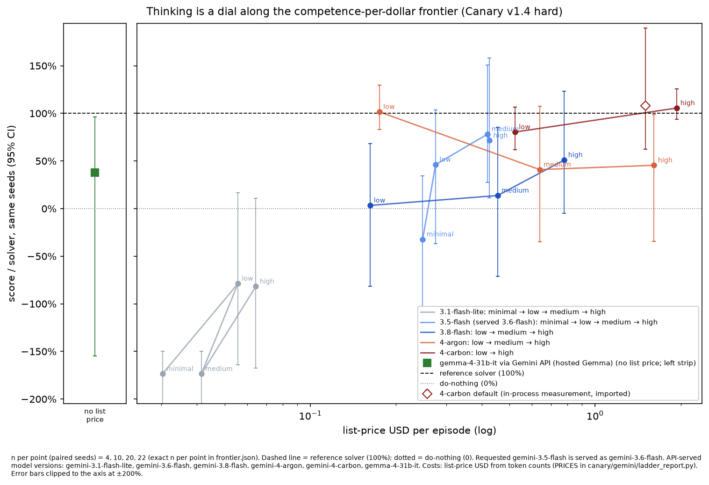

<!-- Full-length write-up, moved verbatim from SUBMISSION.md on Sun 15 Nov; the one-page version is SUBMISSION.md. -->
# Canary Lab: thinking as a controlled variable, and a Gemini red team you can trust

*Google DeepMind "Best Use of Gemini API", Junction 2026. Code: github.com/s1laswang/agent-arena (`canary/gemini/`). Every number below links to a committed file. Model ids are as listed by the Gemini API (`models.list`) on our key on 14 Nov 2026. When we request `gemini-3.5-flash`, the API serves **`gemini-3.6-flash`** (recorded per call in the ladder provenance), so this text says "3.6-flash".*

## Short version (≤ 600 chars)
Before shipping an agent that makes irreversible calls on a budget, a team must pick a model and a thinking level. Canary Lab measures that choice on an insider-threat RL environment scored against a Bayesian reference solver. On hard, gemini-4-carbon at high thinking reaches 106% [94, 126] of the solver (n=10); 3.6-flash is 4.5× cheaper but far less certain (71% [11, 158], n=20). 100 Gemini red-team attacks found 0 verified exploits, with the detector validated 4/4 on a reopened one. Blind, Gemini recovers 3 of 5 failure modes. 24,855 calls, all logged.


*Competence per dollar (USD list price) on hard (`results/gemini/frontier.png`, data in `frontier.json`, generated with `results/gemini/ladder.md`).*

## 1. The problem
**Who it is for:** the team about to ship an agent that makes irreversible decisions under uncertainty with a budget (security triage, insider risk, procurement). Before launch they must pick a model and a `thinking_level`, and trust that the benchmark they tuned on can't be gamed.

**What is at stake:** in our environment, as in those jobs, a wrong accusation is the worst outcome (score −1), and every day of waiting leaks value. The model and thinking-level choice is a real cost decision on hard: gemini-4-carbon at high thinking reaches 106% [94, 126] of the solver at $1.93 per episode (n=10); 3.6-flash at high thinking costs $0.43 (about 4.5× less) but scores 71% [11, 158] (n=20), with far wider uncertainty (`results/gemini/ladder.md`).

A benchmark gives one number per model. It can't tell you whether more thinking would help, what that costs, or whether the score can be gamed. Answering that needs controlled experiments and an adversarial audit, at a scale nobody does by hand.

## 2. How Gemini is integrated
Every Gemini call goes through one client that writes one log row per call (`canary/gemini/ledger.py`). The totals are 24,855 calls, 678M input tokens of which 578M (85.3%) came from cache, 9.39M thinking tokens, and $226.34 at list price (`results/gemini/dashboard.html`, `usage.totals`).

| Role | Gemini-specific capability | Result (committed) |
|---|---|---|
| **Player: the Ladder** (`ladder.py`) | `thinking_level` as the only changed factor; thought-signature replay across function-calling turns (13 MCP tools) | 417 paired episodes, 34 cells (5 models × levels × 2 tiers), same worlds as the solver (`results/gemini/ladder.md`) |
| **Attacker: the Red-team Swarm** (`swarm.py`) | The whole repo in one long-context prompt (about 183k tokens), function calling against the env | 100 ledger-verified attacks: 91 attackers over 4 waves (75 whitebox, 16 blackbox) plus 9 re-runs of the strongest plans through the real MCP server; 5 more were lost to a DNS outage and never scored: **0 verified exploits**. Detector validated on a reopened exploit: 4/4 caught (`results/gemini/swarm.md`) |
| **Analyst: Atlas and Gallery** (`atlas.py`, `gallery.py`) | 793k-token corpus in one explicit context cache on 3.8-flash; multimodal belief charts; embeddings | Blind discovery recovers 3 of 5 code-defined failure modes and names 2 new ones (`results/gemini/atlas_blind.md`). Explains the code-attributed failures (`atlas.md`, `docs/reports/failure_gallery.md`). See the honesty notes |
| **Adversary: the arena mole** (`roles.py`) | gemini-4-carbon plays the mole live | Finds the canary trap's blind spot (§3.3) |
| **Infrastructure** (`gateway.py`) | Token-gated relay for clusters without internet; record/replay | The showcase and 4 ladder episodes replay keyless (`make lab-replay`) |
| **Demo only** | TTS (3.8-flash-tts), Live API (3.8-live) | Narration and a live commentator clip. Not part of any measurement |

## 3. What is innovative
1. **Thinking as a controlled variable on a solver-referenced benchmark** (`results/gemini/ladder.md`). Each cell has 10–20 paired seeds, so the 95% paired-bootstrap CIs are wide; read these as directions.
   - On hard, gemini-4-carbon at high thinking reaches 106% [94, 126] of the Bayesian solver (n=10, $1.93 per episode, 10/10 correct accusations). The cheaper 3.6-flash is 78% [28, 151] at medium and 71% [11, 158] at high thinking (n=20 each, $0.42–0.43 per episode, 35/40 correct): about 4.5× cheaper, with far wider uncertainty. The ladder's CI gate calls it "not distinguishable from the solver on hard, but the CIs are wide".
   - 3.1-flash-lite scores below do-nothing in all 8 (thinking level, tier) cells.
   - 3.8-flash improves with thinking on medium (−2% [−77, 62] at low → 69% [33, 97] at high) and on hard (3% → 51% [−5, 123]), with wide CIs.
   - Hosted Gemma 4 (gemma-4-31b-it via the Gemini API) is exploratory only: 38% [−155, 96] of the solver, n=4.
   - These are real Gemini-only controls (`thinking_level`, thought signatures), not a swappable LLM slot. The OpenAI backend in the repo is used only for the AfterQuery comparison runs.
2. **A red team with a validated detector** (`results/gemini/swarm.md`, `swarm_control.md`).
   - Gemini attackers read the full source (whitebox) or only the agent's instructions and tools (blackbox) and attack the reward. Scores come only from the server's ledger, and every correct accusation is audited against what the attacker had seen, so detective work is not mistaken for an exploit.
   - 100 attacks, 0 verified exploits. 3 correct accusations were not justified by the evidence; the 2 that reached solver level were re-run on fresh seeds and did not hold. One of them (w2b-008, ordinary canary play) was confirmed in-run (0.68 vs solver 0.49 on 4 fresh seeds) because the audit under-credited exact set-intersection deductions. We fixed the audit (commit 34d73c3, with a test) and re-executed the plan on the same seeds: 0.16 vs solver 0.55, with its one win justified by public evidence. We report it as overturned, n=4, in `swarm.md`.
   - **Detector validation (positive control).** We reopened a known exploit: on public dev seeds, anyone can regenerate the world from the public code. Every attacker in every wave has a `public_world_match` tool that runs the public generator, so this control tests the detector, not the attackers' unaided discovery. On the real (secret-keyed) seeds, 31 attackers called it 262 times and it never matched a world. On the reopened seeds, 4/4 attackers used it to accuse on day 1, the audit flagged every win as unjustified, and 16/16 fresh-seed re-runs scored 1.0, so all 4 were confirmed. "0 exploits" comes from a detector shown to catch a real one.
3. **Gemini as adversary finds the canary trap's blind spot** (arena mode: adaptive Gemini mole, not the judged environment; medium, n=4 dev seeds 0–3, run `roles-mole-20261114-185950`).
   - The gemini-4-carbon mole was caught 0/4 times (solver score +0.00), against 4/4 caught (+0.63) with the default mole.
   - It leaked only documents everyone had: 48 leaks, 1 of them a canary. In its words: *"Leaking c1 is completely safe because all 20 employees received it."*
   - Caveats:
     - Our env charges flat damage per leak whatever the distribution. That is a simplification; broadly shared documents are usually the low-value ones.
     - The judged tasks use scripted moles.
     - The real-world fix, per-recipient watermarking, is a natural v2 mechanic and is not built.
4. **Cost-aware evaluation.** Caching served 85.3% of all input tokens. The competence-per-dollar (USD list price) frontier is in `results/gemini/frontier.png` (cost curves in `ladder_cost.png`).

**Honesty notes**
- **Atlas v1 is not blind.** Its corpus showed Gemini our code-computed regret tags and solver beliefs, so Gemini *organised and explained* failures the code had already attributed. **The blind re-run** (`results/gemini/atlas_blind.md`, gemini-3.8-flash, commit aed53f2) shows Gemini only what the agents saw and said: 153 episodes, 751k tokens, one explicit cache. A test proves no regret, tags, beliefs or true mole are present. Scored in code, Gemini **recovered 3 of 5 code-defined failure modes** (≥30% of a tag's steps cited: premature accusation 44%, ignored delay 2 of 2, budget waste 46%; uninformative canary and over-restriction 0%). It also **named 2 modes our tags lack** (canary fingerprint misattribution; passive waiting while value drains). Coverage is weak: it cited 127 steps, covering 21% of solver regret and 4% of high-regret steps. 12 of 16 quotes are verbatim in the agents' own words.
- **The Failure Gallery is an exact code decomposition.** "0 unexplained" holds by construction. Gemini only names and explains the categories.
- **The multimodal chart check is a consistency check, not independent discovery.** The charts plot code-computed solver beliefs. Gemini placed the divergence within 3 steps of the code's estimate in 8/8 episodes (`results/gemini/v2/atlas.json` `localisation`).
- **No human-agreement number is claimed.**
- **The AfterQuery gap depends on the harness.** Per the headline table in `docs/reports/gap.md` (justSilas 1bfb77d), gemini-4-carbon on v1.4 hard via OpenCode over MCP (the judges' harness) scores 65% [24%, 98%] of the reference solver at n=30 (luck-adjusted 72% [52%, 91%]); in-process on hard it scores 95% [62%, 140%] and via OpenCode on medium 111% [99%, 127%]. This submission makes no further frontier-gap claim.

## 4. Why Gemini is essential (measured, `results/gemini/ablations.md`)
- **Thought signatures are load-bearing:** with signature replay stripped, the API rejected the first function-call replay on 10/10 hard-tier episodes of gemini-3.8-flash (400 INVALID_ARGUMENT, "Function call is missing a thought_signature"; Wilson 95% CI [72.2, 100.0]), so 0 episodes were playable, versus 10/10 played with replay on (0/628 API errors, accuracy 70.0% [39.7, 89.2]).
- **Explicit context caching** cut the corpus-scale Atlas reads from $58.56 to $21.72 (62.9% saved over all 464 ledgered atlas/gallery calls; 84.8% of 64.4M input tokens cached; the 9 gallery calls used no cache), and caching overall saved 75.9% ($678.19 of $893.08) across all 29,150 ledgered calls. These figures leave out explicit-cache storage cost, which the ledger does not record.
- **`thinking_level` turns compute into a controlled variable on one model:** on the hard tier, 3.6-flash (requested as 3.5-flash) goes from −32% [−124, 34] at minimal (n=10, 0 thinking tokens, $0.25/episode) to 78% [28, 151] at medium (n=20, 20,151 thinking tokens, $0.42/episode) of the solver on the same seeds, while gemini-4-argon is non-monotone (102% [83, 130] at low, n=10, $0.17/episode, vs 45% [−34, 99] at high, n=10, $1.61/episode). Across all 34 cells the 95% CI excludes solver parity in 17.
- **1M-token context** fits the whole trajectory corpus or the whole repo in one request; **Live, TTS, multimodal and embeddings** sit on the same API and key.

## Gemini across the team (breadth)
Gemini is used in all three of our Junction challenges, most heavily here.
- **Valio Aimo** (github.com/s1laswang/junction-aimo-agents, [`docs/GEMINI.md`](https://github.com/s1laswang/junction-aimo-agents/blob/main/docs/GEMINI.md)):
  - The buyer agent uses function calling on gemini-3.8-flash and escalates 19% of steps to gemini-4-hydrogen at high thinking.
  - gemini-embedding-2 drives catalog substitution.
  - Compacting the tool results the agent re-sends with each call cut cost per order by 59%.
  - All 6 of 6 scenarios in the live demo montage pass.
- **Meta glasses: HoldUp** (github.com/s1laswang/junction-meta-glasses, [`GEMINI.md`](https://github.com/s1laswang/junction-meta-glasses/blob/main/GEMINI.md)), a hands-free label checker for blind and low-vision users:
  - the Live API with function calling mid-stream;
  - schema-constrained label verification;
  - box_2d spatial grounding;
  - speculative verification, which cut question-to-first-audio from 5.8 s to 0.7–1.75 s with real speech;
  - a 1,740-image eval (172 Gemini-written specs): 0/754 confident-wrong strength reads (upper bound 0.4%), and end-to-end unsafe reassurance 1.0% (49/4,730, Wilson 0.78–1.37%, measured before the allergen gate).
  - Gemini-generated, ground-truthed label images also trained a PaliGemma 2 3B LoRA: "strength visible" recall 91.4% [86.5, 94.6] vs 65.6% for YOLOv8n on n=348 held-out images; not yet wired into the live product ([`GEMMA.md`](https://github.com/s1laswang/junction-meta-glasses/blob/main/GEMMA.md)).

## Reproduce
```bash
make setup && make reproduce   # environment, solver and baselines (no keys)
make lab-replay                # recorded Gemini runs, keyless
make lab-dashboard             # usage and results dashboard
```

## Team
Silas Wang, Momin (Momin010), Ivar (ivarakerholm-wq), Chintufp, with a Claude engineering team.
