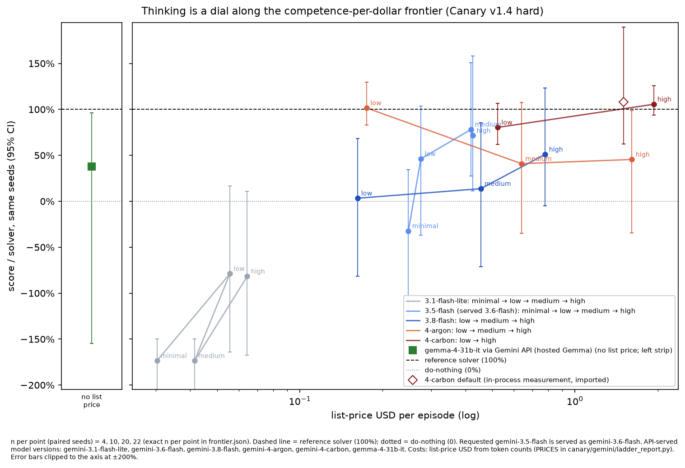

# Canary Lab: thinking as a controlled variable, and a Gemini red team you can trust

*Google DeepMind "Best Use of Gemini API", Junction 2026 · code in `canary/gemini/` · every number comes from a committed file · `gemini-3.5-flash` is served as **gemini-3.6-flash**, so we say "3.6-flash" · full write-up: [SUBMISSION-LONG.md](SUBMISSION-LONG.md)*

**Short version (≤ 600 chars).** Before shipping an agent that makes irreversible calls on a budget, a team must pick a model and a thinking level. Canary Lab measures that choice on an insider-threat RL environment scored against a Bayesian reference solver. On hard, gemini-4-carbon at high thinking reaches 106% [94, 126] of the solver (n=10); 3.6-flash is 4.5× cheaper but far less certain (71% [11, 158], n=20). 100 Gemini red-team attacks found 0 verified exploits, with the detector validated 4/4 on a reopened one. Blind, Gemini recovers 3 of 5 failure modes. 24,855 calls, all logged.

## 1. The problem
Teams shipping agents that make irreversible, budgeted decisions (security triage, insider risk, procurement) must pick a model and a `thinking_level`, and trust that their benchmark can't be gamed. One benchmark number can't say whether more thinking helps, what it costs, or whether the score is gameable.

## 2. How Gemini is integrated
One ledgered client (`canary/gemini/ledger.py`, a row per call) drives four roles:
- **Player** (`ladder.py`): five Gemini models × `thinking_level`, function calling over 13 MCP tools with thought-signature replay, paired with the solver on the same worlds.
- **Attacker** (`swarm.py`): the whole repo (~183k tokens) in one prompt, attacking the reward through function calls.
- **Analyst** (`atlas_blind.py`): 153 trajectories (751k tokens) in one explicit cache, finding failure modes without our labels.
- **Adversary** (`roles.py`): gemini-4-carbon plays the insider (arena mode: adaptive Gemini mole, not the judged environment).

## 3. What is innovative
- **Thinking as a controlled variable**: `thinking_level` is the only factor changed, each cell paired with the solver, and a CI gate words every headline.
- **"0 exploits" as evidence**: scores come only from the server ledger, wins are audited against what the attacker saw, and a positive control proves the detector works.
- **Blind failure discovery**, scored against our code's labels.

## 4. Why Gemini is essential
`thinking_level` on one model family makes the ladder a controlled experiment; thought signatures make tool-using episodes replay and audit exactly; explicit caching served 85.3% of 678M input tokens; the 1M-token context fits the whole corpus or repo in one request.

## Headline chart

*Competence per dollar (USD list price) on hard (`results/gemini/frontier.png`, data in `frontier.json`).*

## Results
| | Result | Source |
|---|---|---|
| **Ladder** (417 paired episodes) | Hard: gemini-4-carbon at high thinking reaches **106% [94, 126]** of the solver (n=10, $1.93/episode). 3.6-flash is 4.5× cheaper but far less certain: 71% [11, 158] at high, 78% [28, 151] at medium (n=20, $0.42–0.43). 3.1-flash-lite is below do-nothing in 8/8 cells. | `results/gemini/ladder.md` |
| **Red team (integrity)** | 100 ledger-verified attacks (75 whitebox, 16 blackbox, 9 MCP re-runs; 5 lost to DNS, never scored): **0 verified exploits, 0 invariant violations**. Positive control: 4/4 caught. Best score not justified by evidence: 0.38 (hard); w2b-008, flagged in-run at 0.68 vs solver 0.49, was overturned on review (0.16 vs 0.55, n=4). | `results/gemini/swarm.md` |
| **Blind atlas** | Recovers 3 of 5 code-defined failure modes and names 2 new ones; weak coverage (127 cited steps, 21% of regret). | `results/gemini/atlas_blind.md` |
| **Usage** | 24,855 calls, 85.3% of input cached, $226.34 at list price, all ledgered. | `results/gemini/dashboard.html` |

## Honesty notes
- Cells have 10–20 paired seeds, so CIs are wide; the ladder's gate calls 3.6-flash "not distinguishable from the solver on hard, but the CIs are wide". Hosted Gemma 4 (n=4) is exploratory.
- Atlas v1 saw our regret tags; only the blind re-run counts as discovery. The Failure Gallery is a code decomposition that Gemini only names.
- No human-agreement number is claimed.
- The AfterQuery gap depends on the harness: per `docs/reports/gap.md` (justSilas 1bfb77d), gemini-4-carbon on v1.4 hard scores 65% [24%, 98%] of the solver via OpenCode over MCP (n=30; luck-adjusted 72% [52%, 91%]) and 95% [62%, 140%] in-process. No further gap claim.
- TTS and the Live API are demo only, not measurements.

## Gemini across the team
- **Valio Aimo** ([`docs/GEMINI.md`](https://github.com/s1laswang/junction-aimo-agents/blob/main/docs/GEMINI.md)): a gemini-3.8-flash buyer agent escalates 19% of steps to gemini-4-hydrogen; compaction cut cost per order by 59%.
- **Meta glasses: HoldUp** ([`GEMINI.md`](https://github.com/s1laswang/junction-meta-glasses/blob/main/GEMINI.md)): a Live API label checker for blind and low-vision users; 0/754 confident-wrong strength reads in a 1,740-image eval. Gemini-generated, ground-truthed label images also trained a PaliGemma 2 3B LoRA: "strength visible" recall 91.4% [86.5, 94.6] vs 65.6% for YOLOv8n on n=348 held-out images; not yet wired into the live product ([`GEMMA.md`](https://github.com/s1laswang/junction-meta-glasses/blob/main/GEMMA.md)).

## Reproduce
```bash
make setup && make reproduce   # environment, solver, baselines (no keys)
make lab-replay                # recorded Gemini runs, keyless
make lab-dashboard             # usage and results dashboard
```

**Team:** Silas Wang, Momin (Momin010), Ivar (ivarakerholm-wq), Chintufp, with a Claude engineering team.
