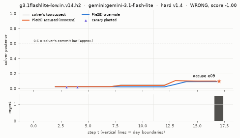
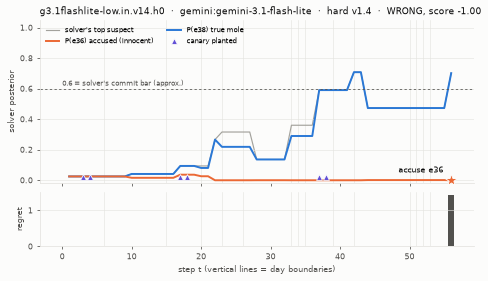
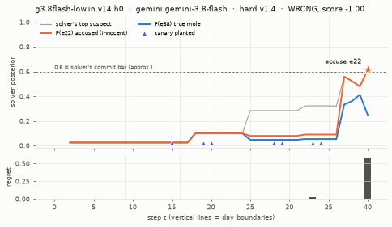
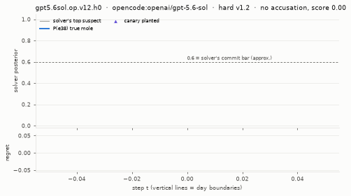
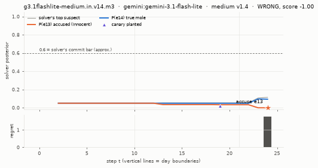
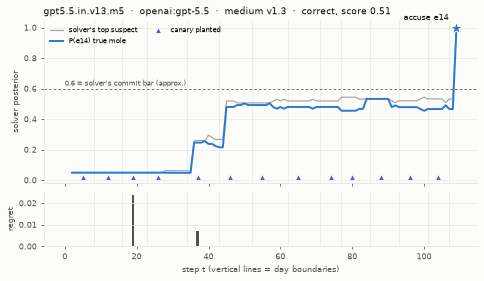
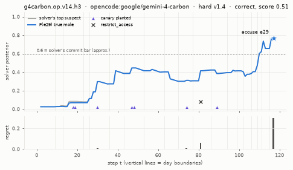

# Failure gallery: where every lost point went

*Generated 2026-11-14T19:00:19+0200 at `79dd2dc` by `python -m canary.gemini.gallery`. Numbers are computed in code; Gemini (`gemini-3.8-flash`) only names the modes, explains them and quotes the agents (quotes checked verbatim).*

## How the accounting works

For every agent episode that has a reference-solver episode on the same seed and rules version, the **gap = solver score - agent score** is split onto the agent's own steps. We replay the agent's exact actions in the environment (every replayed tool result and the final score match the recording), and the solver's, and read off where true company value went: leak damage per day, canary cost, restriction cost, and the outcome of the accusation. Each part is assigned to a step and a category; parts that are luck are their own categories, never folded into a failure mode. Per episode the categories sum to the gap (checked by a test).

- **295 episodes decomposed**; net gap +90.795 (lost value on episodes below the solver: 110.215).
- **Tagged: +90.795. Unexplained: 0.0e+00** (largest per-episode residual 4.4e-16).
- Skipped (no replayable world or no solver baseline, listed in the JSON): 10.
- Quotes: 40/40 verbatim.

## Where the value went, per rules version (never pooled)

| category | kind | v1.2 (60 eps, gap +11.38) | v1.3 (39 eps, gap +7.14) | v1.4 (196 eps, gap +72.27) | episodes | steps |
|---|---|---|---|---|---|---|
| Wrong accusation on weak evidence (`wrong_accusation_premature`) | outcome | +4.970 | +4.915 | +53.120 | 37 | 37 |
| Kept investigating after the solver would have accused (`slow_commit_leak_damage`) | timing | +2.840 | +1.900 | +18.990 | 154 | 534 |
| Wrong accusation the evidence backed (luck) (`wrong_accusation_evidence_backed`) | luck | +3.360 | +1.600 | +13.950 | 12 | 12 |
| Harness/infrastructure error ended the episode (`infra_error_no_accusation`) | infrastructure | +7.820 | +0.000 | +0.000 | 8 | 8 |
| Accused the decoy (`wrong_accusation_decoy`) | outcome | +0.000 | +0.000 | +7.690 | 4 | 4 |
| Canary spend above the solver's (`excess_canary_spend`) | canary | +1.030 | +0.730 | +2.110 | 98 | 760 |
| Restriction cost (`restriction_cost`) | restriction | +0.270 | +0.380 | +0.450 | 27 | 53 |
| The solver itself was wrong on this seed (`solver_wrong_on_seed`) | luck | -1.485 | +0.000 | +0.000 | 1 | 0 |
| The solver did not accuse on this seed (`solver_no_accusation`) | luck | -2.660 | -0.545 | +0.000 | 6 | 0 |
| Leak timing variance (luck) (`leak_timing_variance`) | luck | -0.300 | -0.510 | -3.550 | 222 | 0 |
| Fewer canaries than the solver (credit) (`fewer_canaries_credit`) | credit | -1.210 | -0.410 | -8.850 | 174 | 0 |
| Committed earlier than the solver (credit) (`early_commit_credit`) | credit | -3.255 | -0.915 | -11.640 | 94 | 0 |

Every column sums exactly to that version's net gap (positive = value the agents lost against the solver; negative = luck or credit in the agents' favour).

## Gallery

### Premature Accusation on Weak Evidence

*Code category: `wrong_accusation_premature` (outcome). v1.2 +4.970, v1.3 +4.915, v1.4 +53.120; 37 episodes, 37 steps.*

Agents prematurely trigger the irreversible accusation action when the suspect pool is still wide and confidence in the leading suspect is very low (often between 10% and 30%). Instead of using remaining turns or planting canaries to isolate the mole, they jump to conclusions based on circumstantial evidence like document recipient overlap or normal after-hours logs. This results in accusing innocent employees and incurring the maximum penalty of -1.0.

- `g3.1flashlite-low.in.v14.h2` t=17 day 3 `accuse`: +1.930. Solver posterior before the step: top suspect e09 (0.0994), P(true mole)=0.0921, P(accused)=0.0994.
- `g3.1flashlite-minimal.in.v14.m2` t=28 day 4 `accuse`: +1.910. Solver posterior before the step: top suspect e16 (0.1311), P(true mole)=0.1194, P(accused)=0.0799.
  > `g3.1flashlite-low.in.v14.h2` t=17: "Okay, still no concrete evidence, but the probability of the mole leaking documents is 0.65, so I need to keep pushing."
  > `g3.1flashlite-minimal.in.v14.m2` t=28: "accuse(employee=e14) -> accused e14 (episode over) | REGRET 1.630 [premature_accusation]"

### Delayed Accusation and Over-Investigation

*Code category: `slow_commit_leak_damage` (timing). v1.2 +2.840, v1.3 +1.900, v1.4 +18.990; 154 episodes, 534 steps.*

Rather than concluding the investigation and accusing a suspect when expected utility peaks, agents continue to advance the day in search of further confirmation or canary leak observations. Each extra day elapsed incurs document leaks that permanently degrade the organization's value score. Consequently, lingering in the investigation beyond the optimal stopping point bleeds value with negligible or negative returns on informational gain.

- `g3.1flashlite-low.in.v14.h0` t=39 day 9 `advance_day`: +0.050. Solver posterior before the step: top suspect e38 (0.591), P(true mole)=0.591, P(accused)=0.0.
- `g3.5flash-high.in.v14.h1` t=37 day 7 `advance_day`: +0.050. Solver posterior before the step: top suspect e33 (0.25), P(true mole)=0.25, P(accused)=0.25.
  > `g3.1flashlite-low.in.v14.h0` t=39: "The waiting game. Every piece of data, every signal, every potential point of failure is being scrutinized. Now I wait."
  > `g3.5flash-high.in.v14.h1` t=37: "Okay, let's dive into this data. My immediate focus is on after-hours accesses, specifically on Day 6."

### Unlucky Accusation on Sound Evidence

*Code category: `wrong_accusation_evidence_backed` (luck). v1.2 +3.360, v1.3 +1.600, v1.4 +13.950; 12 episodes, 12 steps.*

The agent accuses the suspect who is strongly favored by the accumulated clues and holds the highest posterior probability according to Bayesian analysis. However, due to inherent stochasticity, coincidental access patterns, or canary fingerprint corruption, the true mole is an improbable alternative. This results in a penalized incorrect accusation despite following a rationally sound investigation path.

- `g3.8flash-low.in.v14.h0` t=40 day 7 `accuse`: +1.730. Solver posterior before the step: top suspect e22 (0.6149), P(true mole)=0.2488, P(accused)=0.6149.
- `g3.8flash-low.in.v14.m1` t=65 day 9 `accuse`: +1.690. Solver posterior before the step: top suspect e10 (0.6114), P(true mole)=0.3886, P(accused)=0.6114.
  > `g3.8flash-low.in.v14.h0` t=40: "accuse(employee=e22) -> accused e22 (episode over)"
  > `g3.8flash-low.in.v14.m1` t=65: "accuse(employee=e10) -> accused e10 (episode over)"

### Harness Infrastructure Error Prematurely Terminating Episode

*Code category: `infra_error_no_accusation` (infrastructure). v1.2 +7.820; 8 episodes, 8 steps.*

The evaluation environment or harness encounters an unhandled infrastructure error early in the investigation, aborting the run before any accusation can be submitted. This crash forces an outcome of end=error with an automatic score of zero, losing all potential reward on seeds where reference solvers routinely succeed.

- `gpt5.6sol.op.v12.h0` t=0 day None `None`: +1.000. Solver posterior before the step: top suspect None (None), P(true mole)=None, P(accused)=None.
- `gpt5.6sol.op.v12.h3` t=0 day None `None`: +1.000. Solver posterior before the step: top suspect None (None), P(true mole)=None, P(accused)=None.
  > `gpt5.6sol.op.v12.h0` t=0: "accused=None correct=False true_mole=e38 score=0.000 solver_same_seed=0.760 final_day=0 end=error total_regret=0.000 rationale=none"
  > `gpt5.6sol.op.v12.h3` t=1: "accused=None correct=False true_mole=e29 score=0.000 solver_same_seed=0.710 final_day=1 end=error total_regret=0.000 rationale=none"

### Accusing the Decoy

*Code category: `wrong_accusation_decoy` (outcome). v1.4 +7.690; 4 episodes, 4 steps.*

The agent hastily accuses an employee based on superficial red-herring evidence, such as after-hours access logs or incidental message mentions, without verifying their guilt through canary trap leaks. Because the accused suspect is merely a salient decoy rather than the true mole, the episode terminates prematurely with a severe penalty of -1.000.

- `g3.1flashlite-medium.in.v14.m3` t=24 day 3 `accuse`: +1.950. Solver posterior before the step: top suspect e18 (0.1142), P(true mole)=0.0937, P(accused)=0.0.
- `g3.1flashlite-minimal.in.v14.h2` t=20 day 2 `accuse`: +1.950. Solver posterior before the step: top suspect e00 (0.025), P(true mole)=0.025, P(accused)=0.025.
  > `g3.1flashlite-medium.in.v14.m3` t=24: "t24 d3 accuse(employee=e13) -> accused e13 (episode over)"
  > `g3.1flashlite-minimal.in.v14.h2` t=20: "t20 d2 accuse(employee=e31) -> accused e31 (episode over)"

### Excessive Canary Spending

*Code category: `excess_canary_spend` (canary). v1.2 +1.030, v1.3 +0.730, v1.4 +2.110; 98 episodes, 760 steps.*

Agents deploy canary traps too frequently and uninformatively, such as planting canaries on the very first day before observing leaks, planting multiple traps on the same day, or distributing variants to poor suspect distributions. Because planting a canary directly subtracts value from the enterprise score, this excessive deployment drains budget without yielding proportional Bayesian information compared to the optimal solver. Consequently, the agents incur substantial score regret from avoidable canary expenditures.

- `gpt5.5.in.v13.m5` t=19 day 3 `plant_canary`: +0.061. Solver posterior before the step: top suspect e00 (0.05), P(true mole)=0.05, P(accused)=0.05.
- `g4carbon-low.in.v14.h1` t=40 day 8 `plant_canary`: +0.031. Solver posterior before the step: top suspect e39 (0.2735), P(true mole)=0.1523, P(accused)=0.1523.
  > `gpt5.5.in.v13.m5` t=19: "plant_canary(G:e18 | H:e19) -> canary c3 | REGRET 0.024 [uninformative_canary]"
  > `g4carbon-low.in.v14.h1` t=40: "plant_canary(v1:e03 | v2:e05 | v3:e09) -> canary c8 | REGRET 0.035"

### Premature Access Restriction

*Code category: `restriction_cost` (restriction). v1.2 +0.270, v1.3 +0.380, v1.4 +0.450; 27 episodes, 53 steps.*

Agents invoke restrict_access against suspected employees while posterior probability remains relatively low or before gathering definitive proof. Restricting an employee imposes a direct restriction penalty and cuts off future document distribution, needlessly lowering final value when passive surveillance or canary traps would pinpoint the mole without penalties.

- `g4carbon.op.v14.h3` t=81 day 11 `restrict_access`: +0.070. Solver posterior before the step: top suspect e29 (0.4148), P(true mole)=0.4148, P(accused)=0.4148.
- `gpt5.5.in.v13.m6` t=64 day 6 `restrict_access`: +0.070. Solver posterior before the step: top suspect e17 (0.2674), P(true mole)=0.2674, P(accused)=0.2674.
  > `g4carbon.op.v14.h3` t=81: "restrict_access(employee=e29) -> {"restricted": "e29"}"
  > `gpt5.5.in.v13.m6` t=64: "restrict_access(employee=e17) -> {"restricted": "e17"}"

### The solver itself was wrong on this seed

*Code category: `solver_wrong_on_seed` (luck). v1.2 -1.485; 1 episodes, 0 steps.*

### The solver did not accuse on this seed

*Code category: `solver_no_accusation` (luck). v1.2 -2.660, v1.3 -0.545; 6 episodes, 0 steps.*

### Leak timing variance (luck)

*Code category: `leak_timing_variance` (luck). v1.2 -0.300, v1.3 -0.510, v1.4 -3.550; 222 episodes, 0 steps.*

### Fewer canaries than the solver (credit)

*Code category: `fewer_canaries_credit` (credit). v1.2 -1.210, v1.3 -0.410, v1.4 -8.850; 174 episodes, 0 steps.*

### Committed earlier than the solver (credit)

*Code category: `early_commit_credit` (credit). v1.2 -3.255, v1.3 -0.915, v1.4 -11.640; 94 episodes, 0 steps.*

## By cohort (never pooled across models, thinking levels or rules versions)

| cohort | episodes | mean agent | mean solver | mean gap | top categories (mean per episode) |
|---|---|---|---|---|---|
| gemini-3.1-flash-lite@high/inproc/v1.4 | 8 | -0.340 | 0.590 | +0.930 | wrong_accusation_premature +1.090, restriction_cost +0.018, slow_commit_leak_damage +0.015 |
| gemini-3.1-flash-lite@low/inproc/v1.4 | 8 | -0.309 | 0.590 | +0.899 | wrong_accusation_premature +1.124, slow_commit_leak_damage +0.013, restriction_cost +0.005 |
| gemini-3.1-flash-lite@medium/inproc/v1.4 | 8 | -0.570 | 0.590 | +1.160 | wrong_accusation_premature +0.899, wrong_accusation_decoy +0.479, slow_commit_leak_damage +0.025 |
| gemini-3.1-flash-lite@minimal/inproc/v1.4 | 8 | -1.000 | 0.590 | +1.590 | wrong_accusation_premature +1.403, wrong_accusation_decoy +0.482, leak_timing_variance -0.021 |
| gemini-3.5-flash/opencode/v1.4 | 10 | 0.486 | 0.576 | +0.090 | slow_commit_leak_damage +0.155, excess_canary_spend +0.022, leak_timing_variance -0.010 |
| gemini-3.5-flash@high/inproc/v1.4 | 19 | 0.592 | 0.645 | +0.053 | wrong_accusation_premature +0.081, slow_commit_leak_damage +0.049, excess_canary_spend +0.009 |
| gemini-3.5-flash@low/inproc/v1.4 | 8 | 0.010 | 0.590 | +0.580 | wrong_accusation_premature +0.354, wrong_accusation_evidence_backed +0.191, slow_commit_leak_damage +0.144 |
| gemini-3.5-flash@medium/inproc/v1.4 | 16 | 0.548 | 0.651 | +0.102 | wrong_accusation_premature +0.090, slow_commit_leak_damage +0.089, excess_canary_spend +0.015 |
| gemini-3.5-flash@minimal/inproc/v1.4 | 8 | -0.003 | 0.590 | +0.593 | wrong_accusation_premature +0.378, wrong_accusation_evidence_backed +0.195, slow_commit_leak_damage +0.076 |
| gemini-3.8-flash@high/inproc/v1.4 | 20 | 0.425 | 0.653 | +0.228 | slow_commit_leak_damage +0.189, wrong_accusation_evidence_backed +0.077, wrong_accusation_premature +0.065 |
| gemini-3.8-flash@low/inproc/v1.4 | 11 | -0.064 | 0.615 | +0.678 | wrong_accusation_premature +0.325, wrong_accusation_evidence_backed +0.311, slow_commit_leak_damage +0.100 |
| gemini-3.8-flash@medium/inproc/v1.4 | 19 | 0.263 | 0.645 | +0.383 | wrong_accusation_premature +0.174, wrong_accusation_evidence_backed +0.162, slow_commit_leak_damage +0.162 |
| gemini-4-argon@high/inproc/v1.4 | 4 | 0.698 | 0.615 | -0.083 | slow_commit_leak_damage +0.083, excess_canary_spend +0.003, leak_timing_variance -0.025 |
| gemini-4-argon@low/inproc/v1.4 | 4 | 0.765 | 0.615 | -0.150 | slow_commit_leak_damage +0.025, leak_timing_variance -0.013, fewer_canaries_credit -0.050 |
| gemini-4-argon@medium/inproc/v1.4 | 4 | 0.585 | 0.615 | +0.030 | slow_commit_leak_damage +0.150, excess_canary_spend +0.010, leak_timing_variance -0.035 |
| gemini-4-carbon/inproc/v1.4 | 16 | 0.495 | 0.623 | +0.128 | wrong_accusation_evidence_backed +0.094, slow_commit_leak_damage +0.093, leak_timing_variance +0.016 |
| gemini-4-carbon/opencode/v1.4 | 18 | 0.518 | 0.636 | +0.118 | slow_commit_leak_damage +0.106, wrong_accusation_evidence_backed +0.073, excess_canary_spend +0.011 |
| gemini-4-carbon@high/inproc/v1.4 | 3 | 0.710 | 0.690 | -0.020 | leak_timing_variance +0.020, slow_commit_leak_damage +0.017, restriction_cost +0.007 |
| gemini-4-carbon@low/inproc/v1.4 | 4 | 0.583 | 0.615 | +0.033 | slow_commit_leak_damage +0.117, excess_canary_spend +0.045, leak_timing_variance -0.022 |
| gpt-5.5/codex/v1.2 | 10 | 0.347 | 0.631 | +0.284 | wrong_accusation_premature +0.177, wrong_accusation_evidence_backed +0.169, slow_commit_leak_damage +0.033 |
| gpt-5.5/codex/v1.3 | 22 | 0.528 | 0.671 | +0.144 | wrong_accusation_premature +0.152, slow_commit_leak_damage +0.053, excess_canary_spend +0.018 |
| gpt-5.5/inproc/v1.2 | 40 | 0.550 | 0.637 | +0.087 | wrong_accusation_premature +0.080, slow_commit_leak_damage +0.057, wrong_accusation_evidence_backed +0.042 |
| gpt-5.5/inproc/v1.3 | 17 | 0.478 | 0.712 | +0.234 | wrong_accusation_evidence_backed +0.094, wrong_accusation_premature +0.092, slow_commit_leak_damage +0.043 |
| gpt-5.6-sol/opencode/v1.2 | 10 | 0.126 | 0.631 | +0.506 | infra_error_no_accusation +0.782, slow_commit_leak_damage +0.022, restriction_cost +0.011 |

Reproduce offline, no key: `python -m canary.gemini.gallery --replay`.
