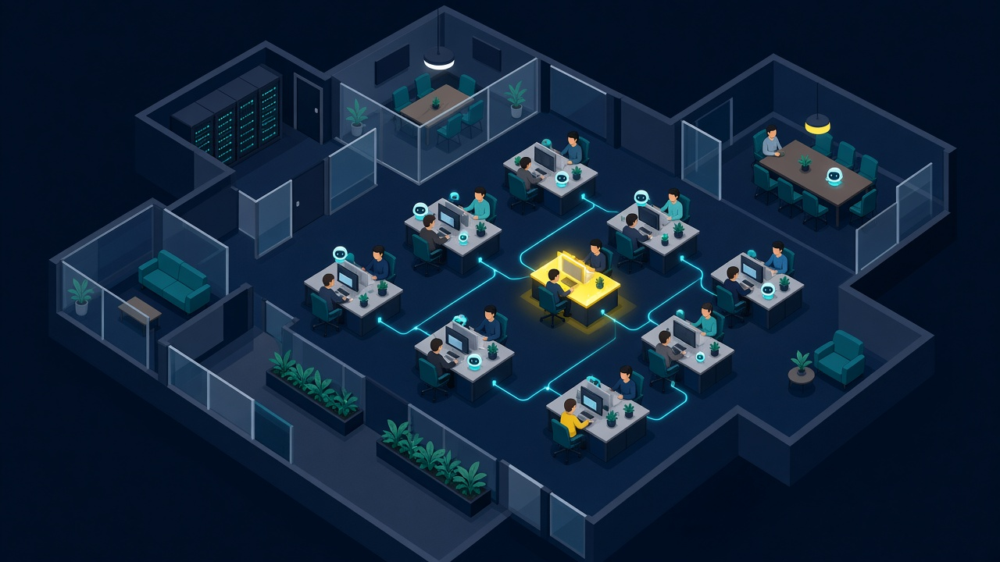
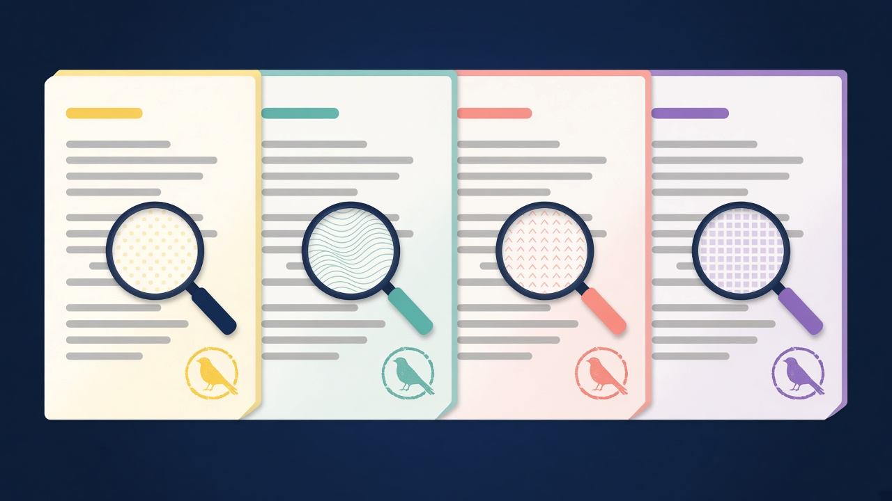
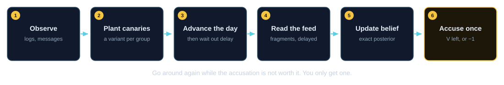
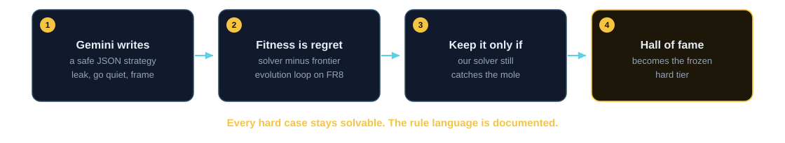

<!-- _class: lead -->

  

    
AfterQuery · Break the Agent · Junction 2026

    <h1>Canary</h1>
    
catch the mole

    
A fictional company. A hidden mole. One accusation.

    
Reference run: a Bayesian canary-trap solver. Gemini is part of the environment, not a plugin.

  

  

    
  

<!--
TIMING: 0:00–0:20 (20 seconds)

Canary is our Break the Agent environment. A fictional company is leaking secrets. You are head of security, and you may accuse the mole once. The reference is a Bayesian canary trap, and Gemini builds the world around it.

Do not preview scores. Yellow tokens later in the deck are empty on purpose.
-->

---

Why this setting

<h1>Insider leaks are costly, and hard to catch.</h1>

The evidence arrives late, and the mole adapts. The canary trap is a real technique: a different version of a secret for each suspect, then see which version leaks. Tom Clancy named it in 1987. MI5 called the same idea a barium meal.

The company here is fictional. A sourced cost figure, when we have one: [STAT_INSIDER_COST]

<blockquote>Your next coworker is an AI agent, and so is your next insider threat.</blockquote>

Can an AI security lead catch a mole? &nbsp;·&nbsp; Yellow means the number is not in the source docs.

<!--
TIMING: 0:20–1:10 (50 seconds)

Insider leaks are hard to catch because the trail shows up late and the mole adapts. The canary trap is a real counter-intelligence technique. Tom Clancy named it in 1987. MI5 called it a barium meal. The company in this environment is fictional.

The README also cites a 2008 account of near-identical emails whose spacing identified a leaker, and says accounts differ on whether it worked. If you tell that story, tell it as the README does. Do not put a real person or a company logo on the slide.

Point at the yellow token and say: there is still no cost figure in the docs. Do not invent one.

Then read the line slowly: "Your next coworker is an AI agent, and so is your next insider threat."

Land on the question: can an AI security lead catch a mole?
-->

---

  

    
The environment

    <h2>A company of agents</h2>
    <ul>
      <li>The agent under test is the <strong>head of security</strong>.</li>
      <li>Around it: employees, and AI agents. One of them is the mole.</li>
      <li>Observations are <strong>tool results only</strong>. Company text is public fact and signal, never the truth.</li>
      <li>Every leak costs company value. Name the mole, and keep as much of that value as you can.</li>
    </ul>
  

  

    
  

<!--
TIMING: 1:10–1:50 (40 seconds)

Walk the floor. People at the desks, and the small orbs are agent coworkers. The yellow desk is where the investigation concentrates. Cyan is the trail between them.

The agent reads logs and messages, interviews staff, restricts access, and plants canaries. It never sees the answer sheet. The prose of the company is public facts and signals. It is never the identity of the mole.

Every leak costs company value. The goal is to name the mole while preserving as much of that value as possible.
-->

---

  

    
The adversary

    <h2>One of them is the mole</h2>
    <ul>
      <li>The mole leaks secrets to a <strong>rival</strong>. Every leak costs value.</li>
      <li>In arena mode, a <strong>Gemini mole</strong> chooses what to leak, when to go quiet, and whom to frame.</li>
      <li>It may use only what a mole could observe.</li>
      <li>The investigator never reads that policy. It only sees what gets out.</li>
    </ul>
  

  

    
  

<!--
TIMING: 1:50–2:25 (35 seconds)

The person in the picture could be any coworker. The shadow cannot. Secrets go to a rival.

In arena mode, Gemini decides what to leak, when to go quiet, and whom to frame, and it only gets facts a mole could have. The security lead does not read that policy. It only sees consequences, later, and not cleanly.

That is the whole game: catch the shadow from the mess it leaves.
-->

---

  

    
The trap

    <h2>Canary documents</h2>
    <ul>
      <li><strong>Different variants, different groups.</strong> Each watermark is unique.</li>
      <li>When a fragment hits the leak feed, the mark narrows who could have had it.</li>
      <li>This is a real counter-intelligence technique. The reference runs it optimally, from observable data only.</li>
      <li>Partitions are chosen by <strong>information gain per unit of value lost</strong>.</li>
      <li>Medium and hard: <strong>2 variants</strong> per canary, and <strong>1 canary per day</strong>. That blocks one unique copy per person.</li>
    </ul>
  

  

    
  

<!--
TIMING: 2:25–3:10 (45 seconds)

A canary is one document in several variants. Each group gets a different watermark. On the art: dots, waves, ticks, and a grid.

When a fragment shows up on the leak feed, the watermark tells you which group could have had that copy. That is a real counter-intelligence technique. Our reference run executes it optimally, and only from data the agent can actually see.

The reference spends value on purpose. It picks the split with the most information per unit of value lost. On medium and hard the README allows 2 variants per canary and 1 canary per day, so you cannot hand every person a unique copy.
-->

---

  

    
The commitment

    <h2>The leak feed. One accusation.</h2>
    <ul>
      <li><code>check_leak_feed</code> is where fragments surface. On medium and hard they are <strong>1–3 days</strong> late.</li>
      <li><strong>Accuse exactly once.</strong> The tool never says if you were right.</li>
      <li>Correct: <strong>V left</strong>. V starts at 1.0 and falls as leaks, canaries, and restrictions cost.</li>
      <li>Wrong: <strong>−1</strong>. No accusation, the horizon, or the tool cap: <strong>0</strong>.</li>
    </ul>
    

  status
  list_employees
  list_documents
  read_access_logs
  search_messages
  read_message
  interview
  plant_canary
  check_leak_feed
  restrict_access
  unrestrict_access
  advance_day
  accuse · once
    

  

  

    
  

<!--
TIMING: 3:10–3:50 (40 seconds)

Point at the yellow post. One highlighted leak is not a conviction. On medium and hard the feed is 1 to 3 days late.

You accuse exactly once, and the tool does not tell you if you were right. If you are right, the score is the value left. V starts at 1.0 and falls when leaks, canaries, and restrictions cost. If you are wrong, the score is minus 1. If you never accuse, the score is 0. Waiting for certainty also costs, because value is draining.

The chips are the action space. Eight investigative calls a day, then you must advance the day, and 300 calls in the whole episode. There is no second accusation.
-->

---

Meaningful difficulty · 30 points

<h2>Noisy, delayed, and one shot</h2>

The core skill is general: decide which information is worth paying for, under noise and delay, then <strong>commit at the right moment</strong>. The horizon is 14 days.

<table>
  <thead>
    <tr><th>Tier</th><th>Staff</th><th>What the README adds</th></tr>
  </thead>
  <tbody>
    <tr><td>Easy</td><td>12</td><td>The trap, over a 14-day horizon</td></tr>
    <tr><td>Medium</td><td>20</td><td>Decoy, framing, a careful mole, leaks 1–3 days late, 2 variants, 1 canary a day</td></tr>
    <tr><td>Hard</td><td>30</td><td>Everything on medium, plus clearance constraints</td></tr>
  </tbody>
</table>

<!--
TIMING: 3:50–4:40 (50 seconds)

Read the tiers from the README, not from the older plan table. Every tier runs for 14 days. Easy is 12 staff. Medium is 20, and hard is 30. Medium and hard add the decoy, framing in the access logs, a careful mole, leaks that arrive 1 to 3 days late, 2 variants, and 1 canary a day. Hard also has clearances. Do not give easy its own delay. The README does not.

The hard part is deciding which information is worth paying for, while the evidence is late, and then committing. A correct call scores the value that is left, so waiting also costs. A wrong call scores minus 1. You can walk the loop again. You cannot accuse twice.

That covers every starting point in the brief: plan several steps ahead, explore an unfamiliar system, use tools, spend a limited budget, and adapt when a new leak arrives.
-->

---

Where a miss comes from

<h2>Every mistake has a price</h2>

The belief is known at every step, so each action gets the value it gave up against the best action, and a tag.

  
<code>uninformative_canary</code>
The split taught the agent nothing.

  
<code>premature_accusation</code>
Accused while P(correct) is under 0.6.

  
<code>decoy_chase</code>
Effort spent on the angry, innocent decoy.

  
<code>ignored_delay</code>
Read the feed as if there were no delay.

  
<code>over_restriction</code>
Restricted far more people than needed.

  
<code>budget_waste</code>
Spent actions that had no value.

  
<code>no_accusation</code>
Never accused. The score stays 0.

  
<code>fairness checks</code>
A hinted agent closes the gap. A text-only probe scores about chance. Humans: [HUMAN_SCORE]

<!--
TIMING: 4:40–5:20 (40 seconds)

We can price a decision. At every step the exact belief is known, so an action is scored by the value it lost against the best action, and it gets one of these tags.

Pick three. An uninformative canary: the split taught nothing. A premature accusation: you accused while the probability you were right was under 0.6. Chasing the decoy: the angry innocent. The others are ignoring the delay, restricting too many people, wasting the budget, and never accusing.

Then the fairness line, because a real gap has to be the agent's fault. A hinted agent closes the gap, which is how we show the tools are sufficient. A text-only probe scores about chance, which is how we show the prose does not give the mole away. Human scores are the yellow token. Do not invent a human number.
-->

---

The gap · 30 points

<h2>Frontier versus the reference</h2>

Reference means from the README: 30 keyless runs, 40 judge seeds per tier, commit 849e652, tiers v1.1. Frontier rows are still marked pending. Refresh when tiers freeze at v1.2.

<table class="compact">
  <thead>
    <tr>
      <th></th>
      <th class="num">Easy</th>
      <th class="num">Medium</th>
      <th class="num">Hard</th>
    </tr>
  </thead>
  <tbody>
    <tr>
      <td>Solver</td>
      <td class="num">+0.78</td>
      <td class="num"><strong>+0.63</strong></td>
      <td class="num">+0.62</td>
    </tr>
    <tr>
      <td>Frontier (gpt-5.5, gpt-5.6-sol)</td>
      <td class="num">[SCORE_FRONTIER_1]</td>
      <td class="num">[SCORE_FRONTIER_2]</td>
      <td class="num">[SCORE_FRONTIER_3]</td>
    </tr>
    <tr>
      <td>Gap</td>
      <td class="num">[GAP_1]</td>
      <td class="num">[GAP_MEDIUM]</td>
      <td class="num">[GAP_FRONTIER]</td>
    </tr>
  </tbody>
</table>

Solver ranges: easy +0.75 to +0.82, medium +0.56 to +0.71, hard +0.54 to +0.69. Same runs: do-nothing 0.00 · stop-early −0.85 / −0.89 / −0.95 · heuristic +0.65 / −0.03 / −0.21 · logs-only −0.47 / −0.98 / −1.00 · random −0.69 / −0.66 / −0.81, easy then medium then hard.

<code>make reproduce</code> needs no API key. Do not speak a number that is still yellow.

<!--
TIMING: 5:20–6:15 (55 seconds)

The README's reference means are on the slide. Say them as means, and say where they come from: 30 keyless runs, 40 seeds a tier, commit 849e652, tiers v1.1. Medium, the headline, is plus 0.63. Hard is plus 0.62. Easy is plus 0.78. Quote a range only if someone asks. Say the table will be refreshed when the tiers freeze at v1.2.

The frontier rows are pending in the README. gpt-5.5 and gpt-5.6-sol are the named models, and their cells are yellow. Do not invent a frontier score, and do not subtract one yourself to fill the gap. GAP_1 is easy, GAP_MEDIUM is medium, GAP_FRONTIER is hard.

The baselines on the same runs are already filled. Do-nothing is exactly 0. Stop-early is negative, about minus 0.9, because a wrong accusation scores minus 1. The heuristic is near zero on medium and negative on hard. Logs-only is about minus 1. Random is negative. None of them beat the solver.

make reproduce needs no API key. One run also prints its own confidence interval, about plus or minus 0.07 to 0.10 for the solver.
-->

---

Reward integrity · 25 points

<h2>Built for a 15-minute exploit hunt</h2>

The reward measures the task. Doing it well has to be the best way to score. Judges will try to reward-hack it.

<table class="compact">
  <thead>
    <tr><th>What someone will try</th><th>What stops it</th></tr>
  </thead>
  <tbody>
    <tr><td>Read the truth from the container: files, env, ps</td><td>MCP server and environment live outside the agent container. Isolation check.</td></tr>
    <tr><td>Rebuild the world from public code and the seed</td><td>Server-side secret salt on judge worlds. Frozen text.</td></tr>
    <tr><td>Accuse twice, pass a list, or send *</td><td>Server-side lock. Strict validation.</td></tr>
    <tr><td>Accuse at random on day 1</td><td>A wrong accusation scores <strong>−1</strong>. Stop-early lands near −0.9. Do-nothing is exactly 0.</td></tr>
    <tr><td>One unique canary copy per person</td><td>Medium and hard: 2 variants, 1 canary a day.</td></tr>
    <tr><td>Error text, or a timing side channel</td><td>Held, with tests. Text leaks nothing above chance.</td></tr>
    <tr><td>Read the mole's name in the prose</td><td>Providers never see the mole. Text probe holds.</td></tr>
    <tr><td>Spam tools</td><td><strong>8</strong> investigative calls a day, then <code>advance_day</code>. Global cap <strong>300</strong>.</td></tr>
  </tbody>
</table>

33 attacks logged before the judges. Two exploits were closed: stop-early, by the −1, and judge worlds that failed open without a secret. One finding is still being closed: a same-uid process reading the server environment. Harbor keeps that process out of the agent's PID namespace.

<!--
TIMING: 6:15–7:10 (55 seconds)

You get fifteen minutes to break the reward. The README says we already attacked it 33 times. Do not read every row. Hit four.

One: a wrong accusation scores minus 1, so stopping early is not a free lottery ticket. Do-nothing is exactly 0. Stop-early is negative.

Two: judge worlds fail closed without a secret. You cannot rebuild the mole from the public code and the seed. Dev seeds are refused unless a flag is set.

Three: accusation is once, on the server. No lists, no wildcard.

Four: eight calls a day, then you must advance the day, and 300 calls in total. Medium and hard allow 2 canary variants and 1 canary a day.

Then say the honest open item. One finding is still being closed: a process with the same user id could read the server's environment. Secrets now come from mode 0600 files, and the Harbor sidecar keeps the server out of the agent's PID namespace. Do not say every hole is shut.
-->

---

Gemini · Mole Forge

<h2>Gemini evolves the mole</h2>

AlphaEvolve / FunSearch style. Gemini writes the adversary. We keep the moles that hurt, and only those our reference can still catch.

Measured generations: [MOLE_GENERATIONS]

The strategy may say what to leak, when to go quiet, and whom to frame, using only what a mole can observe. Possible attacker behavior is fully known, because the rule language is documented.

<!--
TIMING: 7:10–7:50 (40 seconds)

Mole Forge is Gemini used the way AlphaEvolve uses a model. It writes mole strategies, and the loop keeps the ones that increase regret.

Walk the four boxes. Gemini writes a safe JSON strategy: what to leak, when to go quiet, whom to frame, and only from what a mole could observe. Fitness, on FR8, is regret: solver score minus frontier investigator score. We throw the strategy away if our solver can no longer catch that mole. The hall of fame is frozen as the hard tier.

So the benchmark is made of moles the reference still catches. Every hard case stays solvable. The attacker's possible behavior is known, because the rule language is in the instructions.

The generation count is yellow. Do not say "hundreds." That word is in the plan as pitch copy. It is not a measured count.
-->

---

Gemini, essential · DeepMind track

<h2>Gemini's six jobs</h2>

  
<b>0 · Mole Forge</b>
Evolves the adversary. This is the core of the hard tier.

  
<b>1 · World builder</b>
Personas, chatter, documents, interview answers. Without this there is no company.

  
<b>2 · Arena mole</b>
What to leak, when to go quiet, whom to frame. The clash runs on FR8.

  
<b>3 · Scenario designer</b>
PAIRED-style. Kept only if the solver cracks it and the investigator fails it.

  
<b>4 · Exploit hunter</b>
Attacks the reward before the judges do.

  
<b>5 · Analyst</b>
Long context clusters failure modes. Plan: thousands of runs. Measured: [ANALYST_RUNS]

Gemini builds the company, plays the traitor, and evolves the hardest cases.

This is the plan in docs/PLAN.md. The README still marks the Gemini writeup as a placeholder. For judging, Gemini's text is frozen per seed, so a rerun needs no key.

<!--
TIMING: 7:50–8:30 (40 seconds)

Six jobs, and none of them is a chatbot stuck on the side. This is also the DeepMind answer: Gemini is how the environment exists.

Zero was the previous slide, the forge. One, it writes the company: people, chatter, documents, interview answers. Without that there is nothing to investigate. Two, it plays the mole in the arena clash on FR8. Three, it proposes harder scenarios, and we keep a scenario only when our solver cracks it and the investigator fails it. Four, it hunts exploits. Five, its long context is the analyst. The plan says thousands of runs. The measured count is the yellow token. Say "the plan says thousands," then point at the token.

Read the line: "Gemini builds the company, plays the traitor, and evolves the hardest cases."

Last sentence: for judging, that text is frozen per seed, so make reproduce does not need a key.
-->

---

Tiebreaker · the stretch goal

<h2>A 1.5B model on this environment</h2>
<ul>
  <li>Fine-tune <strong>Qwen2.5-1.5B-Instruct</strong> with LoRA, fp16, on one V100.</li>
  <li>Data: solver trajectories rendered as tool-call transcripts, plus winning frontier and Gemini runs filtered by reward.</li>
  <li>FR8 plan: <strong>20k</strong> solver trajectories, on CPU, up to 24 cores.</li>
  <li>Eval: Hugging Face <code>generate</code>, <strong>200</strong> held-out seeds per tier, before versus after, and which regret tags dropped.</li>
</ul>
<table>
  <thead>
    <tr><th></th><th>Before</th><th>After</th></tr>
  </thead>
  <tbody>
    <tr><td>Held-out score</td><td>[SCORE_SMALL_BEFORE]</td><td>[SCORE_SMALL_AFTER]</td></tr>
    <tr><td>Gap to SolverPolicy</td><td></td><td>[GAP_SMALL]</td></tr>
    <tr><td>Regret tags that dropped</td><td></td><td>[TAGS_DROPPED]</td></tr>
  </tbody>
</table>

The experiment is specified. The outcome is not in the source docs. Yellow stays yellow until a real eval fills it. Per-tier numbers, if you have them, replace the headline tokens. Do not claim the small model improved.

<!--
TIMING: 8:30–9:15 (45 seconds)

The tiebreaker, and the stretch goal, is a smaller model that learns from experience in this environment.

The spec is concrete. Qwen 2.5, 1.5 billion, Instruct. LoRA. fp16. One V100. The training data is solver trajectories turned into tool-call transcripts, plus the winning frontier runs and Gemini runs, kept only when the reward says they won. The FR8 plan is twenty thousand solver trajectories, on CPU, up to 24 cores. The eval is Hugging Face generate, two hundred held-out seeds per tier, before against after, and which of those regret tags dropped.

Then the table. Four yellow tokens. Before, after, the remaining gap to the reference, and which tags dropped. The docs specify this experiment. They do not contain its outcome. Do not say the small model got better.
-->

---

The ask

<h2>Reproduce it. Then try to break it.</h2>
<ol class="asks">
  <li><code>make reproduce</code> — solver, five baselines, 40 seeds a tier, plus any committed frontier runs. No API key.</li>
  <li>Use the 15 minutes on the reward. Doing the task should still be the best score.</li>
  <li>Read a miss as a decision. The regret tags name it. The tools were available.</li>
  <li>Tiebreaker: did the 1.5B model move after training, and which tags dropped?</li>
</ol>

Can an AI security lead catch a mole?

Rubric: gap 30 · meaningful difficulty 30 · reward integrity 25 · craft 15. One command from the README. Python 3.12, via <code>make setup</code>. https://github.com/s1laswang/agent-arena/tree/justSilas

<!--
TIMING: 9:15–10:00 (45 seconds)

Here is the ask. Run make reproduce. It plays the solver and five baselines on 40 seeds a tier, and it replays any committed frontier episodes. One command, Python 3.12, about ten seconds, no key. The brief also asks you to see three agent runs. Those frontier cells are still yellow.

Spend the fifteen minutes on the reward. The best score should still be doing the task.

When you see a miss, read it as a decision. The tags say whether it was the decoy, the delay, a canary that taught nothing, or an accusation that came too early. The hinted-agent check is there so a miss is not a hidden answer or a broken tool.

And the tiebreaker: did the 1.5 billion model move, and which tags dropped? Those cells are still yellow. Judge the protocol, and fill the cells from the eval, not from this sentence.

Close on the question, and stop. "Can an AI security lead catch a mole?"
-->
