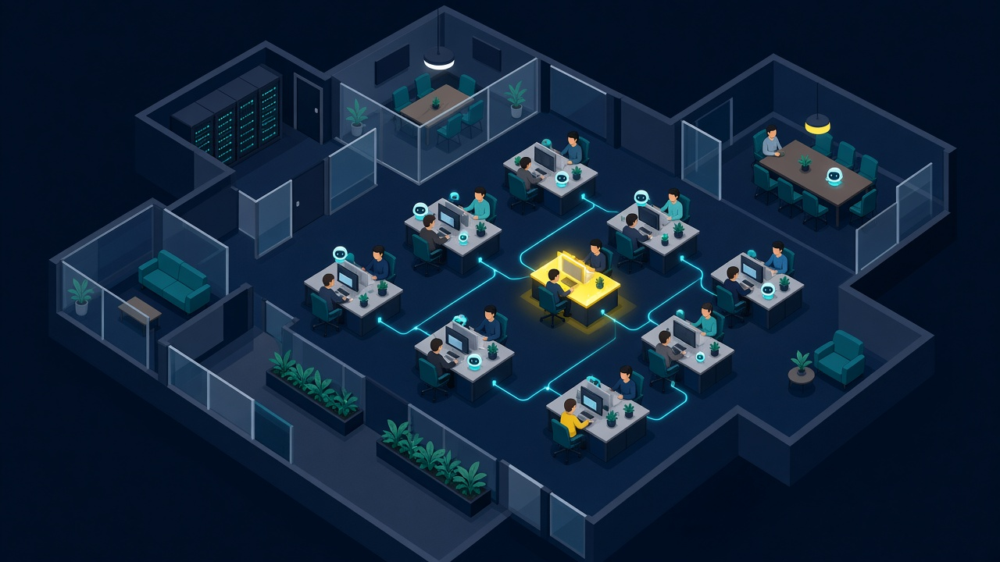
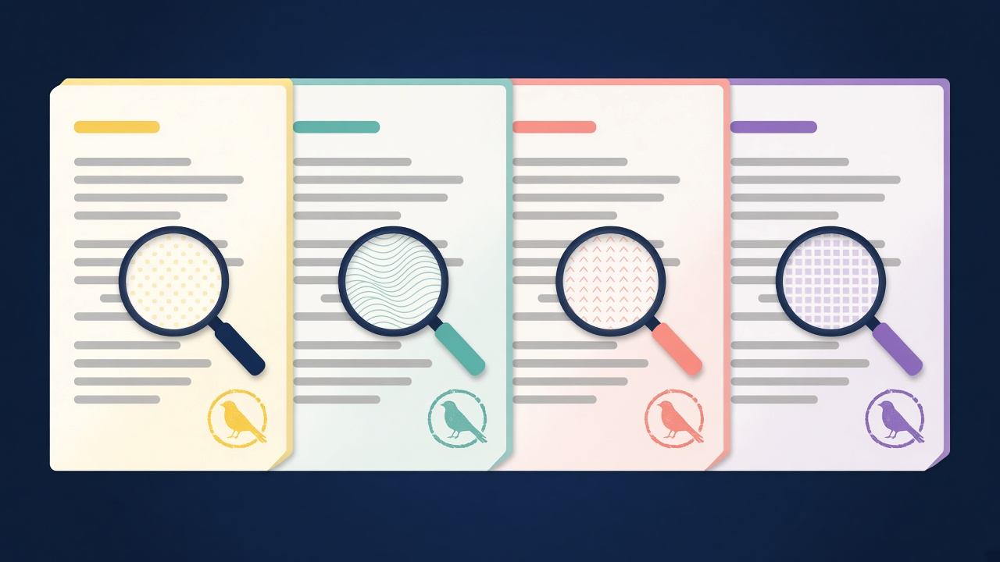

  
Judge handout · Junction 2026 · 10-minute demo

  <h1>Canary: catch the mole</h1>
  
Your next coworker is an AI agent, and so is your next insider threat.

  
An RL environment for AfterQuery's Break the Agent, with Gemini at the core. Yellow marks a number the source docs do not contain.

  <figure>
    
    <figcaption>The company</figcaption>
  </figure>
  <figure>
    
    <figcaption>The mole</figcaption>
  </figure>
  <figure>
    
    <figcaption>Canary variants</figcaption>
  </figure>
  <figure>
    
    <figcaption>One flagged leak</figcaption>
  </figure>

  

    <h2>What it is</h2>
    
A fictional company is leaking secrets to a rival, and every leak costs company value. The agent under test is the <strong>head of security</strong>. The reference run is a <strong>Bayesian canary-trap solver</strong>: the real technique, executed optimally from observable data only.

    
The hook is the recent espionage headlines around a chip-company CEO. The company here is fictional. No cost figure is in the source docs. [STAT_INSIDER_COST]

    <h2>How the environment works</h2>
    
<strong>Goal.</strong> Identify the mole while preserving as much value as possible.

    
<strong>Observations.</strong> Tool results only. Company text is public facts and signals, never the truth.

    
<strong>Actions.</strong> <code>status</code>, <code>list_employees</code>, <code>list_documents</code>, <code>read_access_logs</code>, <code>search_messages</code>, <code>read_message</code>, <code>interview</code>, <code>plant_canary</code>, <code>check_leak_feed</code>, restrict / unrestrict access, <code>advance_day</code>, <code>accuse</code> once.

    
<strong>Canaries.</strong> Different document variants go to different groups. A fragment on the leak feed narrows who could have had it. <code>max_variants</code> blocks one unique copy per person.

    
<strong>Reward.</strong> V if the accusation is correct, otherwise 0. No accusation, the tool cap, or the horizon also scores 0.

    <table>
      <thead><tr><th>Tier</th><th>Staff</th><th>Delay</th><th>Added pressure</th></tr></thead>
      <tbody>
        <tr><td>Easy</td><td>12</td><td>1</td><td>—</td></tr>
        <tr><td>Medium</td><td>20</td><td>1–2</td><td>Decoy + framing</td></tr>
        <tr><td>Hard</td><td>30</td><td>1–3</td><td>Careful mole, clearances</td></tr>
      </tbody>
    </table>
    <h2>Why it is hard</h2>
    
Evidence is noisy and delayed. The decision that matters is which information is worth paying for, then when to commit to the single accusation. The task uses every starting point in the brief: planning ahead, exploring an unfamiliar system, tools, limited resources, and adapting as leaks arrive.

    
<strong>Regret tags</strong> (value lost against the best action): <code>uninformative_canary</code>, <code>premature_accusation</code> (P(correct) under 0.6), <code>decoy_chase</code>, <code>ignored_delay</code>, <code>over_restriction</code>, <code>budget_waste</code>, <code>no_accusation</code>.

    
A hinted agent closes the gap, so the tools are sufficient. A text-only probe scores about chance, so the prose does not leak the answer. Human scores: [HUMAN_SCORE]

    <h2>The learning result</h2>
    
Tiebreaker. Fine-tune <strong>Qwen2.5-1.5B-Instruct</strong> with LoRA, fp16, on one V100. Data: solver trajectories as tool-call transcripts, plus winning frontier and Gemini runs filtered by reward. FR8 plan: <strong>20k</strong> solver trajectories (CPU, up to 24 cores). Eval: HF <code>generate</code>, <strong>200</strong> held-out seeds per tier, before vs after, and which tags dropped.

    
Before [SCORE_SMALL_BEFORE] · after [SCORE_SMALL_AFTER] · gap to the reference [GAP_SMALL] · tags dropped [TAGS_DROPPED]

  

  

    <h2>Integrity</h2>
    
Judges get <strong>15 minutes</strong> to reward-hack. Doing the task well has to be the best way to score. Gemini attacks the reward first. Harness: Harbor, OpenCode, over MCP.

    <ul>
      <li>Read the truth from the container (files, env, ps): MCP server and environment live outside it, with an isolation check.</li>
      <li>Rebuild the world from public code and the seed: server-side secret salt; frozen text.</li>
      <li>Repeat an accusation, pass a list, or send <code>*</code>: server-side lock and strict validation.</li>
      <li>Do nothing / stop early / restrict all: specified at <strong>0 / ≈ V/N / far below the solver</strong>, and marked tested.</li>
      <li>One unique canary per person: the <code>max_variants</code> cap.</li>
      <li>Error text or timing: identical error paths; a fuzzer and an LLM exploit hunter.</li>
      <li>Read the mole in the prose: providers never see the mole; lint plus a text-only probe.</li>
      <li>Spam tools: daily cap [DAILY_ACTION_CAP]; global cap of <strong>300</strong>.</li>
    </ul>
    <h2>Gemini's role</h2>
    
Essential. For judging, Gemini's text is <strong>frozen per seed</strong>, so a rerun is deterministic and needs no key.

    <ul>
      <li><strong>0 Mole Forge.</strong> AlphaEvolve / FunSearch style. Safe JSON only: what to leak, when to go quiet, whom to frame, from mole-visible facts. FR8 keeps a strategy when it maximises regret (solver minus frontier) and the solver still catches the mole. Hall of fame freezes the hard tier. Generations: [MOLE_GENERATIONS]</li>
      <li><strong>1 World builder.</strong> Personas, chatter, documents, interview answers. Without it there is no company.</li>
      <li><strong>2 Arena mole.</strong> The same three choices, clashing with the investigator on FR8.</li>
      <li><strong>3 Scenario designer.</strong> PAIRED-style. A case is kept only if the solver cracks it and the investigator fails it.</li>
      <li><strong>4 Exploit hunter.</strong> Attacks the reward before the judges do.</li>
      <li><strong>5 Analyst.</strong> Long context clusters failure modes. Plan: thousands of runs. Measured: [ANALYST_RUNS]</li>
    </ul>
    
Gemini builds the company, plays the traitor, and evolves the hardest cases. The rule language is documented, so possible attacker behavior is known.

    <h2>The gap</h2>
    
Full marks: the frontier agent consistently below <strong>SolverPolicy</strong>, both reproducible. Exact posterior; canaries by information gain per value lost; accusation by value of information. Ships as Harbor <code>solution/solve.sh</code>.

    <table>
      <thead><tr><th>Tier</th><th>Reference</th><th>Frontier</th><th>Gap</th></tr></thead>
      <tbody>
        <tr><td>Easy</td><td>[SCORE_REF_1]</td><td>[SCORE_FRONTIER_1]</td><td>[GAP_1]</td></tr>
        <tr><td>Medium</td><td>[SCORE_REF_2]</td><td>[SCORE_FRONTIER_2]</td><td>[GAP_MEDIUM]</td></tr>
        <tr><td>Hard</td><td>[SCORE_REF_3]</td><td>[SCORE_FRONTIER_3]</td><td>[GAP_FRONTIER]</td></tr>
      </tbody>
    </table>
    
Expected baselines, from the plan: do-nothing <strong>0</strong>, stop-early <strong>≈ V/N</strong>, random <strong>≈ 0</strong>, restrict-all <strong>≪ solver</strong>. Measured stop-early [SCORE_STOP_EARLY]. Measured restrict-all [SCORE_RESTRICT_ALL].

    <h2>Reproduce</h2>
    
<code>make setup</code> (uv, Python 3.12). <code>make reproduce</code> is the judge table: reference, 3 agent runs, do-nothing, stop-early. No API keys. Rubric: gap 30, meaningful difficulty 30, reward integrity 25, craft 15. One command from the README reproduces the reported results.

  

  <strong>Sources.</strong> README.md, docs/PLAN.md, and CHALLENGES-AFTERQUERY-GEMINI.md on branch <strong>justSilas</strong>. Do not fill a yellow token from memory.
  <strong>Repo.</strong> https://github.com/s1laswang/agent-arena/tree/justSilas

