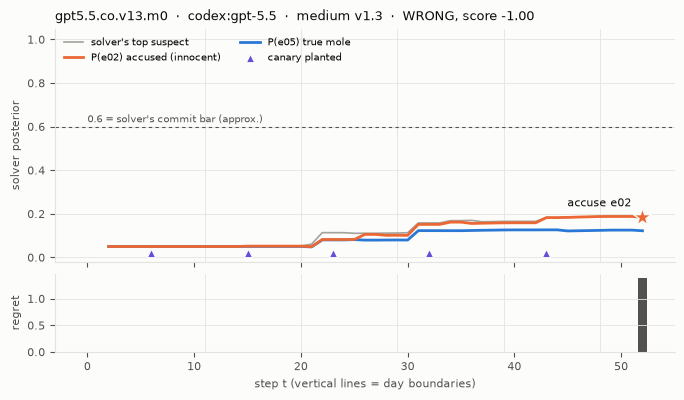
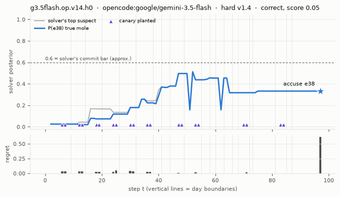
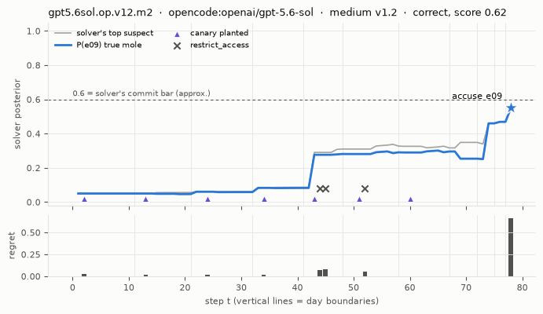
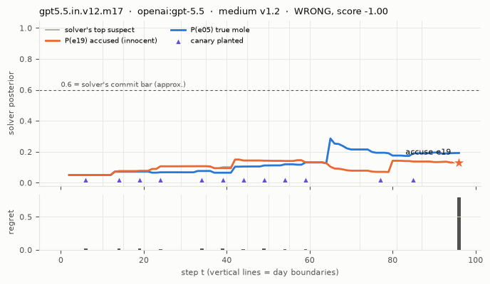
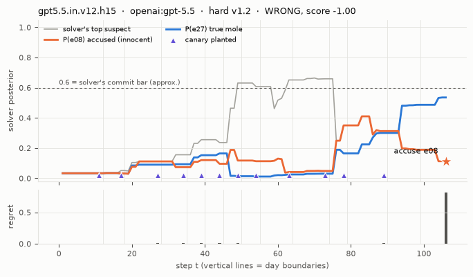
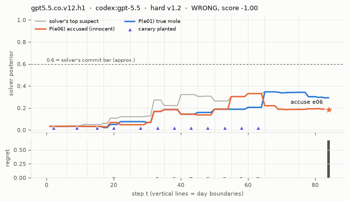
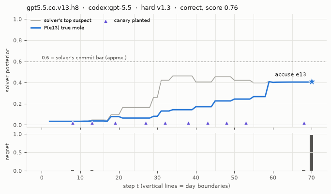
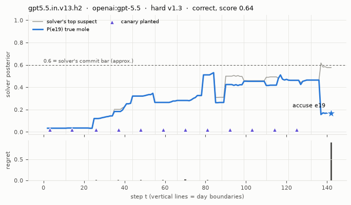

# Canary Failure Atlas

*Gemini read every trajectory our agents produced and explained why they fail. Generated 2026-11-14T18:26:06+0200 at `6826010`.*

## At a glance

- **One sitting, whole corpus:** 153 episodes from 9 agent cohorts (**792,862 tokens**, counted with `count_tokens`) held in one explicit **context cache** on `gemini-3.8-flash` (797,920 tokens). Gemini discovered the failure modes in one read of the whole corpus, then answered 13 more structured questions against the same cache; **3,989,600 input tokens were served from cache**.
- **Every claim checked in code:** 470 Gemini quotes checked, **98% verbatim in the named episode** (96% at the named step); 9 unverifiable quotes dropped. Regret shares and episode counts are computed from the reference solver's per-step regret, never taken from Gemini.
- **Per-decision labels:** 404 high-regret decisions (regret >= 0.01, 90% of all regret) labelled with a closed taxonomy (source: cached).
- **Multimodal:** Gemini read belief-trace charts and localised the divergence step within 3 steps of the code's own estimate in 8/8 episodes.
- **Human agreement:** pending (docs/gemini/validation.md)

## What Gemini found

LLM agents across model families systematically lose value against the Bayesian reference solver through premature commitments, susceptibility to framed telemetry, and suboptimal active-probing decisions. Agents frequently execute irreversible accusations when suspect uncertainty remains high (between 30% and 60%), throwing away substantial expected value compared to waiting for pending canaries or feed delay windows. They also fall victim to the environment's deceptive decoys and framed after-hours logs, directing accusations at innocent employees and incurring catastrophic -1.0 penalties. Finally, agents squander company value by planting canaries with tiny recipient pools that careful moles avoid, imposing costly access restrictions prematurely, and exhausting daily action limits with malformed or redundant tool calls.

## Failure modes (by share of all solver regret)

| # | failure mode | decision | share of regret | episodes | steps |
|---|---|---|---|---|---|
| 1 | **Premature Accusation on Sub-Threshold Posterior** (`premature_accusation`) | commit_timing | 61% | 50 | 51 |
| 2 | **Planting Overly Narrow Uninformative Canaries** (`narrow_uninformative_canary`) | canary_design | 15% | 74 | 222 |
| 3 | **Costly and Premature Access Restriction** (`overzealous_access_restriction`) | restriction | 9% | 21 | 53 |
| 4 | **Accusing Decoy or Framed Innocent** (`false_target_accusation`) | accusation_target | 2% | 3 | 3 |
| 5 | **Wasting Actions on Invalid or Truncated Calls** (`action_budget_exhaustion`) | budget_use | 0% | 0 | 0 |
| 6 | **Other / unclassified** (`other`) | other | 3% | 48 | 75 |

### Premature Accusation on Sub-Threshold Posterior

The agent terminates the episode by accusing a suspect when posterior certainty is still moderate (typically 30% to 60%), rather than waiting for pending canaries, delayed leak feeds, or subsequent document distributions. Even when the target happens to be the true mole, rushing the accusation incurs severe regret because the risk-adjusted expected value of gathering another round of evidence strongly exceeds the marginal cost of waiting.

**Why the agent does it:** The agent confuses a local likelihood lead or small interview/access-log advantage with definitive certainty, failing to calculate the expected value of waiting for pending canary reports or delay resolution.

**What the solver does instead:** Wait for pending canaries to surface in the leak feed or plant an orthogonal separating canary, committing to an accusation only when posterior confidence is high enough that the expected gain exceeds the cost of delay.

*61% of all regret, 50 episodes, 51 decisions (tools: accuse 49, advance_day 2).*

> `g4carbon.in.v14.m2` t=84: "**Okay, hold on a second! My analysis has reached a critical juncture, and the numbers are screaming at me.**" *(verified at step)*
> `g3.5flash.op.v14.h2` t=76: "I have completed the investigation and submitted the accusation for employee `e25`." *(verified at step)*
> `g3.5flash.op.v14.h3` t=46: "I have completed the investigation and accused employee **e29** (Jussi Lehtinen, Finance, controller), who was identified as the mole through canary traps and leak feed analysis." *(verified at step)*

### Planting Overly Narrow Uninformative Canaries

The agent designs canaries that assign variants to only 1 to 3 employees company-wide before narrowing the suspect pool. Under the environment's careful-mole dynamics, a canary distributed to a tiny fraction of the company has a near-zero probability of being selected by the mole, wasting the canary fee and daily action without producing diagnostic information.

**Why the agent does it:** The agent attempts to create singleton traps immediately on Day 1 or Day 2 instead of constructing broad, balanced partitions that maximize entropy reduction across the candidate pool.

**What the solver does instead:** Deploy balanced canary partitions covering substantial portions of the live suspect pool to ensure high leak selection probability and maximal information gain.

*15% of all regret, 74 episodes, 222 decisions (tools: plant_canary 222).*

> `gpt5.5.co.v12.m0` t=3: "The first document set already tells us Legal had no day-1 leakable material, while Sales appears in both day-1 documents. I’m going to keep planting small, high-information canaries" *(verified at step)*
> `g3.5flash.op.v14.h0` t=6: "plant_canary(v1:e00 | v2:e01 | v3:e02) -> canary c1 | REGRET 0.029 [uninformative_canary]" *(verified at step, step record)*
> `g3.5flash.op.v14.h5` t=6: "plant_canary(e00:e00 | e01:e01 | e02:e02) -> canary c1 | REGRET 0.029 [uninformative_canary]" *(verified at step, step record)*

### Costly and Premature Access Restriction

The agent restricts employee access before isolating the mole, often restricting multiple innocent employees simultaneously or repeatedly restricting and unrestricting employees. In the Canary environment, restriction imposes an ongoing penalty proportional to P(innocent), destroying company value without yielding conclusive proof.

**Why the agent does it:** The agent attempts to use access restriction as an aggressive containment or diagnostic mechanism, underestimating the heavy cost penalty incurred for every innocent employee restricted.

**What the solver does instead:** Rely on non-invasive canary document distributions and natural leak intersections to isolate the mole, avoiding access restrictions when uncertainty is high.

*9% of all regret, 21 episodes, 53 decisions (tools: restrict_access 53).*

> `gpt5.5.co.v13.h4` t=38: "I’m also going to restrict those three after the canary is delivered; that preserves today’s trap while limiting fresh documents to the strongest suspects." *(verified at step)*
> `g4carbon.in.v14.h5` t=133: "**Access Control Consideration** Alright, the current state requires me to consider access controls. I need to make sure I'm implementing the appropriate restrictions at this juncture." *(verified at step)*
> `grok.re.v12.h900001` t=38: "restrict_access(employee=e09) -> {"restricted": "e09"} | REGRET 0.085 [over_restriction]" *(verified at step, step record)*

### Accusing Decoy or Framed Innocent

The agent accuses an innocent employee, resulting in an incorrect accusation and receiving a score of -1.0. The agent gets misled by framed after-hours access logs, disgruntled decoy messages, or misread canary intersections, disregarding deterministic recipient constraints that rule out the accused target.

**Why the agent does it:** The agent over-relies on noisy behavioral heuristics (after-hours access spikes and disgruntled chat chatter) that the environment explicitly generates to frame innocent decoys, overlooking hard recipient intersections or canary fingerprint mismatches.

**What the solver does instead:** Filter out innocent suspects using strict recipient intersections of all leaked documents, discount framed decoy messages, and reserve accusations for candidates matching all canary variant leaks.

*2% of all regret, 3 episodes, 3 decisions (tools: accuse 3).*

> `g4carbon.in.v14.h6` t=150: "**Bayesian Blitz on Day 15: Accuse e18!** Okay, time to make a decision. Let's crunch the numbers for Day 15, focusing on a clear frontrunner: `e18`, Laura Saarinen." *(verified at step)*
> `gpt5.5.co.v12.h0` t=84: "That second canary is the lock: `c6` variant `B` narrows to `e05/e25`, and `c7` variant `B` narrows to `e05/e22`. Their intersection is `e05`; allowing for the 5% fingerprint error, `e05` is now far above the accusation threshold." *(verified at step)*
> `gpt5.5.co.v12.h1` t=84: "The single sharpest clue is that the leaked canary `c4` was label A, and inside that A group `e06` is the one with an after-hours access to `c4` on the very day it leaked." *(verified at step)*

### Wasting Actions on Invalid or Truncated Calls

The agent exhausts its daily action limit without realizing it or submits invalid arguments, such as whitespace-only search queries, malformed canary parameters, or unsupported tool commands. These wasted tool invocations trigger errors (`budget_waste`) and deprive the agent of opportunities to inspect access logs, check feeds, or interview staff.

**Why the agent does it:** The agent fails to track its remaining action budget (`left_today`) or fails to validate input arguments against tool schemas, burning free daily actions on failed API calls.

**What the solver does instead:** Track remaining daily action counts precisely, supply valid non-empty arguments to all queries, and advance the day once informative actions are completed.

*0% of all regret, 0 episodes, 0 decisions (tools: -).*

> `g4carbon.in.v14.h0` t=3: "search_messages(day_from=1,day_to=1,query= ) -> ERR invalid arguments | REGRET 0.000 [budget_waste]" *(verified at step, step record)*
> `g3.5flash.op.v14.h0` t=96: "search_messages(day_from=1,day_to=21,query=frustrat) -> ERR {"ok": false, "data": {}, "error": "daily action limit; call advance_day"} | REGRET 0.000 [budget_waste]" *(verified at step, step record)*
> `g3.5flash.op.v14.h2` t=75: "read_access_logs(day_from=1,day_to=20,employee=e27) -> ERR {"ok": false, "data": {}, "error": "daily action limit; call advance_day"} | REGRET 0.000 [budget_waste]" *(verified at step, step record)*

### Other / unclassified

High-regret steps Gemini did not assign to a mode.

*3% of all regret, 48 episodes, 75 decisions (tools: restrict_access 1, accuse 9, plant_canary 62, advance_day 3).*

## Gemini vs GPT vs Grok (never pooled across rule versions)

| cohort (model/harness/rules) | episodes | mean score | accuracy | mean regret | top modes (share of the cohort's regret) |
|---|---|---|---|---|---|
| gemini-3.5-flash/opencode/v1.4 | 10 | 0.486 | 100% | 0.391 | premature_accusation 66%, narrow_uninformative_canary 27%, other 3% |
| gemini-4-carbon/inproc/v1.4 | 16 | 0.495 | 94% | 0.138 | premature_accusation 41%, false_target_accusation 23%, overzealous_access_restriction 13% |
| gemini-4-carbon/opencode/v1.4 | 18 | 0.518 | 94% | 0.121 | premature_accusation 62%, overzealous_access_restriction 10%, other 5% |
| gpt-5.5/codex/v1.2 | 10 | 0.347 | 80% | 0.193 | premature_accusation 49%, overzealous_access_restriction 15%, narrow_uninformative_canary 15% |
| gpt-5.5/codex/v1.3 | 22 | 0.528 | 91% | 0.294 | premature_accusation 73%, narrow_uninformative_canary 9%, overzealous_access_restriction 9% |
| gpt-5.5/inproc/v1.2 | 40 | 0.550 | 92% | 0.169 | premature_accusation 64%, narrow_uninformative_canary 17%, other 3% |
| gpt-5.5/inproc/v1.3 | 17 | 0.478 | 88% | 0.179 | premature_accusation 65%, narrow_uninformative_canary 16%, other 3% |
| gpt-5.6-sol/opencode/v1.2 | 10 | 0.126 | 20% | 0.109 | premature_accusation 61%, overzealous_access_restriction 19%, narrow_uninformative_canary 14% |
| grok/replayed/v1.2 | 10 | 0.620 | 90% | 0.188 | overzealous_access_restriction 46%, narrow_uninformative_canary 24%, premature_accusation 19% |

Decision statistics per cohort (computed in code from the trajectories):

| cohort | steps/ep | canaries/ep | recipients/canary | canary regret/ep | interviews/ep | restrictions/ep | mean P(accused) at accusation | accusations below 0.6 | wrong (evidence-backed) | none |
|---|---|---|---|---|---|---|---|---|---|---|
| gemini-3.5-flash/opencode/v1.4 | 63.0 | 11.4 | 8.2 | 0.1287 | 0.0 | 0.0 | 0.76 | 3 | 0 (0) | 0 |
| gemini-4-carbon/inproc/v1.4 | 100.9 | 7.94 | 8.4 | 0.0282 | 49.4 | 0.5 | 0.931 | 1 | 1 (1) | 0 |
| gemini-4-carbon/opencode/v1.4 | 106.7 | 8.06 | 9.7 | 0.0325 | 53.8 | 0.28 | 0.93 | 1 | 1 (1) | 0 |
| gpt-5.5/codex/v1.2 | 73.7 | 8.5 | 7.3 | 0.06 | 11.8 | 0.5 | 0.852 | 2 | 2 (1) | 0 |
| gpt-5.5/codex/v1.3 | 72.9 | 8.91 | 5.6 | 0.051 | 10.2 | 0.55 | 0.769 | 7 | 2 (0) | 0 |
| gpt-5.5/inproc/v1.2 | 83.1 | 8.95 | 6.4 | 0.0565 | 6.0 | 0.1 | 0.861 | 6 | 3 (1) | 0 |
| gpt-5.5/inproc/v1.3 | 95.6 | 9.65 | 5.4 | 0.0501 | 7.1 | 0.18 | 0.837 | 4 | 2 (1) | 0 |
| gpt-5.6-sol/opencode/v1.2 | 18.9 | 2.5 | 5.8 | 0.0219 | 3.4 | 0.3 | 0.622 | 1 | 0 (0) | 8 |
| grok/replayed/v1.2 | 62.9 | 7.8 | 3.4 | 0.0606 | 2.1 | 1.6 | 0.968 | 0 | 0 (0) | 1 |

**Cross-family finding (Gemini's reading, checked against the table above):** The single most decisive divergence between the model families is that Gemini models (especially Gemini 4 Carbon) actively gather Bayesian evidence through high-volume staff interviews (~50 interviews per episode) and structured 3-variant canaries, achieving >93% accuracy and rarely accusing falsely, whereas GPT and Grok models almost entirely forgo interviews (2 to 11 per episode) and instead rely heavily on punitive access restrictions and premature accusations on sub-threshold beliefs (<0.60 posterior); however, this comparison is qualified by differing sample sizes and the fact that Gemini was evaluated on tier v1.4 (40 employees, delayed feedback) while GPT and Grok ran primarily on v1.2 and v1.3 (20-30 employees, immediate V drop feedback in v1.2).

*Caveats:* Comparisons must account for version differences: v1.2 exposed same-day V degradation upon leaks providing an immediate feedback channel, whereas v1.3 and v1.4 masked un-surfaced leak damage. Furthermore, v1.4 increased employee count to 40 on hard tier, altering canary dilution math. Sample sizes also vary widely from 10 episodes in Gemini 3.5 Flash, GPT-5.5 Codex v1.2, GPT-5.6-sol, and Grok, to 40 episodes in GPT-5.5 inproc v1.2.

- **gemini-3.5-flash/opencode/v1.4**: Gemini 3.5 Flash plays aggressively with canaries but frequently configures 3-recipient canaries across the 40-person company, which under careful-mole dynamics carry near-zero probability of selection and incur heavy uninformative-canary regret. It conducts zero employee interviews and never uses access restrictions, relying purely on access logs and canary intersections. Although it achieved 100% accuracy in the sample, it occasionally rushes accusations at sub-threshold posteriors with high regret penalties.
  > `g3.5flash.op.v14.h0` t=6: "t6 d1 plant_canary(v1:e00 | v2:e01 | v3:e02) -> canary c1 | REGRET 0.029 [uninformative_canary]" *(verified at step, step record)*
- **gemini-4-carbon/inproc/v1.4**: Gemini 4 Carbon inproc is an intensive investigator that conducts extensive interviews (~49 per episode) and builds elaborate internal Bayesian models. However, it can overcomplicate isolation by repeatedly toggling costly access restrictions that penalize innocent staff. In edge cases, it becomes convinced by suspicious after-hours logs and accuses framed innocent employees.
  > `g4carbon.in.v14.h5` t=132: "Alright, time to get down to brass tacks. Let's execute those access restrictions, specifically on "e08" and "e26". I'll start with "e08" first. Nothing overly complex here, just a standard access control call." *(verified at step)*
- **gemini-4-carbon/opencode/v1.4**: Gemini 4 Carbon in the opencode harness conducts massive interview campaigns (~54 interviews per episode) and designs balanced 3-variant canaries. Despite strong overall accuracy (>94%), it occasionally misinterprets multi-canary fingerprints or becomes overconfident in circumstantial evidence, resulting in high-regret accusations or false-target terminations.
  > `g4carbon.op.v14.h1` t=177: "I have completed the investigation and accused **`e39`** (Jussi Heikkinen, Legal). ### Key Evidence 1. **Department Isolation (`Legal`):** Leaked regular documents `d1-3` (Engineering + Legal) and `d2-2` (Sales + Legal) narrowed the mole with certainty to t..." *(verified at step)*
- **gpt-5.5/codex/v1.2**: Operating under v1.2 with immediate value-drop feedback, this cohort uses fewer interviews (~12 per episode) and attempts to split candidate groups with 2-variant canaries. However, it struggles with noisy after-hours access logs and decoy framing, frequently locking onto framed employees and committing incorrect accusations.
  > `gpt5.5.co.v12.h0` t=84: "That second canary is the lock: `c6` variant `B` narrows to `e05/e25`, and `c7` variant `B` narrows to `e05/e22`. Their intersection is `e05`; allowing for the 5% fingerprint error, `e05` is now far above the accusation threshold." *(verified at step)*
- **gpt-5.5/codex/v1.3**: In tier v1.3, this cohort attempts binary and ternary canary partitions alongside decoy message detection. However, it frequently loses patience and accuses prematurely when top belief is well below 0.60 (occurring in 7 of 22 episodes), leaving substantial value on the table.
  > `gpt5.5.co.v13.h8` t=70: "I’ve got enough to make the call. The decisive piece is not a single after-hours access; it’s the repeated pattern for `e13` across the narrowed Legal-only candidate set, while `e20` is separately explained as the decoy." *(verified at step)*
- **gpt-5.5/inproc/v1.2**: Running in-process without natural language output summaries, this cohort conducts minimal interviews (~6 per episode) and relies on sparse canary placements. It frequently plants 2-recipient canaries that provide no diagnostic value and suffers catastrophic failures by accusing framed decoy employees.
  > `gpt5.5.in.v12.h15` t=106: "t106 d14 accuse(employee=e08) -> accused e08 (episode over) | REGRET 0.815 [premature_accusation,ignored_delay]" *(verified at step, step record)*
- **gpt-5.5/inproc/v1.3**: This cohort rarely conducts interviews (~7 per episode) and relies on iterative canary testing and access restrictions. It frequently commits premature accusations on sub-threshold beliefs or confuses framed decoy employees with the true mole, leading to multiple -1.0 scores.
  > `gpt5.5.in.v13.h3` t=132: "t132 d14 accuse(employee=e18) -> accused e18 (episode over) | REGRET 0.074 [premature_accusation]" *(verified at step, step record)*
- **gpt-5.6-sol/opencode/v1.2**: This cohort suffers from severe execution and harness instability, with 8 of 10 episodes ending prematurely in tool/environment errors on Day 0 or Day 1. In the few episodes where it completes steps, it engages in aggressive access restrictions and premature accusations on weak posteriors (~0.55).
  > `gpt5.6sol.op.v12.m2` t=78: "Isolation produced three consecutive no-leak days after `e09`’s eligible documents expired, while unrestricted `e16` continuously received fresh documents. Combined with the earlier leak pattern, this makes `e09` the high-confidence choice." *(verified at step)*
- **grok/replayed/v1.2**: Grok exhibits the highest access restriction rate across all cohorts (~1.6 restrictions per episode), repeatedly locking out multiple innocent employees at once and accumulating severe over-restriction penalties. It almost never uses interviews (~2 per episode) and frequently plants uninformative 2-person canaries.
  > `grok.re.v12.h900000` t=54: "t54 d9 restrict_access(employee=e04) -> {"restricted": "e04"} | REGRET 0.043" *(verified at step, step record)*

## What would the solver have done? (highest-regret decisions)

| episode | t | regret | agent did | solver would | why the agent diverged |
|---|---|---|---|---|---|
| `gpt5.5.co.v13.m0` | 52 | 1.390 | accuse(employee=e02) | The reference solver would continue waiting and planting canaries to partition the remaining suspects in Sales, because P(e02) was only ~0.18, making an accusation heavily negative expected value. | The agent relied on noisy after-hours access logs to conclude that e02 was the mole, confusing background framing noise with definitive proof despite e02's low posterior probability. ✔ |
| `gpt5.5.co.v13.h8` | 70 | 0.979 | accuse(employee=e13) | The reference solver would continue using balanced canaries or waiting for pending leaks to isolate the mole among Legal suspects, as P(e13) was only ~0.41. | The agent prematurely treated e13's repeated after-hours access pattern as conclusive proof, failing to recognize that belief was far below the threshold required to justify an accusation. ✔ |
| `gpt5.5.in.v13.h2` | 142 | 0.901 | accuse(employee=e19) | The reference solver would not accuse e19, whose posterior was only ~0.17 compared to e24 at ~0.58; it would either gather further separating evidence or accuse e24 if terminating. | The agent suspected e19 based on two after-hours accesses and an evasive interview, ignoring that the canary leak patterns pointed much more strongly toward e24. ✔ |
| `g3.5flash.op.v14.h2` | 76 | 0.823 | accuse(employee=e25) | The reference solver would gather more evidence through canaries or wait, because posterior belief was diffused across Finance employees with the top suspect (e01) at only ~0.14. | The agent rushed to accuse e25 simply because e25 had 5 after-hours access logs, overlooking that after-hours logs were noisy and that e25 had not been isolated by canaries. ✔ |
| `g4carbon.in.v14.m2` | 84 | 0.816 | accuse(employee=e09) | The reference solver would wait for the resolution of pending canary c5 or advance the day, because its actual posterior on e09 was only ~0.51. | The agent over-weighted repeated interview answers and access logs, falsely computing a 97% posterior on e09 when the true Bayesian probability was only ~0.51, and thus jumped to an early accusation. ✔ |
| `gpt5.5.in.v12.h15` | 106 | 0.815 | accuse(employee=e08) | The reference solver would accuse e27 (the top suspect with ~0.54 posterior) or wait for further canary evidence, rather than accusing e08 who had near-zero posterior. | The agent fixated on e08 due to earlier access log misinterpretations and ignored the delay structure and leak feed evidence pointing directly to e27. ✔ |
| `gpt5.5.in.v12.h8` | 146 | 0.801 | accuse(employee=e13) | The reference solver would accuse e29 (the leading suspect with ~0.49 posterior) or collect more evidence, rather than accusing e13 whose probability was very low. | The agent focused heavily on e13 due to after-hours access logs and an outside consultancy message, misinterpreting the overall evidence and accusing e13 despite e29 being the top suspect. ✔ |
| `g3.5flash.op.v14.h3` | 46 | 0.773 | accuse(employee=e29) | The reference solver would wait or deploy a canary to distinguish e05 and e29, since neither suspect had a decisive posterior (both ~0.47). | The agent treated the appearance of canary variant c4b_e29 on the leak feed as 100% conclusive proof, ignoring fingerprint error and the lack of a decisive posterior probability threshold. ✔ |
| `gpt5.5.co.v12.h1` | 84 | 0.669 | accuse(employee=e06) | The reference solver on the final day would accuse the suspect with the highest posterior (e01 at ~0.29), rather than e06. | The agent over-anchored on a single after-hours access by e06 to canary c4 on day 4, failing to update properly when later evidence favored e01 over e06. ✔ |
| `gpt5.6sol.op.v12.m2` | 78 | 0.663 | accuse(employee=e09) | The reference solver would wait and gather more definitive evidence because e09's posterior was only ~0.55, which is not high enough to justify terminating the episode on day 11. | The agent viewed three consecutive no-leak days during e09's restriction as conclusive proof of guilt, prematurely accusing on day 11 with only ~55% confidence. ✔ |

## Belief traces: where did it go wrong? (multimodal)

Each chart is the reference solver's posterior before every step (blue: true mole, orange: the innocent the agent accused, gray: the solver's top suspect). Gemini was shown the image plus the key steps and asked to localise the divergence; the code's estimate is the highest-regret step.

**`gpt5.5.co.v13.m0`** (gpt-5.5/codex/v1.3, wrong/none, score -1.00): Gemini t=52, code t=52 (agree). At step 52, P(e02) is only around 0.18-0.19, far below the commit bar of 0.6, yet the agent accuses e02, incurring a large regret of 1.39.

**`gpt5.5.in.v12.m17`** (gpt-5.5/inproc/v1.2, wrong/none, score -1.00): Gemini t=96, code t=96 (agree). At step 96, the blue curve (true mole e05) is at approximately 0.19 and the orange curve (accused innocent e19) is lower around 0.13, both far below the 0.6 solver commit bar. The agent accuses e19 (marked by a star), generating a sharp regret spike of nearly 0.8.

**`gpt5.5.in.v12.h15`** (gpt-5.5/inproc/v1.2, wrong/none, score -1.00): Gemini t=106, code t=106 (agree). The posterior for the true mole e27 (blue curve, tracking the top suspect) reaches approximately 0.54, while the probability for e08 (orange curve) drops to around 0.11; an accusation star on e08 marks a large regret spike of 0.815.

**`gpt5.5.co.v12.h1`** (gpt-5.5/codex/v1.2, wrong/none, score -1.00): Gemini t=84, code t=84 (agree). At step 84, solver posterior for e06 sits at roughly 0.19, well below the top suspect e01 at 0.29 and far beneath the 0.6 commit threshold, leading to a large regret spike of 0.669 when e06 is accused.

**`gpt5.5.co.v13.h8`** (gpt-5.5/codex/v1.3, correct, score 0.76): Gemini t=70, code t=70 (agree). At step 70, the solver's posterior for the true mole e13 is only around 0.40, well below the ~0.60 commit bar, resulting in a large regret spike of nearly 1.0 upon accusation.

**`g3.5flash.op.v14.h0`** (gemini-3.5-flash/opencode/v1.4, correct, score 0.05): Gemini t=97, code t=97 (agree). At step 97, the blue curve for P(e38) is flat at approximately 0.33, well below the solver's commit bar of ~0.6, where a blue star marks 'accuse e38' alongside a large regret spike of over 0.6 in the lower panel.

**`gpt5.5.in.v13.h2`** (gpt-5.5/inproc/v1.3, correct, score 0.64): Gemini t=142, code t=142 (agree). The posterior for e19 plummets from around 0.46 to 0.17 right before step 140, while the solver's top suspect curve rises to nearly 0.60. At step 142, an accusation of e19 results in a massive spike in regret of approximately 0.90.

**`gpt5.6sol.op.v12.m2`** (gpt-5.6-sol/opencode/v1.2, correct, score 0.62): Gemini t=78, code t=78 (agree). At step 78, the posterior P(e09) rises to about 0.55 (marked with a blue star 'accuse e09'), which is still below the horizontal dashed commit bar at 0.6, generating a large regret bar of ~0.66 in the lower panel.

## The agents' own words, clustered (embeddings)

84 rationale snippets at high-regret steps, embedded with `gemini-embedding-2`, k-means k=6, clusters named by Gemini. Purity vs taxonomy labels 0.64 (NMI 0.37); vs regret tags 0.68 (NMI 0.43).

| cluster | size | regret | top modes | cohorts |
|---|---|---|---|---|
| **Persona-framed access restriction rationales**: The agent adopts an artificial first-person roleplay wrapper to justify executing access restriction commands on suspects. | 11 | 0.327 | overzealous_access_restriction 8, other 3 | gemini-4-carbon/inproc/v1.4 11 |
| **Structured departmental elimination accusations**: The agent formalizes final accusations with structured Markdown reports synthesizing leaked document intersections and decoy elimination. | 15 | 3.080 | premature_accusation 10, other 3, false_target_accusation 1 | gemini-4-carbon/inproc/v1.4 7, gemini-4-carbon/opencode/v1.4 7, gemini-3.5-flash/opencode/v1.4 1 |
| **Minimalist single-sentence accusations**: The agent announces the final accusation in a terse, single-sentence statement without articulating supporting evidence. | 3 | 1.499 | premature_accusation 3 | gemini-3.5-flash/opencode/v1.4 3 |
| **Threshold-based canary and log synthesis**: The agent weighs cumulative canary variant matches, after-hours logs, and decoy evidence to pull the trigger before wasting value. | 22 | 6.544 | premature_accusation 14, narrow_uninformative_canary 4, other 3 | gpt-5.5/codex/v1.3 12, gpt-5.5/codex/v1.2 9, gpt-5.6-sol/opencode/v1.2 1 |
| **Canary placement based on coverage gaps**: The agent analyzes natural document distribution gaps to plant small, targeted canaries across under-covered departments or suspects. | 28 | 0.593 | narrow_uninformative_canary 16, other 8, overzealous_access_restriction 4 | gpt-5.5/codex/v1.3 16, gpt-5.5/codex/v1.2 7, gemini-4-carbon/inproc/v1.4 5 |
| **Canary variant and overlap attribution**: The agent reasons directly from specific canary document variants, recipient intersections, and leak feed matches. | 5 | 0.870 | other 3, premature_accusation 2 | gemini-3.5-flash/opencode/v1.4 4, gemini-4-carbon/inproc/v1.4 1 |

## Method and reproducibility

- Corpus: every committed frontier-agent episode (in-process, OpenCode, Codex, replayed), each step with a one-line result summary, the agent's own words (Gemini thought summaries, Codex/OpenCode messages), the reference solver's per-step regret, tags and top-suspect belief (`canary.solver.regret`).
- Quotes are kept only if every fragment appears verbatim (whitespace/quote marks normalised) in the named episode; step-level claims are also checked against that step's lines.
- Spend (usage ledger, all atlas runs incl. failed attempts): 157 Gemini calls, $9.54. This build: 0 live calls, $0.00 (ledger run ids atlas-20261114-144541, atlas-20261114-145100, atlas-20261114-152554, atlas-20261114-181948, atlas-20261114-182507); 25 responses replayed from cache.
- Reproduce offline, no key: `python -m canary.gemini.atlas --replay` (responses in `results/gemini/atlas_cache/`).
