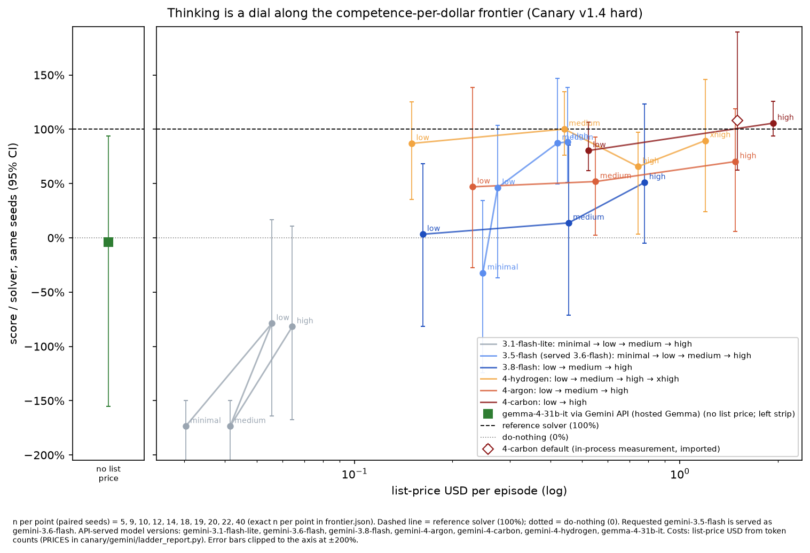

# Gemini Ladder (Canary v1.4)

> **Headline findings** (auto-generated from the table below: 9–40 paired seeds per cell; 95% CIs are wide, so read them as directions).
>
> **gemini-3.5-flash (requested ID; the API serves gemini-3.6-flash) with medium or high thinking is not distinguishable from the reference solver on hard, but the CIs are wide:** 87% [50%, 147%] and 88% [51%, 138%] of the solver on the same seeds (n=40, 40), 73/80 correct accusations, $0.42–0.45 per episode, versus $1.93 for gemini-4-carbon at high thinking (106% [94%, 126%], n=10; different n, so the seed sets differ).
>
> **gemini-3.1-flash-lite fails at every thinking level:** its mean score is below the do-nothing score (0) in 8/8 (level, tier) cells; at minimal thinking it accused the wrong employee in 19/20 episodes.
>
> **gemini-3.8-flash gains from thinking on medium** (-2% [-77%, 62%] at low → 69% [33%, 97%] at high); on hard 3% [-82%, 68%] → 51% [-5%, 123%]. Pooled over the flash models, low → high thinking changes premature-accusation regret by -0.16/episode on medium, -0.22/episode on hard; uninformative-canary regret goes 0.003 → 0.001 on medium, 0.013 → 0.025 on hard (thinking buys commit timing more than experiment design).

Hard tier. Medium tier: [frontier_medium.png](frontier_medium.png). Points and n: frontier.json.

Generated 2026-11-15T03:51:32+0200 at git `007802f532` from `~/agent-arena-data/gemini/ladder/ladder-v14, ~/agent-arena-data/gemini/scale/ladder30`. 587 valid Gemini episodes in 42 cells; ledger: 36164 calls, 618 run ids, list price $298.75.

Every cell is one (model, thinking level, tier) played by the in-process `LLMPolicy` (full history, thought-signature replay) through `canary.agents.play`, the frontier measurement's own runner, on v1.4 dev seeds. The solver and baselines are replayed on exactly the same worlds. **ratio** = mean score / solver's mean on the same seeds, with a paired bootstrap 95% CI over seeds; **luck-adj.** scores each accusation as P·V − (1−P) under the solver's exact posterior at that step.

## medium

| model | thinking | n | score ± 95% CI | acc. | accuse day | solver, same seeds | **score / solver [95% CI]** | paired diff ± CI | luck-adj. / solver | thinking tok/ep | calls/ep | $/ep | min/ep |
|---|---|---|---|---|---|---|---|---|---|---|---|---|---|
| gemini-3.1-flash-lite | minimal | 10 | -0.805 ± 0.38 | 0.10 | 5.0 | +0.730 | **-110% [-153%, -53%]** | -1.535 ± 0.37 | -116% [-130%, -105%] | 0 | 39 | 0.03 | 0.6 |
| gemini-3.1-flash-lite | low | 10 | -0.243 ± 0.61 | 0.40 | 5.0 | +0.730 | **-33% [-110%, 48%]** | -0.973 ± 0.62 | -63% [-111%, 5%] | 4,290 | 30 | 0.04 | 1.3 |
| gemini-3.1-flash-lite | medium | 10 | -0.656 ± 0.45 | 0.20 | 5.5 | +0.730 | **-90% [-133%, -22%]** | -1.386 ± 0.51 | -122% [-136%, -110%] | 1,686 | 40 | 0.06 | 1.4 |
| gemini-3.1-flash-lite | high | 10 | -0.640 ± 0.47 | 0.20 | 7.4 | +0.730 | **-88% [-129%, -16%]** | -1.370 ± 0.55 | -91% [-108%, -71%] | 5,544 | 37 | 0.06 | 3.3 |
| gemini-3.6-flash (requested as 3.5-flash) | minimal | 10 | +0.532 ± 0.34 | 0.90 | 8.9 | +0.730 | **73% [22%, 108%]** | -0.198 ± 0.35 | 51% [3%, 95%] | 0 | 37 | 0.12 | 0.8 |
| gemini-3.6-flash (requested as 3.5-flash) | low | 10 | +0.021 ± 0.55 | 0.60 | 10.9 | +0.730 | **3% [-69%, 73%]** | -0.709 ± 0.56 | 8% [-43%, 61%] | 7,269 | 50 | 0.27 | 4.7 |
| gemini-3.6-flash (requested as 3.5-flash) | medium | 20 | +0.635 ± 0.18 | 0.95 | 8.5 | +0.717 | **89% [60%, 109%]** | -0.082 ± 0.19 | 63% [22%, 96%] | 15,033 | 48 | 0.29 | 3.3 |
| gemini-3.6-flash (requested as 3.5-flash) | high | 20 | +0.538 ± 0.24 | 0.90 | 8.9 | +0.717 | **75% [39%, 104%]** | -0.179 ± 0.24 | 58% [22%, 91%] | 21,513 | 58 | 0.39 | 4.4 |
| gemini-3.8-flash | low | 10 | -0.012 ± 0.53 | 0.60 | 9.3 | +0.730 | **-2% [-77%, 62%]** | -0.742 ± 0.49 | 1% [-39%, 41%] | 0 | 58 | 0.12 | 2.0 |
| gemini-3.8-flash | medium | 10 | +0.473 ± 0.33 | 0.90 | 12.4 | +0.730 | **65% [18%, 93%]** | -0.257 ± 0.32 | -1% [-57%, 50%] | 33,837 | 75 | 0.55 | 11.1 |
| gemini-3.8-flash | high | 20 | +0.496 ± 0.23 | 0.90 | 10.9 | +0.717 | **69% [33%, 97%]** | -0.221 ± 0.24 | 46% [11%, 77%] | 45,240 | 73 | 0.62 | 11.5 |
| gemini-4-hydrogen | low | 13 | +0.575 ± 0.18 | 0.77 | 7.9 | +0.740 | **78% [51%, 104%]** | -0.165 ± 0.22 | 17% [-27%, 62%] | 2,932 | 30 | 0.15 | 3.1 |
| gemini-4-hydrogen | medium | 9 | +0.439 ± 0.39 | 0.78 | 8.4 | +0.720 | **61% [5%, 102%]** | -0.281 ± 0.40 | 46% [3%, 89%] | 11,352 | 63 | 0.39 | 6.0 |
| gemini-4-hydrogen | high | 10 | +0.682 ± 0.08 | 1.00 | 8.6 | +0.732 | **93% [84%, 103%]** | -0.050 ± 0.07 | 75% [34%, 102%] | 22,876 | 82 | 0.63 | 8.9 |
| gemini-4-hydrogen | xhigh | 10 | +0.642 ± 0.15 | 0.90 | 8.4 | +0.715 | **90% [74%, 102%]** | -0.073 ± 0.10 | 74% [42%, 96%] | 61,838 | 89 | 1.14 | 14.2 |
| gemini-4-argon | low | 21 | +0.701 ± 0.05 | 1.00 | 8.3 | +0.683 | **103% [90%, 121%]** | +0.019 ± 0.11 | 71% [34%, 106%] | 0 | 25 | 0.15 | 5.5 |
| gemini-4-argon | medium | 21 | +0.633 ± 0.08 | 0.95 | 9.1 | +0.683 | **93% [79%, 110%]** | -0.050 ± 0.11 | 80% [54%, 105%] | 8,424 | 30 | 0.30 | 8.9 |
| gemini-4-argon | high | 14 | +0.479 ± 0.33 | 0.86 | 9.1 | +0.736 | **65% [16%, 103%]** | -0.257 ± 0.34 | 61% [18%, 99%] | 33,560 | 87 | 1.05 | 28.8 |
| gemini-4-carbon | low | 10 | +0.629 ± 0.10 | 1.00 | 9.1 | +0.730 | **86% [71%, 107%]** | -0.101 ± 0.15 | 81% [59%, 106%] | 530 | 65 | 0.39 | 39.2 |
| gemini-4-carbon | high | 10 | +0.639 ± 0.16 | 0.90 | 8.4 | +0.730 | **88% [72%, 99%]** | -0.091 ± 0.10 | 66% [24%, 97%] | 50,290 | 88 | 1.47 | 65.5 |
| gemini-4-carbon (imported†) | default | 15 | +0.558 ± 0.15 | 0.80 | 8.7 | +0.712 | **78% [55%, 100%]** | -0.154 ± 0.18 | 70% [45%, 96%] | 36,812* | 95 | 1.14 | – |

Reference on the union of these seeds: solver +0.652 ± 0.10 (n=22, acc 0.91); grok_tactics +0.527 ± 0.14 (n=22, acc 0.77); heuristic -0.266 ± 0.34 (n=22, acc 0.45); do_nothing +0.000 ± 0.00 (n=22, acc 0.00)

## hard

| model | thinking | n | score ± 95% CI | acc. | accuse day | solver, same seeds | **score / solver [95% CI]** | paired diff ± CI | luck-adj. / solver | thinking tok/ep | calls/ep | $/ep | min/ep |
|---|---|---|---|---|---|---|---|---|---|---|---|---|---|
| gemini-3.1-flash-lite | minimal | 10 | -1.000 ± 0.00 | 0.00 | 4.4 | +0.576 | **-174% [-215%, -150%]** | -1.576 ± 0.11 | -166% [-214%, -134%] | 0 | 34 | 0.03 | 0.5 |
| gemini-3.1-flash-lite | low | 10 | -0.454 ± 0.54 | 0.30 | 6.9 | +0.576 | **-79% [-164%, 17%]** | -1.030 ± 0.56 | -142% [-174%, -119%] | 5,543 | 34 | 0.06 | 1.6 |
| gemini-3.1-flash-lite | medium | 10 | -1.000 ± 0.00 | 0.00 | 5.1 | +0.576 | **-174% [-215%, -150%]** | -1.576 ± 0.11 | -145% [-179%, -113%] | 1,666 | 34 | 0.04 | 1.9 |
| gemini-3.1-flash-lite | high | 10 | -0.471 ± 0.53 | 0.30 | 6.7 | +0.576 | **-82% [-167%, 11%]** | -1.047 ± 0.54 | -67% [-150%, 20%] | 5,679 | 39 | 0.06 | 3.4 |
| gemini-3.6-flash (requested as 3.5-flash) | minimal | 10 | -0.186 ± 0.44 | 0.60 | 13.7 | +0.576 | **-32% [-124%, 34%]** | -0.762 ± 0.38 | -23% [-100%, 35%] | 0 | 73 | 0.25 | 1.9 |
| gemini-3.6-flash (requested as 3.5-flash) | low | 10 | +0.266 ± 0.42 | 0.80 | 11.6 | +0.576 | **46% [-37%, 104%]** | -0.310 ± 0.39 | 22% [-48%, 83%] | 8,531 | 49 | 0.28 | 4.3 |
| gemini-3.6-flash (requested as 3.5-flash) | medium | 40 | +0.385 ± 0.13 | 0.93 | 12.7 | +0.441 | **87% [50%, 147%]** | -0.056 ± 0.21 | 19% [-17%, 55%] | 20,275 | 64 | 0.42 | 5.0 |
| gemini-3.6-flash (requested as 3.5-flash) | high | 40 | +0.390 ± 0.15 | 0.90 | 11.8 | +0.441 | **88% [51%, 138%]** | -0.051 ± 0.19 | 43% [11%, 70%] | 26,775 | 60 | 0.45 | 5.3 |
| gemini-3.8-flash | low | 10 | +0.019 ± 0.45 | 0.70 | 11.5 | +0.576 | **3% [-82%, 68%]** | -0.557 ± 0.43 | 44% [9%, 78%] | 0 | 65 | 0.16 | 2.3 |
| gemini-3.8-flash | medium | 10 | +0.079 ± 0.47 | 0.70 | 13.5 | +0.576 | **14% [-71%, 85%]** | -0.497 ± 0.47 | 53% [16%, 91%] | 28,300 | 63 | 0.45 | 9.6 |
| gemini-3.8-flash | high | 20 | +0.237 ± 0.24 | 0.80 | 15.9 | +0.464 | **51% [-5%, 123%]** | -0.227 ± 0.32 | 25% [-20%, 70%] | 50,732 | 83 | 0.78 | 12.5 |
| gemini-4-hydrogen | low | 12 | +0.478 ± 0.27 | 0.92 | 11.4 | +0.549 | **87% [35%, 125%]** | -0.072 ± 0.25 | -17% [-88%, 47%] | 3,537 | 27 | 0.15 | 3.1 |
| gemini-4-hydrogen | medium | 10 | +0.525 ± 0.09 | 1.00 | 11.9 | +0.524 | **100% [76%, 134%]** | +0.001 ± 0.15 | 45% [-14%, 101%] | 16,061 | 56 | 0.44 | 6.8 |
| gemini-4-hydrogen | high | 9 | +0.394 ± 0.35 | 0.89 | 10.9 | +0.601 | **66% [3%, 97%]** | -0.207 ± 0.27 | 89% [74%, 109%] | 34,275 | 77 | 0.74 | 8.0 |
| gemini-4-hydrogen | xhigh | 10 | +0.475 ± 0.32 | 0.90 | 9.0 | +0.530 | **90% [24%, 146%]** | -0.055 ± 0.33 | 128% [100%, 176%] | 66,948 | 85 | 1.20 | 13.4 |
| gemini-4-argon | low | 18 | +0.205 ± 0.31 | 0.78 | 11.9 | +0.436 | **47% [-28%, 138%]** | -0.231 ± 0.37 | 56% [7%, 94%] | 11 | 34 | 0.23 | 8.4 |
| gemini-4-argon | medium | 19 | +0.291 ± 0.27 | 0.84 | 14.0 | +0.561 | **52% [2%, 93%]** | -0.270 ± 0.26 | 36% [-4%, 75%] | 12,073 | 48 | 0.55 | 14.8 |
| gemini-4-argon | high | 14 | +0.373 ± 0.31 | 0.86 | 12.5 | +0.531 | **70% [6%, 119%]** | -0.158 ± 0.31 | 52% [8%, 88%] | 42,162 | 114 | 1.48 | 36.5 |
| gemini-4-carbon | low | 10 | +0.463 ± 0.09 | 1.00 | 11.7 | +0.576 | **80% [62%, 107%]** | -0.113 ± 0.14 | 75% [56%, 104%] | 289 | 76 | 0.52 | 55.1 |
| gemini-4-carbon | high | 10 | +0.608 ± 0.10 | 1.00 | 10.8 | +0.576 | **106% [94%, 126%]** | +0.032 ± 0.09 | 80% [45%, 111%] | 63,171 | 107 | 1.93 | 72.1 |
| gemini-4-carbon (imported†) | default | 22 | +0.493 ± 0.15 | 0.95 | 12.0 | +0.457 | **108% [62%, 189%]** | +0.036 ± 0.24 | 98% [75%, 123%] | 48,351* | 103 | 1.50 | – |

Reference on the union of these seeds: solver +0.441 ± 0.14 (n=40, acc 0.90); grok_tactics +0.380 ± 0.10 (n=40, acc 0.88); heuristic +0.134 ± 0.15 (n=40, acc 0.85); do_nothing +0.000 ± 0.00 (n=40, acc 0.00)

Provenance: tiers v1.4, v1.4 (imported dir); launch commits 035105e9e1, 0e9d85ae2a, 107c485, 2786c00, 498bccdea8, 7cb16dc305, 8fa04b3391, 92f3b27c9b, e9f58b4580; code fingerprints (env/harness/client files) 06ea9b6a0f68d1dc, 1f370abe3bf74f77, None, e8cbe51acbfbc5a3; API-served model versions gemini-3.1-flash-lite, gemini-3.6-flash, gemini-3.8-flash, gemini-4-argon, gemini-4-carbon, gemini-4-hydrogen.

\* imported cell: output tokens incl. thinking (the measurement's usage does not split thinking out).
† imported read-only from the AfterQuery measurement (branch justSilas-gemini); not rerun by the ladder.

## Which mistakes does thinking fix?

Solver regret per episode by failure tag (`canary.solver.regret.attribute`), pooled over the models that ran low, medium and high: gemini-3.1-flash-lite, gemini-3.6-flash (requested as 3.5-flash), gemini-3.8-flash, gemini-4-argon, gemini-4-hydrogen. Δ = high − low (negative = thinking fixes it).

**medium**

| tag | low (n=64) | medium (n=70) | high (n=74) | Δ high−low |
|---|---|---|---|---|
| ignored_delay | 0.000 (0% eps) | 0.000 (0% eps) | 0.017 (3% eps) | +0.017 |
| other:accuse | 0.017 (5% eps) | 0.000 (0% eps) | 0.000 (0% eps) | -0.017 |
| other:advance_day | 0.000 (2% eps) | 0.000 (0% eps) | 0.000 (0% eps) | -0.000 |
| other:plant_canary | 0.028 (84% eps) | 0.024 (87% eps) | 0.023 (85% eps) | -0.005 |
| other:restrict_access | 0.006 (5% eps) | 0.002 (3% eps) | 0.006 (7% eps) | +0.001 |
| over_restriction | 0.003 (3% eps) | 0.002 (3% eps) | 0.004 (4% eps) | +0.001 |
| premature_accusation | 0.447 (42% eps) | 0.363 (36% eps) | 0.287 (34% eps) | -0.160 |
| uninformative_canary | 0.003 (8% eps) | 0.001 (4% eps) | 0.001 (3% eps) | -0.002 |

**hard**

| tag | low (n=60) | medium (n=89) | high (n=93) | Δ high−low |
|---|---|---|---|---|
| ignored_delay | 0.000 (0% eps) | 0.005 (1% eps) | 0.008 (1% eps) | +0.008 |
| other:accuse | 0.047 (45% eps) | 0.035 (44% eps) | 0.060 (53% eps) | +0.013 |
| other:advance_day | 0.000 (0% eps) | 0.000 (3% eps) | 0.001 (3% eps) | +0.001 |
| other:plant_canary | 0.056 (97% eps) | 0.045 (93% eps) | 0.047 (97% eps) | -0.010 |
| other:restrict_access | 0.010 (8% eps) | 0.000 (1% eps) | 0.005 (4% eps) | -0.005 |
| over_restriction | 0.015 (7% eps) | 0.000 (0% eps) | 0.005 (3% eps) | -0.009 |
| premature_accusation | 0.470 (43% eps) | 0.396 (38% eps) | 0.247 (27% eps) | -0.223 |
| uninformative_canary | 0.013 (27% eps) | 0.019 (29% eps) | 0.025 (29% eps) | +0.011 |

## Open-weight Gemma (hosted Gemma via the Gemini API)

Gemma 4 open-weight models served by Google's hosted Gemini API (not self-hosted), played by the same `LLMPolicy` with native function calling on the same v1.4 dev seeds; ratios are paired against the solver on the same seeds. Gemma gets no thinking config (level `default`). 5 valid episodes from `~/agent-arena-data/gemini/ladder/gemma-v14`; ledger: 332 calls, 12 errors, 14 run ids (e.g. ladder:gemma-v14:gemma-4-26b-a4b-it/default/hard/0, ladder:gemma-v14:gemma-4-26b-a4b-it/default/hard/1). $/ep is not shown: our price table has no hosted-Gemma list price.

**hard**

| model | n | score ± 95% CI | acc. | accuse day | solver, same seeds | **score / solver [95% CI]** | paired diff ± CI | luck-adj. / solver | calls/ep | min/ep |
|---|---|---|---|---|---|---|---|---|---|---|
| gemma-4-31b-it via Gemini API (hosted Gemma) | 5 | -0.024 ± 0.78 | 0.60 | 10.4 | +0.592 | **-4% [-155%, 94%]** | -0.616 ± 0.69 | -153% [-233%, -122%] | 21 | 16.8 |

Gemma provenance: launch commits 2afea55f07, bb65032bc1; code fingerprints 1f370abe3bf74f77; API-served model versions gemma-4-31b-it.

## Thinking levels each model accepts (probe)

| model | accepted thinking_level |
|---|---|
| gemini-3.1-flash-lite | minimal, low, medium, high |
| gemini-3.6-flash (requested as 3.5-flash) | minimal, low, medium, high |
| gemini-3.8-flash | low, medium, high |
| gemini-4-hydrogen | low, medium, high, xhigh |
| gemini-4-argon | low, medium, high |
| gemini-4-carbon | low, medium, high |

Figures: frontier_medium.png, frontier.png, ladder_heatmap.png, ladder_curve.png, ladder_cost.png, ladder_tags.png. Data: ladder.json (rows, tags, ledger run ids).
