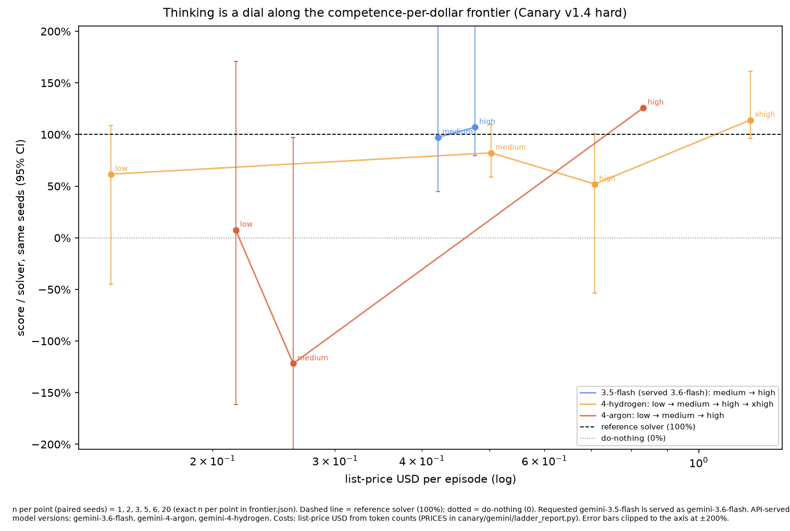

# Gemini Ladder (Canary v1.4)

> **Headline findings** (auto-generated from the table below: 1–20 paired seeds per cell; 95% CIs are wide, so read them as directions).
>
> **gemini-3.6-flash (requested as 3.5-flash) with medium or high thinking on hard is within the CI of the solver, n=20:** 97% [45%, 288%] and 107% [79%, 213%] of the solver on the same seeds, 38/40 correct accusations, $0.42–0.48 per episode.

Hard tier. Medium tier: [frontier_medium.png](frontier_medium.png). Points and n: frontier.json.

Generated 2026-11-15T03:05:17+0200 at git `92f3b27c9b` from `~/agent-arena-data/gemini/scale/ladder30`. 101 valid Gemini episodes in 16 cells; ledger: 7416 calls, 131 run ids, list price $64.39.

Every cell is one (model, thinking level, tier) played by the in-process `LLMPolicy` (full history, thought-signature replay) through `canary.agents.play`, the frontier measurement's own runner, on v1.4 dev seeds. The solver and baselines are replayed on exactly the same worlds. **ratio** = mean score / solver's mean on the same seeds, with a paired bootstrap 95% CI over seeds; **luck-adj.** scores each accusation as P·V − (1−P) under the solver's exact posterior at that step.

## medium

| model | thinking | n | score ± 95% CI | acc. | accuse day | solver, same seeds | **score / solver [95% CI]** | paired diff ± CI | luck-adj. / solver | thinking tok/ep | calls/ep | $/ep | min/ep |
|---|---|---|---|---|---|---|---|---|---|---|---|---|---|
| gemini-4-hydrogen | low | 6 | +0.710 ± 0.08 | 1.00 | 8.2 | +0.668 | **106% [89%, 133%]** | +0.042 ± 0.15 | 29% [-40%, 105%] | 2,559 | 26 | 0.13 | 1.5 |
| gemini-4-hydrogen | medium | 5 | +0.224 ± 0.66 | 0.60 | 9.2 | +0.644 | **35% [-60%, 119%]** | -0.420 ± 0.73 | 60% [5%, 119%] | 12,953 | 70 | 0.44 | 5.3 |
| gemini-4-hydrogen | high | 5 | +0.664 ± 0.13 | 1.00 | 8.4 | +0.644 | **103% [90%, 116%]** | +0.020 ± 0.09 | 103% [90%, 116%] | 21,868 | 80 | 0.60 | 5.9 |
| gemini-4-hydrogen | xhigh | 5 | +0.588 ± 0.29 | 0.80 | 7.5 | +0.644 | **91% [55%, 112%]** | -0.056 ± 0.18 | 56% [-5%, 104%] | 64,668 | 88 | 1.19 | 11.1 |
| gemini-4-argon | low | 4 | +0.660 ± 0.10 | 1.00 | 10.5 | +0.748 | **88% [79%, 105%]** | -0.087 ± 0.12 | 43% [-55%, 102%] | 0 | 19 | 0.13 | 2.9 |
| gemini-4-argon | medium | 4 | +0.720 ± 0.07 | 1.00 | 8.0 | +0.748 | **96% [89%, 105%]** | -0.027 ± 0.07 | 96% [89%, 105%] | 6,215 | 18 | 0.19 | 4.5 |
| gemini-4-argon | high | 3 | +0.757 ± 0.10 | 1.00 | 7.3 | +0.767 | **99% [79%, 124%]** | -0.010 ± 0.19 | 99% [79%, 124%] | 30,780 | 65 | 0.79 | 20.7 |

Reference on the union of these seeds: solver +0.700 ± 0.08 (n=10, acc 1.00); grok_tactics +0.495 ± 0.18 (n=10, acc 0.80); heuristic -0.361 ± 0.51 (n=10, acc 0.40); do_nothing +0.000 ± 0.00 (n=10, acc 0.00)

## hard

| model | thinking | n | score ± 95% CI | acc. | accuse day | solver, same seeds | **score / solver [95% CI]** | paired diff ± CI | luck-adj. / solver | thinking tok/ep | calls/ep | $/ep | min/ep |
|---|---|---|---|---|---|---|---|---|---|---|---|---|---|
| gemini-3.6-flash (requested as 3.5-flash) | medium | 20 | +0.407 ± 0.16 | 0.95 | 13.0 | +0.417 | **97% [45%, 288%]** | -0.011 ± 0.32 | -11% [-64%, 45%] | 20,400 | 65 | 0.42 | 5.0 |
| gemini-3.6-flash (requested as 3.5-flash) | high | 20 | +0.447 ± 0.16 | 0.95 | 12.2 | +0.417 | **107% [79%, 213%]** | +0.030 ± 0.17 | 43% [-5%, 80%] | 27,004 | 64 | 0.48 | 5.6 |
| gemini-4-hydrogen | low | 6 | +0.353 ± 0.54 | 0.83 | 11.2 | +0.573 | **62% [-45%, 109%]** | -0.220 ± 0.42 | 2% [-115%, 74%] | 3,400 | 26 | 0.14 | 1.8 |
| gemini-4-hydrogen | medium | 6 | +0.472 ± 0.13 | 1.00 | 13.2 | +0.573 | **82% [59%, 110%]** | -0.102 ± 0.16 | 27% [-44%, 109%] | 16,702 | 66 | 0.50 | 5.4 |
| gemini-4-hydrogen | high | 6 | +0.298 ± 0.52 | 0.83 | 11.7 | +0.573 | **52% [-54%, 101%]** | -0.275 ± 0.41 | 93% [71%, 123%] | 32,944 | 72 | 0.71 | 6.4 |
| gemini-4-hydrogen | xhigh | 5 | +0.666 ± 0.06 | 1.00 | 8.8 | +0.584 | **114% [96%, 161%]** | +0.082 ± 0.17 | 114% [96%, 166%] | 66,007 | 88 | 1.19 | 10.5 |
| gemini-4-argon | low | 3 | +0.037 ± 1.02 | 0.67 | 11.0 | +0.480 | **8% [-161%, 171%]** | -0.443 ± 1.16 | 123% [64%, 197%] | 0 | 31 | 0.22 | 8.7 |
| gemini-4-argon | medium | 2 | -0.335 ± 1.30 | 0.50 | 15.5 | +0.275 | **-122% [-476%, 97%]** | -0.610 ± 1.18 | -60% [-191%, 212%] | 0 | 36 | 0.26 | 5.5 |
| gemini-4-argon | high | 1 | +0.780 ± 0.00 | 1.00 | 8.0 | +0.620 | **126%** | +0.160 ± 0.00 | 107% | 24,779 | 81 | 0.83 | 23.8 |

Reference on the union of these seeds: solver +0.448 ± 0.16 (n=30, acc 0.90); grok_tactics +0.385 ± 0.13 (n=30, acc 0.87); heuristic +0.076 ± 0.18 (n=30, acc 0.83); do_nothing +0.000 ± 0.00 (n=30, acc 0.00)

Provenance: tiers v1.4; launch commits 92f3b27c9b; code fingerprints (env/harness/client files) e8cbe51acbfbc5a3; API-served model versions gemini-3.6-flash, gemini-4-argon, gemini-4-hydrogen.

\* imported cell: output tokens incl. thinking (the measurement's usage does not split thinking out).
† imported read-only from the AfterQuery measurement (branch justSilas-gemini); not rerun by the ladder.

## Which mistakes does thinking fix?

Solver regret per episode by failure tag (`canary.solver.regret.attribute`), pooled over the models that ran low, medium and high: gemini-4-argon, gemini-4-hydrogen. Δ = high − low (negative = thinking fixes it).

**medium**

| tag | low (n=10) | medium (n=9) | high (n=8) | Δ high−low |
|---|---|---|---|---|
| other:accuse | 0.005 (10% eps) | 0.000 (0% eps) | 0.000 (0% eps) | -0.005 |
| other:advance_day | 0.002 (10% eps) | 0.000 (0% eps) | 0.000 (0% eps) | -0.002 |
| other:plant_canary | 0.020 (90% eps) | 0.015 (89% eps) | 0.015 (100% eps) | -0.004 |
| other:restrict_access | 0.020 (10% eps) | 0.000 (0% eps) | 0.021 (12% eps) | +0.001 |
| premature_accusation | 0.365 (40% eps) | 0.015 (11% eps) | 0.000 (0% eps) | -0.365 |

**hard**

| tag | low (n=9) | medium (n=8) | high (n=7) | Δ high−low |
|---|---|---|---|---|
| other:accuse | 0.040 (56% eps) | 0.020 (38% eps) | 0.048 (71% eps) | +0.008 |
| other:advance_day | 0.000 (0% eps) | 0.001 (12% eps) | 0.000 (0% eps) | +0.000 |
| other:plant_canary | 0.029 (89% eps) | 0.037 (100% eps) | 0.046 (86% eps) | +0.017 |
| other:restrict_access | 0.000 (0% eps) | 0.000 (12% eps) | 0.001 (14% eps) | +0.001 |
| premature_accusation | 0.290 (33% eps) | 0.310 (38% eps) | 0.000 (0% eps) | -0.290 |
| uninformative_canary | 0.004 (22% eps) | 0.000 (0% eps) | 0.004 (14% eps) | +0.001 |

## Thinking levels each model accepts (probe)

| model | accepted thinking_level |
|---|---|
| gemini-3.1-flash-lite | minimal, low, medium, high |
| gemini-3.6-flash (requested as 3.5-flash) | minimal, low, medium, high |
| gemini-3.8-flash | low, medium, high |
| gemini-4-hydrogen | low, medium, high, xhigh |
| gemini-4-argon | low, medium, high |
| gemini-4-carbon | low, medium, high |

Figures: frontier_medium.png, frontier.png, ladder_heatmap.png, ladder_curve.png, ladder_cost.png, ladder_tags.png. Data: ladder.json (rows, tags, ledger run ids).
