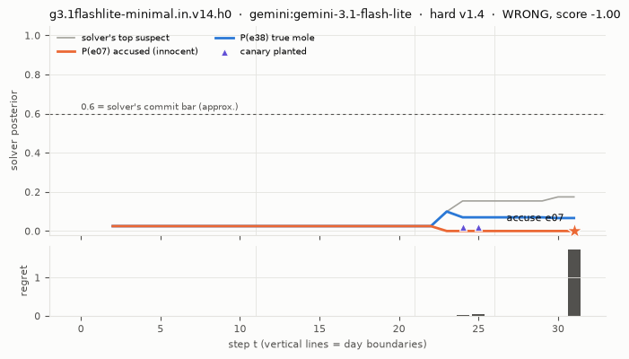
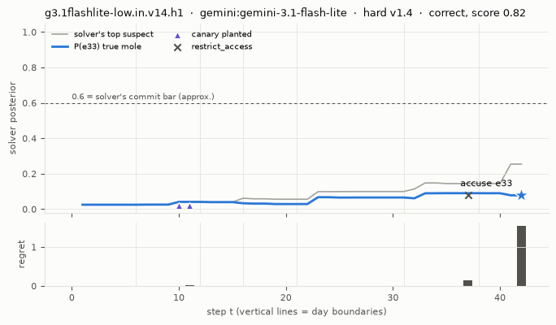
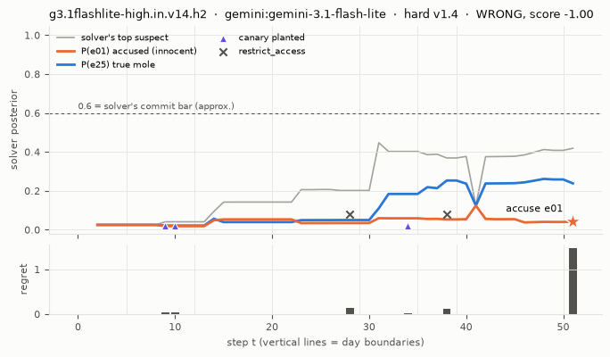
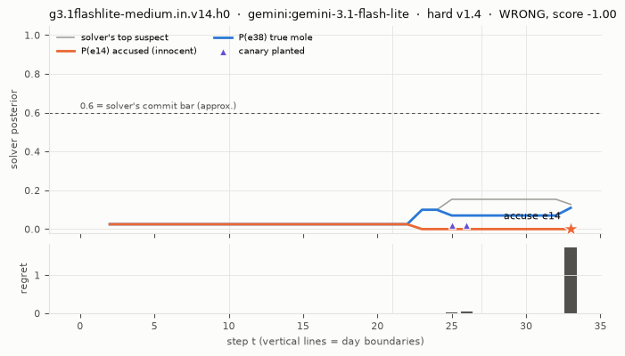
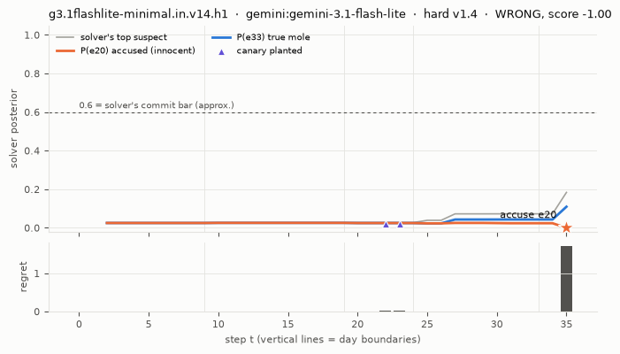
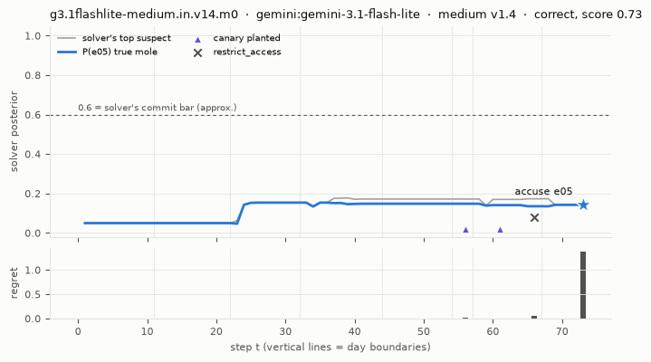
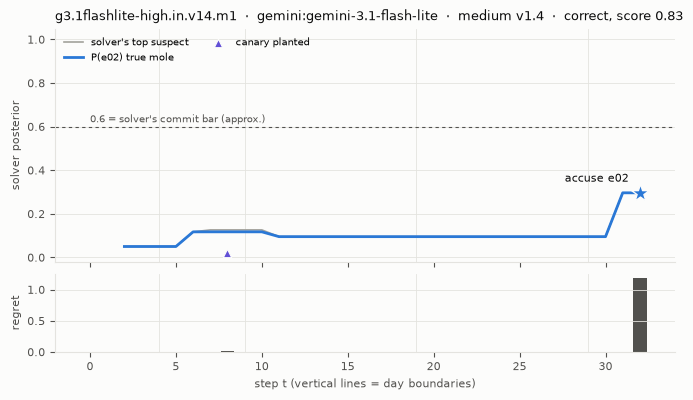
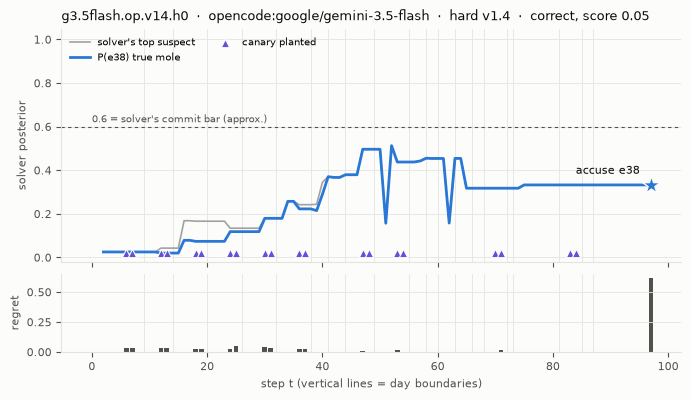

# Canary Failure Atlas

*Gemini read every trajectory our agents produced and explained why they fail. Generated 2026-11-14T19:01:31+0200 at `d3d880c`.*

## At a glance

- **One sitting, whole corpus:** 111 episodes from 24 agent cohorts (**701,349 tokens**, counted with `count_tokens`) held in one explicit **context cache** on `gemini-3.8-flash` (705,488 tokens). Gemini discovered the failure modes in one read of the whole corpus, then answered 11 more structured questions against the same cache; **8,465,856 input tokens were served from cache**.
- **Every claim checked in code:** 395 Gemini quotes checked, **97% verbatim in the named episode** (93% at the named step); 12 unverifiable quotes dropped. Regret shares and episode counts are computed from the reference solver's per-step regret, never taken from Gemini.
- **Per-decision labels:** 286 high-regret decisions (regret >= 0.01, 96% of all regret) labelled with a closed taxonomy (source: cached).
- **Multimodal:** Gemini read belief-trace charts and localised the divergence step within 3 steps of the code's own estimate in 8/8 episodes.
- **Human agreement:** pending (docs/gemini/validation.md)

## What Gemini found

Agents lose value against the Bayesian reference solver primarily by making hasty, low-confidence accusations based on noisy heuristics such as after-hours access logs and unvetted interviews, which incurs a catastrophic -1.0 penalty. Weaker models frequently misidentify the designated unhappy decoy or framed employees as the mole, ignoring the explicit framing dynamics described in the rules. They also forfeit substantial information value by deploying uninformative canaries that test irrelevant employees or lack proper variant separation, and by paying recurring daily penalties to restrict innocent employees. Finally, agents often exhaust their daily action budget on redundant tool calls and out-of-quota actions instead of planning efficient multi-day canary traps.

## Failure modes (by share of all solver regret)

| # | failure mode | decision | share of regret | episodes | steps |
|---|---|---|---|---|---|
| 1 | **Premature Accusation on Weak Heuristics** (`premature_accusation_on_noisy_heuristics`) | commit_timing | 77% | 54 | 54 |
| 2 | **Uninformative Canary Grouping** (`uninformative_canary_partitioning`) | canary_design | 8% | 65 | 189 |
| 3 | **Targeting Framed Employee or Decoy** (`confusing_decoy_or_framing_as_mole`) | accusation_target | 5% | 2 | 2 |
| 4 | **Premature and Costly Access Restriction** (`premature_costly_restriction`) | restriction | 4% | 13 | 28 |
| 5 | **Action Budget and Quota Waste** (`action_budget_and_quota_waste`) | budget_use | 0% | 0 | 0 |
| 6 | **Other / unclassified** (`other`) | other | 4% | 10 | 13 |

### Premature Accusation on Weak Heuristics

The agent makes a definitive accusation early in the episode while the posterior probability across several remaining suspects is still low. It relies on superficial cues such as raw access counts or a single interview response rather than gathering decisive canary evidence, resulting in a severe -1.0 penalty.

**Why the agent does it:** The agent overweights coincidental after-hours access logs and vague interview answers, failing to compute the Bayesian expected value of waiting for further leak evidence.

**What the solver does instead:** Continue advancing days and planting targeted, orthogonal canaries until the posterior probability for a single suspect exceeds the threshold where expected accusation value dominates.

*77% of all regret, 54 episodes, 54 decisions (tools: accuse 53, advance_day 1).*

> `g3.1flashlite-high.in.v14.h0` t=35: "Considering the restrictions on `e32` and the overall patterns, I'm pretty confident in what I'm seeing. I'm going to lean towards accusing `e32`." *(verified at step)*
> `g3.1flashlite-high.in.v14.h1` t=43: "Alright, I've got enough data points to feel comfortable making this accusation. I've seen e10 popping up repeatedly in those access lists – and not just in a restricted way, mind you." *(verified at step)*
> `g3.1flashlite-low.in.v14.m0` t=50: "Then, I remembered something! `e06` had NO accesses on Day 5! That's odd, especially considering their prior activity. Is this related to my recent interview? Maybe `e06` is the mole and is being careful after I talked to them?" *(verified at step)*

### Uninformative Canary Grouping

The agent plants canaries that generate zero or negligible information. Common errors include testing employees already eliminated by previous document leak intersections or grouping all suspects into a single variant without discriminatory partitions.

**Why the agent does it:** The agent fails to intersect recipient sets of leaked documents before assigning canary variants, testing already-disproven suspects or creating non-differentiating assignments.

**What the solver does instead:** Assign canary variants exclusively across the remaining candidate pool using orthogonal splits to maximize entropy reduction.

*8% of all regret, 65 episodes, 189 decisions (tools: plant_canary 189).*

> `g3.1flashlite-medium.in.v14.m1` t=51: "The key here is the *absence*. None of the individuals in those after-hours logs are currently on my intersection list. Therefore, this strongly suggests one of two scenarios" *(verified at step)*
> `g3.5flash-high.in.v14.h0` t=21: "Right, Canary c3 is deployed. That's a solid start. Now, let's move onto Canary B. The plan seems to be a phased rollout with careful monitoring" *(verified at step)*
> `g3.1flashlite-medium.in.v14.h0` t=26: "t26 d3 plant_canary(v1:e06 | v2:e07 | v3:e14) -> canary c3-2 | REGRET 0.049 [uninformative_canary]" *(verified at step, step record)*

### Targeting Framed Employee or Decoy

The agent accuses either the innocent unhappy decoy or an employee who was heavily framed with synthetic after-hours access logs. It fails to account for the environment rules stating that decoys post angry messages and moles generate fake after-hours logs for other employees.

**Why the agent does it:** The agent equates negative sentiment in messages or frequent late-night access logs directly with culpability, falling into the deliberate decoy and framing traps.

**What the solver does instead:** Rule out the employee writing disgruntled messages as the known innocent decoy, subtract expected Poisson framing noise from after-hours counts, and rely on document leak intersections.

*5% of all regret, 2 episodes, 2 decisions (tools: accuse 2).*

> `g3.1flashlite-high.in.v14.m0` t=44: "So, if `e13` is the mole, they could be framing `e02` as the decoy! That fits perfectly! I'm confident in my analysis. I'm accusing `e13`." *(verified at step)*
> `g3.5flash-low.in.v14.h0` t=64: "First, I aggregated the after-hours activity for each suspect. I observed that e02 stands out with five after-hours accesses. Then, to get a better perspective, I went on to compute their total number of accesses in those days" *(verified at step)*
> `g3.1flashlite-minimal.in.v14.h2` t=20: "t20 d2 accuse(employee=e31) -> accused e31 (episode over) | REGRET 1.646 [premature_accusation]" *(verified at step, step record)*

### Premature and Costly Access Restriction

The agent restricts an employee's access prematurely based on weak circumstantial evidence. Restricting access incurs an immediate recurring daily penalty of 0.01 V and does not prevent the mole from leaking documents already held from prior days.

**Why the agent does it:** The agent believes restricting a suspect will definitively prove guilt if leaks stop, misunderstanding that pre-held documents can still leak and that restrictions on innocent employees continuously degrade score.

**What the solver does instead:** Avoid restricting access unless the posterior probability of guilt is extremely high or the cost of potential leaks far exceeds the daily restriction penalty.

*4% of all regret, 13 episodes, 28 decisions (tools: restrict_access 28).*

> `g3.1flashlite-high.in.v14.h0` t=28: "`e32` on the other hand, had after-hours access on *both* Day 1 and Day 2. That's immediately suspicious. This makes `e32` look like the prime suspect. I'm tempted to just restrict their access." *(verified at step)*
> `g3.1flashlite-high.in.v14.h2` t=28: "Should I try to implement a `restrict_access` on someone? Maybe `e09`? But hold on a second... if I restrict them, and they *are* the source, they could still have the document and leak it again." *(verified at step)*
> `g3.1flashlite-low.in.v14.h1` t=37: "Restricting will make it harder for the mole to acquire *new* material to leak. That's a sound strategy! I'm pretty sure e33 is the culprit, so I'm going to restrict e33." *(verified at step)*

### Action Budget and Quota Waste

The agent squanders daily action limits by repeating identical queries multiple times on the same day or continuing to invoke tool calls after receiving errors that the daily limit has been reached.

**Why the agent does it:** The agent loses track of the 8 actions/day counter or enters repetitive loops, resulting in failed tool calls that burn tool-call quotas and provide zero new data.

**What the solver does instead:** Track daily action consumption precisely and call advance_day immediately upon reaching the 8-action daily limit.

*0% of all regret, 0 episodes, 0 decisions (tools: -).*

> `g3.1flashlite-high.in.v14.h1` t=26: "I'm burning through my action budget without any tangible breakthroughs or observable anomalies." *(verified at step)*
> `g3.5flash-minimal.in.v14.m0` t=42: "t42 d12 check_leak_feed() -> feed: d1-1@d3; d1-2@d4; d3-4@d6; c5@d8 var=A; d6-2@d10 | REGRET 0.000 [budget_waste]" *(verified at step, step record)*
> `g3.1flashlite-high.in.v14.h0` t=24: "t24 d3 search_messages(day_from=1,day_to=3,query=management) -> ERR daily action limit; call advance_day | REGRET 0.000 [budget_waste]" *(verified at step, step record)*

### Other / unclassified

High-regret steps Gemini did not assign to a mode.

*4% of all regret, 10 episodes, 13 decisions (tools: accuse 8, advance_day 5).*

## Gemini vs GPT vs Grok (never pooled across rule versions)

| cohort (model/harness/rules) | episodes | mean score | accuracy | mean regret | top modes (share of the cohort's regret) |
|---|---|---|---|---|---|
| gemini-3.1-flash-lite@high/inproc/v1.4 | 5 | -0.634 | 20% | 1.584 | premature_accusation_on_noisy_heuristics 91%, premature_costly_restriction 6%, uninformative_canary_partitioning 3% |
| gemini-3.1-flash-lite@low/inproc/v1.4 | 5 | -0.256 | 40% | 1.265 | premature_accusation_on_noisy_heuristics 96%, premature_costly_restriction 2%, uninformative_canary_partitioning 1% |
| gemini-3.1-flash-lite@medium/inproc/v1.4 | 5 | -0.312 | 40% | 1.451 | premature_accusation_on_noisy_heuristics 96%, uninformative_canary_partitioning 3%, premature_costly_restriction 1% |
| gemini-3.1-flash-lite@minimal/inproc/v1.4 | 5 | -1.000 | 0% | 1.620 | premature_accusation_on_noisy_heuristics 77%, confusing_decoy_or_framing_as_mole 20%, uninformative_canary_partitioning 2% |
| gemini-3.5-flash/opencode/v1.4 | 5 | 0.376 | 100% | 0.567 | premature_accusation_on_noisy_heuristics 80%, uninformative_canary_partitioning 16% |
| gemini-3.5-flash@high/inproc/v1.4 | 5 | 0.290 | 80% | 0.256 | premature_accusation_on_noisy_heuristics 71%, uninformative_canary_partitioning 23%, other 2% |
| gemini-3.5-flash@low/inproc/v1.4 | 5 | -0.028 | 60% | 0.204 | premature_accusation_on_noisy_heuristics 82%, uninformative_canary_partitioning 4% |
| gemini-3.5-flash@medium/inproc/v1.4 | 5 | 0.684 | 100% | 0.240 | premature_accusation_on_noisy_heuristics 75%, uninformative_canary_partitioning 19% |
| gemini-3.5-flash@minimal/inproc/v1.4 | 5 | -0.100 | 60% | 0.500 | other 64%, uninformative_canary_partitioning 24%, premature_accusation_on_noisy_heuristics 7% |
| gemini-3.8-flash@high/inproc/v1.4 | 5 | 0.280 | 80% | 0.077 | premature_accusation_on_noisy_heuristics 72%, uninformative_canary_partitioning 10% |
| gemini-3.8-flash@low/inproc/v1.4 | 5 | -0.158 | 60% | 0.293 | premature_accusation_on_noisy_heuristics 43%, confusing_decoy_or_framing_as_mole 42%, uninformative_canary_partitioning 5% |
| gemini-3.8-flash@medium/inproc/v1.4 | 5 | 0.286 | 80% | 0.170 | premature_accusation_on_noisy_heuristics 83%, other 2%, uninformative_canary_partitioning 1% |
| gemini-4-argon@high/inproc/v1.4 | 3 | 0.713 | 100% | 0.118 | premature_accusation_on_noisy_heuristics 83%, uninformative_canary_partitioning 8% |
| gemini-4-argon@low/inproc/v1.4 | 4 | 0.765 | 100% | 0.086 | uninformative_canary_partitioning 77%, premature_accusation_on_noisy_heuristics 20% |
| gemini-4-argon@medium/inproc/v1.4 | 4 | 0.585 | 100% | 0.123 | premature_accusation_on_noisy_heuristics 53%, uninformative_canary_partitioning 29% |
| gemini-4-carbon/inproc/v1.4 | 5 | 0.504 | 100% | 0.037 | uninformative_canary_partitioning 20%, other 10% |
| gemini-4-carbon/opencode/v1.4 | 5 | 0.246 | 80% | 0.080 | premature_costly_restriction 40%, uninformative_canary_partitioning 19%, premature_accusation_on_noisy_heuristics 7% |
| gemini-4-carbon@high/inproc/v1.4 | 3 | 0.710 | 100% | 0.039 | premature_costly_restriction 44%, other 18%, uninformative_canary_partitioning 16% |
| gemini-4-carbon@low/inproc/v1.4 | 2 | 0.605 | 100% | 0.097 | uninformative_canary_partitioning 56%, premature_accusation_on_noisy_heuristics 29% |
| gpt-5.5/codex/v1.2 | 5 | -0.018 | 60% | 0.313 | premature_accusation_on_noisy_heuristics 61%, premature_costly_restriction 18%, uninformative_canary_partitioning 12% |
| gpt-5.5/codex/v1.3 | 5 | 0.330 | 80% | 0.348 | premature_accusation_on_noisy_heuristics 84%, premature_costly_restriction 5%, uninformative_canary_partitioning 3% |
| gpt-5.5/inproc/v1.3 | 5 | 0.645 | 100% | 0.225 | premature_accusation_on_noisy_heuristics 81%, uninformative_canary_partitioning 7%, other 2% |
| gpt-5.6-sol/opencode/v1.2 | 5 | 0.127 | 20% | 0.012 | uninformative_canary_partitioning 23% |
| grok/replayed/v1.2 | 5 | 0.523 | 80% | 0.247 | premature_costly_restriction 47%, premature_accusation_on_noisy_heuristics 25%, uninformative_canary_partitioning 21% |

Decision statistics per cohort (computed in code from the trajectories):

| cohort | steps/ep | canaries/ep | recipients/canary | canary regret/ep | interviews/ep | restrictions/ep | mean P(accused) at accusation | accusations below 0.6 | wrong (evidence-backed) | none |
|---|---|---|---|---|---|---|---|---|---|---|
| gemini-3.1-flash-lite@high/inproc/v1.4 | 42.0 | 2.2 | 9.6 | 0.0462 | 5.6 | 0.8 | 0.112 | 5 | 4 (0) | 0 |
| gemini-3.1-flash-lite@low/inproc/v1.4 | 40.4 | 2.6 | 13.1 | 0.0221 | 6.0 | 0.2 | 0.252 | 4 | 3 (0) | 0 |
| gemini-3.1-flash-lite@medium/inproc/v1.4 | 53.2 | 1.6 | 3.2 | 0.0426 | 4.8 | 0.2 | 0.169 | 5 | 3 (0) | 0 |
| gemini-3.1-flash-lite@minimal/inproc/v1.4 | 38.6 | 1.0 | 4.2 | 0.0361 | 2.8 | 0.0 | 0.072 | 5 | 5 (0) | 0 |
| gemini-3.5-flash/opencode/v1.4 | 71.2 | 12.4 | 8.2 | 0.1104 | 0.0 | 0.0 | 0.575 | 3 | 0 (0) | 0 |
| gemini-3.5-flash@high/inproc/v1.4 | 54.4 | 7.6 | 5.7 | 0.0691 | 0.6 | 0.0 | 0.868 | 1 | 1 (0) | 0 |
| gemini-3.5-flash@low/inproc/v1.4 | 53.6 | 10.4 | 10.1 | 0.037 | 1.6 | 0.0 | 0.752 | 1 | 2 (1) | 0 |
| gemini-3.5-flash@medium/inproc/v1.4 | 53.0 | 8.6 | 6.6 | 0.0608 | 0.8 | 0.0 | 0.817 | 1 | 0 (0) | 0 |
| gemini-3.5-flash@minimal/inproc/v1.4 | 58.0 | 17.2 | 13.2 | 0.1444 | 0.4 | 0.0 | 0.699 | 2 | 2 (1) | 0 |
| gemini-3.8-flash@high/inproc/v1.4 | 72.2 | 5.4 | 5.8 | 0.0216 | 4.8 | 0.0 | 0.882 | 1 | 1 (1) | 0 |
| gemini-3.8-flash@low/inproc/v1.4 | 61.4 | 11.4 | 8.1 | 0.0376 | 1.8 | 0.0 | 0.832 | 0 | 2 (2) | 0 |
| gemini-3.8-flash@medium/inproc/v1.4 | 60.8 | 5.8 | 5.1 | 0.0268 | 2.6 | 0.0 | 0.758 | 2 | 1 (1) | 0 |
| gemini-4-argon@high/inproc/v1.4 | 78.7 | 3.33 | 7.8 | 0.0201 | 38.7 | 0.0 | 0.93 | 0 | 0 (0) | 0 |
| gemini-4-argon@low/inproc/v1.4 | 32.5 | 5.25 | 4.2 | 0.0687 | 1.0 | 0.0 | 0.987 | 0 | 0 (0) | 0 |
| gemini-4-argon@medium/inproc/v1.4 | 87.2 | 6.75 | 4.9 | 0.0574 | 32.2 | 0.0 | 0.95 | 0 | 0 (0) | 0 |
| gemini-4-carbon/inproc/v1.4 | 111.6 | 8.2 | 7.9 | 0.0329 | 53.6 | 0.0 | 0.993 | 0 | 0 (0) | 0 |
| gemini-4-carbon/opencode/v1.4 | 123.4 | 9.0 | 8.2 | 0.0357 | 63.4 | 0.8 | 0.988 | 0 | 1 (1) | 0 |
| gemini-4-carbon@high/inproc/v1.4 | 70.0 | 4.67 | 9.6 | 0.0148 | 32.7 | 0.33 | 0.992 | 0 | 0 (0) | 0 |
| gemini-4-carbon@low/inproc/v1.4 | 51.0 | 8.5 | 4.3 | 0.0687 | 6.0 | 0.0 | 0.977 | 0 | 0 (0) | 0 |
| gpt-5.5/codex/v1.2 | 85.0 | 9.2 | 7.1 | 0.0668 | 14.0 | 1.0 | 0.796 | 1 | 2 (1) | 0 |
| gpt-5.5/codex/v1.3 | 72.0 | 8.6 | 7.3 | 0.0342 | 10.2 | 0.4 | 0.755 | 1 | 1 (0) | 0 |
| gpt-5.5/inproc/v1.3 | 94.8 | 9.8 | 6.3 | 0.0362 | 6.6 | 0.2 | 0.818 | 1 | 0 (0) | 0 |
| gpt-5.6-sol/opencode/v1.2 | 17.0 | 2.6 | 8.8 | 0.0123 | 2.4 | 0.0 | 0.691 | 0 | 0 (0) | 4 |
| grok/replayed/v1.2 | 71.2 | 8.6 | 3.4 | 0.0667 | 4.2 | 2.2 | 0.94 | 0 | 0 (0) | 1 |

**Cross-family finding (Gemini's reading, checked against the table above):** The fundamental difference between the Gemini family (particularly 3.5, 3.8, 4-argon, and 4-carbon on v1.4) and the GPT/Grok families (evaluated on v1.2/v1.3) lies in their investigative methodology: advanced Gemini models exploit multi-variant (3-label) combinatorial canaries paired with extensive interview sweeps and strict set-theoretic intersections to achieve near-certainty before accusing, whereas GPT and Grok rely heavily on 2-variant binary bisections, aggressive access restrictions, and day advancement, occasionally confusing framed after-hours logs with true guilt or suffering from harness execution timeouts.

*Caveats:* Sample sizes per cohort are small (2 to 5 episodes each), and cohorts were evaluated across differing environment versions with disparate mechanics: v1.2 featured 30 employees, 2-variant canary limits, and same-day visible score drops; v1.3 introduced modified leak penalties; and v1.4 hard scaled the company to 40 employees with 3-variant canaries and delayed leak visibility. In addition, harness differences (inproc vs. opencode vs. replayed) impacted tool reliability, causing several non-accusation terminations in gpt-5.6-sol.

- **gemini-3.1-flash-lite@high/inproc/v1.4**: This cohort frequently jumps to premature accusations early in the episode (mean day 6.4) with very low confidence (mean P(accused)=0.112), resulting in an 80% failure rate. It gets distracted by synthetic after-hours access logs and attempts premature restrictions before gathering informative canary signals. Compared to larger Gemini models, it fails to synthesize Bayesian evidence and acts rashly on superficial correlations.
  > `g3.1flashlite-high.in.v14.h0` t=35: "Considering the restrictions on `e32` and the overall patterns, I'm pretty confident in what I'm seeing. I'm going to lean towards accusing `e32`." *(verified at step)*
- **gemini-3.1-flash-lite@low/inproc/v1.4**: With low thinking budget, this cohort achieves only 40% accuracy and incurs high regret. It often plants uninformative canaries or relies on naive matching between access logs and leaked document recipient lists. It routinely falls victim to framing by confusing after-hours decoy activity with true mole behaviour.
  > `g3.1flashlite-low.in.v14.h2` t=17: "I found `e09` had after-hours access on Day 2 to `d1-3` which makes him look very suspicious. Even better, `e09` also had after-hours access on Day 1 (to the canary `c1`)." *(verified at step)*
- **gemini-3.1-flash-lite@medium/inproc/v1.4**: This cohort repeatedly exhausts daily action limits by running repetitive or ineffective message searches. It rushes to accuse suspects on low posterior probabilities (mean P(accused)=0.169), achieving only 40% accuracy. Rather than designing orthogonal canaries, it fixates on weak interview phrasing and noisy access patterns.
  > `g3.1flashlite-medium.in.v14.h2` t=38: "I'm leaning towards `e09` being the mole, but let's just run a final, quick verification step. Hold on... there's a possibility I missed something." *(verified at step)*
- **gemini-3.1-flash-lite@minimal/inproc/v1.4**: Under minimal thinking, this cohort has a 0% win rate across all five episodes, accusing on average by day 4.8 with a mean solver probability of 0.072. It burns actions through blind keyword message queries and immediately accuses the sender of whatever message it stumbles upon. It exhibits no strategic canary planning or delay handling.
  > `g3.1flashlite-minimal.in.v14.h2` t=20: "t20 d2 accuse(employee=e31) -> accused e31 (episode over) | REGRET 1.646 [premature_accusation]" *(verified at step, step record)*
- **gemini-3.5-flash@high/inproc/v1.4**: This cohort plays a structured, deliberate canary game with high accuracy (80%), deploying on average 7.6 canaries per episode and waiting until day 10.4. It systematically narrows down suspect departments before isolating singletons. Its primary failure occurs when access log coincidences distract it during the final elimination step.
  > `g3.5flash-high.in.v14.m0` t=71: "Then, on Day 8, the access logs confirm it: `{after_hours:true, day:8, doc_id:"c5", employee:"e06"}`. **e06** opened `c5` *after hours* on Day 8! That's a huge red flag." *(verified at step)*
- **gemini-3.5-flash@low/inproc/v1.4**: This cohort achieves 60% accuracy, planting numerous canaries (10.4 per episode) but sometimes struggling to interpret negative canary outcomes. In long games, it tends to over-aggregate after-hours log counts and accuses innocent employees who accumulated framing noise. Compared to high thinking, it lacks the patience to wait for decisive singleton canary leaks.
  > `g3.5flash-low.in.v14.h0` t=64: "Here, I found that e02 has the highest number of after-hours accesses (5) and a high after-hours access ratio (18.5%)." *(verified at step)*
- **gemini-3.5-flash@medium/inproc/v1.4**: This cohort achieves a perfect 100% accuracy with low mean regret (0.240), effectively utilizing 3-variant canary partitions across days 5-11. It occasionally makes minor syntax mistakes or duplicate canary plants but recovers cleanly. It demonstrates strong patience, waiting for canary variants to surface before committing.
  > `g3.5flash-medium.in.v14.h0` t=53: "Alright, time to plant one more canary today, Day 11. The goal is clear: to definitively differentiate between the two variants, **e31** and **e38**." *(verified at step)*
- **gemini-3.5-flash@minimal/inproc/v1.4**: Without chain-of-thought thinking, this cohort relies on high-volume automated canaries (17.2 per episode) but frequently wastes actions repeating calls or hitting error states. It achieves 60% accuracy, but when it fails, it accuses on low evidence due to misunderstanding leak delays. It also repeatedly polls the leak feed multiple times in a single day.
  > `g3.5flash-minimal.in.v14.h1` t=68: "t68 d14 accuse(employee=e27) -> accused e27 (episode over) | REGRET 1.548 [premature_accusation]" *(verified at step, step record)*
- **gemini-3.5-flash/opencode/v1.4**: Running in the OpenCode harness, this cohort achieves 100% accuracy across hard tier episodes by executing rigorous canary elimination schedules. It averages 12.4 canaries per episode and accuses around day 15. Its only failure mode is occasional bash tool invocation errors or slightly premature accusations before full singleton resolution.
  > `g3.5flash.op.v14.h3` t=46: "I have completed the investigation and accused employee **e29** (Jussi Lehtinen, Finance, controller), who was identified as the mole through canary traps and leak feed analysis." *(verified at step)*
- **gemini-3.8-flash@high/inproc/v1.4**: This cohort plays very methodically with exceptionally low regret (0.077) and 80% accuracy. It carefully balances interviews, access log analyses, and orthogonal canary trees. Its sole failure occurs when an innocent employee accesses a canary document after hours right before it leaks, misleading the Bayesian updater.
  > `g3.8flash-high.in.v14.h2` t=71: "Okay, the Visible V is at 0.54. We're at a critical juncture; any delay risks a 0.05 hit to that score. I've got to move swiftly." *(verified at step)*
- **gemini-3.8-flash@low/inproc/v1.4**: With low thinking budget, this cohort achieves 60% accuracy, relying heavily on canary planting (11.4 per episode) but lacking deep deliberation. It occasionally makes accusations on day 7-9 when posterior probability is around 0.60, suffering significant regret. When canary signals conflict with after-hours accesses, it sometimes backs the wrong suspect.
  > `g3.8flash-low.in.v14.h0` t=40: "t40 d7 accuse(employee=e22) -> accused e22 (episode over) | REGRET 0.589 | top=e22:.61 mole:.25" *(verified at step, step record)*
- **gemini-3.8-flash@medium/inproc/v1.4**: This cohort exhibits balanced, competent gameplay (80% accuracy, mean regret 0.170), deploying canaries and interviews in tandem. It tracks the 3-day document retention window well and deduces mole DSL rules. Its main error comes from prematurely committing to a suspect based on fingerprint matches that were corrupted by the 5% error rate.
- **gemini-4-argon@high/inproc/v1.4**: This cohort achieves a perfect 100% accuracy with high final score (0.713) and very low regret (0.118). It executes massive interview sweeps (averaging 38.7 interviews per episode) alongside deterministic document intersection logic. It is virtually immune to framing and decoy traps, accusing only when mathematical certainty is reached.
- **gemini-4-argon@low/inproc/v1.4**: Even with low thinking, Gemini-4-Argon achieves 100% accuracy and the highest mean score (0.765) in the corpus. It resolves episodes rapidly (mean day 6.5) by planting highly effective small-batch canaries directly into document recipient intersections. It rarely wastes actions on non-diagnostic interviews or messages.
  > `g4argon-low.in.v14.h0` t=36: "t36 d7 plant_canary(v1:e05 | v2:e25 | v3:e38) -> canary c7 | REGRET 0.000 [uninformative_canary] | top=e38:.95 mole:.95" *(verified at step, step record)*
- **gemini-4-argon@medium/inproc/v1.4**: This cohort maintains 100% accuracy across all episodes with an average accused probability of 0.950. It conducts thorough interview campaigns (32.2 per episode) to extract behavioral indicators while maintaining strict canary schedules. Its play is highly robust against framing and fingerprint noise.
  > `g4argon-medium.in.v14.h0` t=140: "BOOOOOOM! The leak feed on day 17 just hit me like a ton of bricks! Look at this: `{doc_id: 'c13', surfaced_day: 17, title: 'Sales key account retention plan Q4', variant: 'v3'}`." *(verified at step)*
- **gemini-4-carbon/inproc/v1.4**: Operating under default thinking in inproc, this cohort attains 100% accuracy and exceptionally low regret (0.037). It utilizes a heavy interview strategy (53.6 per episode) to screen employee evasiveness and combines it with exact orthogonal canary matrices. It consistently waits until posterior probability is essentially 1.0 before accusing.
  > `g4carbon.in.v14.h0` t=103: "The Day 11 access logs for `e38` are a smoking gun: I've got two more after-hours accesses logged today, and that's *critical*." *(verified at step)*
- **gemini-4-carbon/opencode/v1.4**: In OpenCode, this cohort plays an exhaustive, high-step investigative game (123.4 steps, 63.4 interviews), winning 4 of 5 episodes. However, in one episode (h1), it was misled by access log distributions between two finalists (e33 and e39) and restricted the wrong suspect. It is otherwise mathematically sophisticated and resilient.
  > `g4carbon.op.v14.h1` t=177: "I have completed the investigation and accused **`e39`** (Jussi Heikkinen, Legal). ### Key Evidence 1. **Department Isolation (`Legal`):** Leaked regular documents `d1-3` (Engineering + Legal) and `d2-2` (Sales + Legal)" *(verified at step)*
- **gemini-4-carbon@high/inproc/v1.4**: With high thinking, this cohort displays near-flawless performance: 100% accuracy, mean score 0.710, and mean regret 0.039. It moves rapidly to isolate the mole by day 7.7 using tight orthogonal canaries and deterministic document intersections. It avoids all decoy traps and premature accusations.
  > `g4carbon-high.in.v14.h0` t=61: "And now, the intersection analysis is absolutely conclusive. Forget probabilistic models – this is 100% deterministic!" *(verified at step)*
- **gemini-4-carbon@low/inproc/v1.4**: This cohort maintains 100% accuracy across hard and medium tiers with minimal thinking, achieving a mean score of 0.605 and regret of 0.097. It plants compact 3-variant canaries and advances days cleanly until singletons leak. It demonstrates that the Gemini-4 architecture's base deductive capability remains intact even with low reasoning tokens.
  > `g4carbon-low.in.v14.h0` t=46: "t46 d9 accuse(employee=e38) -> accused e38 (episode over) | REGRET 0.056 | top=e38:.95 mole:.95" *(verified at step, step record)*
- **gpt-5.5/codex/v1.2**: Operating under v1.2 rules (30 employees, 2-variant canaries, immediate V drops), this cohort attempts binary canary bisections and uses access restrictions as diagnostic tools. However, it achieves only 60% accuracy because it often gets confused by fingerprint rewrite errors and decoy after-hours framing. It is willing to accuse on day 11-14 based on partial intersections.
  > `gpt5.5.co.v12.h0` t=84: "That second canary is the lock: `c6` variant `B` narrows to `e05/e25`, and `c7` variant `B` narrows to `e05/e22`. Their intersection is `e05`" *(verified at step)*
- **gpt-5.5/codex/v1.3**: Operating under v1.3 rules, this cohort shows improved canary discipline (80% accuracy, 0.330 mean score), utilizing 2-variant rotating partitions. It spends actions reading messages to identify the decoy before relying on access logs. Its main failure stems from misattributing framed after-hours logs to the mole when multiple candidates share leaked documents.
  > `gpt5.5.co.v13.m0` t=52: "At this point the evidence is strong enough to act: both surfaced leaks force the mole into the Sales intersection, and within that pool e02 is the only person with a repeated after-hours trail across the leaked docs and planted canaries." *(verified at step)*
- **gpt-5.5/inproc/v1.3**: Under the inproc harness on v1.3, this cohort achieves 100% accuracy and a strong 0.645 mean score. It executes systematic binary search canaries, methodically splitting suspects into A and B cohorts until reaching singletons on days 8-14. It completely avoids false accusations by patiently waiting for confirmatory canary leaks.
  > `gpt5.5.in.v13.h2` t=142: "t142 d13 accuse(employee=e19) -> accused e19 (episode over) | REGRET 0.901 [premature_accusation]" *(verified at step, step record)*
- **gpt-5.6-sol/opencode/v1.2**: On v1.2 under the OpenCode harness, this cohort suffered catastrophic execution failures, with 4 out of 5 episodes terminating prematurely due to harness/environment errors without making an accusation (0% completion in those 4). In the single completed episode, it played sound binary canaries and correctly accused e01 on day 14.
  > `gpt5.6sol.op.v12.h1` t=79: "Accused `e01` (Kaisa Turunen). Key evidence: the `c10` leak narrowed the mole to `e01`, `e06`, or `e07`" *(verified at step)*
- **grok/replayed/v1.2**: Tested under v1.2 via replayed actions, this cohort relies heavily on aggressive access restrictions (mean 2.2 per episode), restricting multiple innocent employees simultaneously and incurring severe V degradation. In episode h900000, it ran out of days without accusing, receiving a score of 0. When it succeeds, it uses small 2-person canaries to reach singleton resolution.
  > `grok.re.v12.h900001` t=38: "t38 d5 restrict_access(employee=e09) -> {"restricted": "e09"} | REGRET 0.085 [over_restriction]" *(verified at step, step record)*

## Does more thinking help? (Gemini Ladder episodes)

Computed in code from the ladder episodes in the corpus (small n per level: read as direction, not as a measured effect; G2's ladder report has the full grid with CIs).

| model | thinking | episodes | mean score | accuracy | mean regret | canary regret/ep | mean P(accused) | top modes (share of regret) |
|---|---|---|---|---|---|---|---|---|
| gemini-3.1-flash-lite | minimal | 5 | -1.000 | 0% | 1.620 | 0.036 | 0.072 | premature_accusation_on_noisy_heuristics 77%, confusing_decoy_or_framing_as_mole 20% |
| gemini-3.1-flash-lite | low | 5 | -0.256 | 40% | 1.265 | 0.022 | 0.252 | premature_accusation_on_noisy_heuristics 96%, premature_costly_restriction 2% |
| gemini-3.1-flash-lite | medium | 5 | -0.312 | 40% | 1.451 | 0.043 | 0.169 | premature_accusation_on_noisy_heuristics 96%, uninformative_canary_partitioning 3% |
| gemini-3.1-flash-lite | high | 5 | -0.634 | 20% | 1.584 | 0.046 | 0.112 | premature_accusation_on_noisy_heuristics 91%, premature_costly_restriction 6% |
| gemini-3.5-flash | minimal | 5 | -0.100 | 60% | 0.500 | 0.144 | 0.699 | other 64%, uninformative_canary_partitioning 24% |
| gemini-3.5-flash | low | 5 | -0.028 | 60% | 0.204 | 0.037 | 0.752 | premature_accusation_on_noisy_heuristics 82%, uninformative_canary_partitioning 4% |
| gemini-3.5-flash | medium | 5 | 0.684 | 100% | 0.240 | 0.061 | 0.817 | premature_accusation_on_noisy_heuristics 75%, uninformative_canary_partitioning 19% |
| gemini-3.5-flash | high | 5 | 0.290 | 80% | 0.256 | 0.069 | 0.868 | premature_accusation_on_noisy_heuristics 71%, uninformative_canary_partitioning 23% |
| gemini-3.8-flash | low | 5 | -0.158 | 60% | 0.293 | 0.038 | 0.832 | premature_accusation_on_noisy_heuristics 43%, confusing_decoy_or_framing_as_mole 42% |
| gemini-3.8-flash | medium | 5 | 0.286 | 80% | 0.170 | 0.027 | 0.758 | premature_accusation_on_noisy_heuristics 83%, other 2% |
| gemini-3.8-flash | high | 5 | 0.280 | 80% | 0.077 | 0.022 | 0.882 | premature_accusation_on_noisy_heuristics 72%, uninformative_canary_partitioning 10% |
| gemini-4-argon | low | 4 | 0.765 | 100% | 0.086 | 0.069 | 0.987 | uninformative_canary_partitioning 77%, premature_accusation_on_noisy_heuristics 20% |
| gemini-4-argon | medium | 4 | 0.585 | 100% | 0.123 | 0.057 | 0.95 | premature_accusation_on_noisy_heuristics 53%, uninformative_canary_partitioning 29% |
| gemini-4-argon | high | 3 | 0.713 | 100% | 0.118 | 0.020 | 0.93 | premature_accusation_on_noisy_heuristics 83%, uninformative_canary_partitioning 8% |
| gemini-4-carbon | low | 2 | 0.605 | 100% | 0.097 | 0.069 | 0.977 | uninformative_canary_partitioning 56%, premature_accusation_on_noisy_heuristics 29% |
| gemini-4-carbon | high | 3 | 0.710 | 100% | 0.039 | 0.015 | 0.992 | premature_costly_restriction 44%, other 18% |
| gemini-4-carbon | default | 5 | 0.504 | 100% | 0.037 | 0.033 | 0.993 | uninformative_canary_partitioning 20%, other 10% |

**Gemini's reading:** Across the evaluated Gemini model families, increasing thinking level substantially reduces premature accusations and quota waste in the 3.5 and 3.8 models, transforming their canary deployments into structured orthogonal partitions that wait for high posterior certainty. In contrast, smaller architectures like gemini-3.1-flash-lite remain vulnerable to premature accusations and confusing framing noise across all thinking budgets.

- **gemini-3.1-flash-lite**: Higher thinking levels increase reasoning text length and introduce costly access restrictions, but fail to eliminate premature accusations driven by circumstantial after-hours access logs and interview responses. Reduced: action_budget_and_quota_waste; unchanged: premature_accusation_on_noisy_heuristics, confusing_decoy_or_framing_as_mole, premature_costly_restriction.
  > `g3.1flashlite-minimal.in.v14.h2` t=20: "t20 d2 accuse(employee=e31) -> accused e31 (episode over) | REGRET 1.646 [premature_accusation]" *(verified at step, step record)*
- **gemini-3.5-flash**: Scaling thinking from minimal/low to high shifts the agent from speculative accusations and redundant Canary calls to principled Bayesian tracking and orthogonal canary partitioning. Reduced: premature_accusation_on_noisy_heuristics, uninformative_canary_partitioning, action_budget_and_quota_waste; unchanged: confusing_decoy_or_framing_as_mole.
  > `g3.5flash-minimal.in.v14.h1` t=68: "t68 d14 accuse(employee=e27) -> accused e27 (episode over) | REGRET 1.548 [premature_accusation]" *(verified at step, step record)*
- **gemini-3.8-flash**: Higher thinking levels curtail hasty guesses on early days, allowing the agent to formulate multi-canary cross-validations, though complex variant misinterpretations still occasionally trigger misattributions. Reduced: premature_accusation_on_noisy_heuristics, action_budget_and_quota_waste; unchanged: uninformative_canary_partitioning.
  > `g3.8flash-low.in.v14.h0` t=40: "t40 d7 accuse(employee=e22) -> accused e22 (episode over) | REGRET 0.589 | top=e22:.61 mole:.25" *(verified at step, step record)*

## What would the solver have done? (highest-regret decisions)

| episode | t | regret | agent did | solver would | why the agent diverged |
|---|---|---|---|---|---|
| `g3.1flashlite-minimal.in.v14.h0` | 31 | 1.735 | accuse(employee=e07) | The solver would not accuse yet, as its top suspect e25 has only P=0.1744 (and e07 has negligible posterior). The solver would continue gathering data and planting informative canaries to separate the candidates. | The agent accused e07 prematurely without evidence, mistaking e07 (or picking randomly) after minimal logging and uninformative canaries, ignoring that e07 was not singled out by any leak. ✔ |
| `g3.1flashlite-medium.in.v14.h0` | 33 | 1.728 | accuse(employee=e14) | The solver would continue investigating and planting informative canaries. Its top suspect e05 had posterior P=0.1275, and e14 had P=0.1064, far too low to justify an accusation. | The agent accused e14 purely because e14 logged 5 after-hours accesses on Days 3-4, failing to recognize that after-hours accesses are heavily influenced by mole framing (especially targeting the decoy). ✔ |
| `g3.1flashlite-minimal.in.v14.h1` | 35 | 1.719 | accuse(employee=e20) | The solver would continue gathering information and planting canaries across the remaining suspects. Top suspect e10 had P=0.1836, and e20 had P=0.1086. | The agent jumped to accusing e20 right after d1-3 leaked on day 5, likely because e20 gave a slightly evasive interview answer ('Can we talk about this another time? I\'ve got a lot going on.'), completely ignoring the low posterior confidence. ✔ |
| `g3.1flashlite-medium.in.v14.h1` | 36 | 1.695 | accuse(employee=e39) | The solver would plant balanced canaries or continue gathering evidence; the top suspect e10 had P=0.1995 and e39 had P=0.1746, nowhere near enough to justify an accusation. | The agent leaped to accusing e39 merely because e39 received d1-3 and said in an interview that they stayed late twice for the launch plan. ✔ |
| `g3.1flashlite-high.in.v14.m0` | 44 | 1.642 | accuse(employee=e13) | The solver would continue testing the suspects with canaries or wait for delayed leak feedback; its top suspect e02 had P=0.134, while e13 had negligible probability. | The agent theorized that e13 was the mole framing e02 based on e13 having after-hours access on Day 6, despite e13 not having received the earlier leaked documents in a way that supported an accusation. ✔ |
| `g3.1flashlite-low.in.v14.m0` | 50 | 1.585 | accuse(employee=e06) | The solver would wait and plant informative canaries; top suspect e15 had P=0.2227, e02 had P=0.1341, and e06 had P=0.0818. | The agent noticed e06 had no accesses logged on Day 5 and gave a standard interview response, speculating that e06 was being careful after being interviewed, and prematurely accused. ✔ |
| `g3.5flash-minimal.in.v14.h1` | 68 | 1.548 | accuse(employee=e27) | The solver would accuse e33, who had posterior P=0.9996 following c10 leaking variant v3. | The agent erroneously accused e27 instead of e33. In c9-2 (t46) variant vZ went to {e27, e33} and leaked at t58. Then in c10 (t50) variant v3 went to {e27, e33} and leaked at t66. But in c5-2 (t26) variant vB had leaked at t43, where vB was e21, e24, e27, e30, e33, e36, e39. The agent picked e27 instead of reading the assignment correctly or tracking the true recipient. ✔ |
| `g3.1flashlite-low.in.v14.h1` | 42 | 1.547 | accuse(employee=e33) | The solver would plant canaries or continue gathering evidence; top suspect e32 had P=0.2543, while e33 had P=0.0844. | The agent believed e33 was guilty based on after-hours access patterns and the fact that no new leaks had appeared on Day 7 right after restricting e33. ✔ |
| `g3.1flashlite-high.in.v14.h0` | 35 | 1.480 | accuse(employee=e32) | The solver would continue investigating and planting canaries; its top suspect e31 had P=0.2103, and e32 had P=0.0784. | The agent restricted e32 on day 4, saw no new leaks on days 5 and 6, and assumed that because leaks stopped, e32 must be the mole, forgetting that a restricted mole can still leak existing documents and leaks are delayed. ✔ |
| `gpt5.5.co.v13.m0` | 52 | 1.390 | accuse(employee=e02) | The solver would plant canaries or wait for pending canaries to surface; top suspect e02 had only P=0.1834 and true mole e05 had P=0.1245. | The agent gave up on waiting for canaries to surface and accused e02 based primarily on repeated after-hours accesses in the log, ignoring that after-hours accesses are heavily confounded by random framing. ✔ |

## Belief traces: where did it go wrong? (multimodal)

Each chart is the reference solver's posterior before every step (blue: true mole, orange: the innocent the agent accused, gray: the solver's top suspect). Gemini was shown the image plus the key steps and asked to localise the divergence; the code's estimate is the highest-regret step.

**`g3.1flashlite-high.in.v14.h2`** (gemini-3.1-flash-lite@high/inproc/v1.4, wrong/none, score -1.00): Gemini t=51, code t=51 (agree). At step 51, the solver's top suspect (gray curve) is at approximately 0.42 and the true mole P(e25) (blue curve) is around 0.24, while the accused innocent employee P(e01) (orange curve) sits near the bottom at roughly 0.04, marked by an orange star for the accusation.

**`g3.1flashlite-minimal.in.v14.h0`** (gemini-3.1-flash-lite@minimal/inproc/v1.4, wrong/none, score -1.00): Gemini t=31, code t=31 (agree). The posterior for e07 (orange) is at 0.0, the true mole P(e38) is flat at around 0.07, and the solver's top suspect (gray) is at roughly 0.17, well below the 0.6 commit bar when the accusation occurs.

**`g3.1flashlite-medium.in.v14.h0`** (gemini-3.1-flash-lite@medium/inproc/v1.4, wrong/none, score -1.00): Gemini t=33, code t=33 (agree). The orange curve for e14 is at 0.0, while the gray line (top suspect) is around 0.13 and the blue line (true mole) is around 0.11, both far below the 0.6 commit bar.

**`g3.1flashlite-minimal.in.v14.h1`** (gemini-3.1-flash-lite@minimal/inproc/v1.4, wrong/none, score -1.00): Gemini t=35, code t=35 (agree). At step 35, the solver's posterior for innocent employee e20 remains near 0.02, while the top suspect rises to approximately 0.18 and the true mole e33 rises to 0.11, well below the 0.6 commit bar.

**`g3.1flashlite-low.in.v14.h1`** (gemini-3.1-flash-lite@low/inproc/v1.4, correct, score 0.82): Gemini t=42, code t=42 (agree). Around step 42, the posterior for the true mole e33 (blue line) is only around 0.08, while the solver's top suspect (gray line) is at approximately 0.25, both well below the solver's commit bar of about 0.6 where the agent accuses e33.

**`g3.1flashlite-medium.in.v14.m0`** (gemini-3.1-flash-lite@medium/inproc/v1.4, correct, score 0.73): Gemini t=73, code t=73 (agree). Both P(e05) and the solver's top suspect curve are flat near 0.14, far below the 0.6 solver commit threshold, where a blue star marks the accusation of e05.

**`g3.1flashlite-high.in.v14.m1`** (gemini-3.1-flash-lite@high/inproc/v1.4, correct, score 0.83): Gemini t=32, code t=32 (agree). The true mole posterior (blue curve) rises to 0.30, remaining far below the reference solver's 0.6 commit bar, where the agent prematurely accuses e02 (indicated by the star).

**`g3.5flash.op.v14.h0`** (gemini-3.5-flash/opencode/v1.4, correct, score 0.05): Gemini t=97, code t=97 (agree). The blue curve for P(e38) is flat at approximately 0.33, well below the dashed 0.6 commit bar, ending with a blue star at t=97 labeled 'accuse e38'.

## Independent re-reading by gemini-4-carbon (cross-check)

`gemini-4-carbon` (no explicit caching on gemini-4) re-read the corpus in 3 shards of <= 250k tokens and merged its shard taxonomies in one call. Mapped onto the atlas taxonomy, it recovered **4/5** of the atlas modes; 4/6 of its own modes match an atlas mode. Its quotes: 36/36 verbatim.

| carbon mode | maps to atlas mode |
|---|---|
| Accusing on Noisy Signals or Corrupt Fingerprints (`premature_or_misweighted_accusation`) | premature_accusation_on_noisy_heuristics |
| Using Access Restrictions as Diagnostic Experiments (`diagnostic_access_over_restriction`) | premature_costly_restriction |
| Narrow, Skewed, or Off-Target Canary Partitions (`suboptimal_canary_partitioning`) | uninformative_canary_partitioning |
| Delaying High-Certainty Accusations or Missing the Horizon (`over_cautious_delay_and_horizon_timeout`) | none |
| Wasting Daily Actions on Blind Searches and Errors (`action_budget_and_invalid_call_waste`) | action_budget_and_quota_waste |
| Early Episode Crash Before Investigation Completes (`early_session_harness_termination`) | none |

## The agents' own words, clustered (embeddings)

110 rationale snippets at high-regret steps, embedded with `gemini-embedding-2`, k-means k=6, clusters named by Gemini. Purity vs taxonomy labels 0.81 (NMI 0.44); vs regret tags 0.72 (NMI 0.46).

| cluster | size | regret | top modes | cohorts |
|---|---|---|---|---|
| **Canary Variant Deployment Strategy**: The agent plans canary document deployments using specific variants to isolate suspects or conduct comparative testing. | 9 | 0.216 | uninformative_canary_partitioning 9 | gemini-3.5-flash@medium/inproc/v1.4 4, gemini-3.5-flash@high/inproc/v1.4 2, gemini-3.5-flash@low/inproc/v1.4 2, gemini-3.1-flash-lite@medium/inproc/v1.4 1 |
| **Accusing Mole From Leak Evidence**: The agent makes a definitive accusation by linking surfaced leak variants and access patterns directly to an individual. | 22 | 3.447 | premature_accusation_on_noisy_heuristics 17, other 5 | gemini-3.8-flash@medium/inproc/v1.4 5, gemini-3.5-flash@high/inproc/v1.4 3, gemini-3.5-flash@medium/inproc/v1.4 2, gemini-4-argon@high/inproc/v1.4 2 |
| **Threshold-Based Accusation Under Uncertainty**: The agent accuses a suspect after using access logs and value decay to break ties among remaining candidates. | 28 | 18.071 | premature_accusation_on_noisy_heuristics 18, premature_costly_restriction 5, uninformative_canary_partitioning 4 | gemini-3.1-flash-lite@high/inproc/v1.4 11, gemini-3.1-flash-lite@low/inproc/v1.4 4, gemini-3.1-flash-lite@medium/inproc/v1.4 3, gpt-5.5/codex/v1.3 3 |
| **Analyzing After-Hours Access Patterns**: The agent investigates anomalous or repeated after-hours access logs to track suspect behavior and identify decoys. | 8 | 6.819 | premature_accusation_on_noisy_heuristics 5, uninformative_canary_partitioning 2, premature_costly_restriction 1 | gemini-3.1-flash-lite@medium/inproc/v1.4 3, gemini-3.1-flash-lite@high/inproc/v1.4 2, gemini-3.1-flash-lite@low/inproc/v1.4 1, gemini-3.5-flash@low/inproc/v1.4 1 |
| **Canary Planning From Access Logs**: The agent evaluates historical access logs and after-hours activity across departments to guide the placement of new canaries. | 30 | 0.616 | uninformative_canary_partitioning 30 | gemini-3.5-flash@high/inproc/v1.4 8, gemini-3.5-flash@medium/inproc/v1.4 6, gemini-3.1-flash-lite@high/inproc/v1.4 4, gemini-3.1-flash-lite@low/inproc/v1.4 3 |
| **Phased Canary Rollout Across Departments**: The agent plans a scheduled multi-day rollout of sequential canaries to systematically expand departmental coverage. | 13 | 0.318 | uninformative_canary_partitioning 10, premature_costly_restriction 3 | gpt-5.5/codex/v1.2 3, gemini-3.5-flash@high/inproc/v1.4 2, gemini-3.5-flash@medium/inproc/v1.4 2, gpt-5.5/codex/v1.3 2 |

## Method and reproducibility

- Corpus: every committed frontier-agent episode (in-process, OpenCode, Codex, replayed), each step with a one-line result summary, the agent's own words (Gemini thought summaries, Codex/OpenCode messages), the reference solver's per-step regret, tags and top-suspect belief (`canary.solver.regret`).
- Quotes are kept only if every fragment appears verbatim (whitespace/quote marks normalised) in the named episode; step-level claims are also checked against that step's lines.
- Spend (usage ledger, all atlas runs incl. failed attempts): 443 Gemini calls, $17.07. This build: 0 live calls, $0.00 (ledger run ids atlas-20261114-182824, atlas-20261114-184326); 28 responses replayed from cache.
- Reproduce offline, no key: `python -m canary.gemini.atlas --replay` (responses in `results/gemini/atlas_cache/`).

Run notes

- batch: batch/gemini-3.8-flash: not recorded

