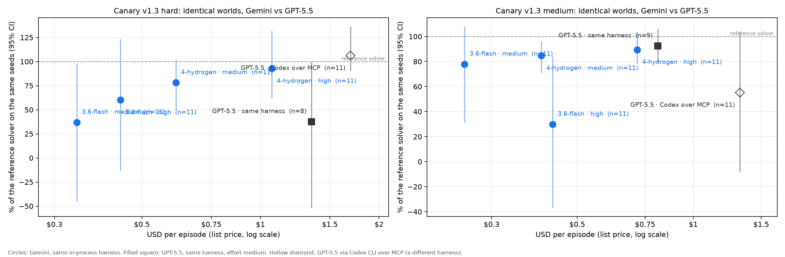

# Cross-provider control: Gemini vs GPT-5.5 on identical Canary worlds (v1.3 rules)

*Generated 2026-11-15T05:39:21+0200 at `3e6513243a`. No API calls: committed GPT-5.5 episodes (Sat 14 Nov, `1724a48ed4`) and Gemini episodes played under the frozen v1.3 rules (`scripts/with_tiers.py v1.3`) on the same public dev seeds.*

> **On identical Canary v1.3 hard worlds, in the same harness and at matched medium effort, against GPT-5.5: gemini-3.6-flash (requested as 3.5-flash) is not distinguishable (mean score +0.26 vs +0.26, paired difference -0.00 [-0.81, +0.79], n=8 shared seeds, 6/8 vs 6/8 correct, $0.35 vs $1.35 per episode (3.8x cheaper)); gemini-4-hydrogen is not distinguishable (mean score +0.53 vs +0.26, paired difference +0.26 [-0.17, +0.79], n=8 shared seeds, 6/8 vs 6/8 correct, $0.57 vs $1.35 per episode (2.3x cheaper)).**

## What is compared

- **Same worlds.** Canary v1.3 rules (hard = 30 staff, 14 days, 1 canary a day), public dev seeds. World identity check: 92 Gemini episodes saw exactly the employee roster the GPT-5.5 episode of the same (tier, seed) saw; 0 differ.
- **Same harness for the headline.** `GPT-5.5 (in-process, effort medium)` and every Gemini row use the same in-process `LLMPolicy` (full history, same instructions and 13 tools). GPT-5.5 ran at reasoning effort medium; Gemini is shown at thinking medium (matched) and high.
- **Different harness, shown for completeness.** `GPT-5.5 (Codex CLI over MCP)` is the judges' harness shape; it is not comparable one-to-one with the in-process rows.
- **Pairing.** % of solver = mean agent score / mean reference-solver score on the same seeds (committed v1.3 reference), 95% paired bootstrap CI.
- **Cost.** Computed from the token usage each API call reported (input, cached input, output including reasoning/thinking tokens), priced at list prices with cached input at the cached price. GPT-5.5: $5 / $0.50 cached / $30 per 1M tokens (`canary/llm/pricing.py`; the per-episode figure recorded with the run). Gemini: the ladder's price table (`canary/gemini/ladder_report.py`). Token counts per episode are in the tables.
- **Effort.** GPT-5.5 ran at its default reasoning effort (medium). Gemini rows show thinking level medium (the matched setting) and high. The two dials are not the same mechanism; treat 'medium vs medium' as nominal.
- **Checks.** Replay: 92/92 Gemini episodes replay to their recorded score. Solver: 22/22 committed reference scores reproduce in-process under v1.3.

## hard

| agent | harness | n | mean score | correct | % of solver [95% CI] | $/episode | input tok/ep (cached) | output tok/ep |
|---|---|---|---|---|---|---|---|---|
| GPT-5.5 (in-process, effort medium) | in-process LLMPolicy | 8 | +0.264 | 6/8 | **38%** [-51%, 99%] | $1.35 | 1.16M (91%) | 11k |
| GPT-5.5 (Codex CLI over MCP) | Codex CLI over MCP | 11 | +0.655 | 11/11 | **106%** [91%, 136%] | $1.69 | 2.01M (96%) | 9k |
| gemini-3.6-flash (requested as 3.5-flash) · thinking high | in-process LLMPolicy | 11 | +0.371 | 9/11 | **60%** [-13%, 123%] | $0.44 | 2.41M (90%) | 27k |
| gemini-3.6-flash (requested as 3.5-flash) · thinking medium | in-process LLMPolicy | 11 | +0.227 | 8/11 | **37%** [-45%, 98%] | $0.34 | 1.70M (88%) | 21k |
| gemini-4-hydrogen · thinking high | in-process LLMPolicy | 11 | +0.572 | 9/11 | **93%** [62%, 132%] | $1.07 | 4.35M (94%) | 45k |
| gemini-4-hydrogen · thinking medium | in-process LLMPolicy | 11 | +0.481 | 8/11 | **78%** [50%, 101%] | $0.61 | 2.03M (90%) | 22k |

Incomplete cells (fewer than 5 episodes; not tabulated or plotted): gemini-3.8-flash · thinking high n=3 (mean score +0.12).

Paired against `GPT-5.5 (in-process, effort medium)` on the seeds both played:

| Gemini agent | shared seeds | score vs GPT-5.5 | paired difference [95% CI] | verdict | cost vs GPT-5.5 |
|---|---|---|---|---|---|
| gemini-3.6-flash (requested as 3.5-flash) · thinking high | 8 | +0.27 vs +0.26 | +0.00 [-0.83, +0.84] | not distinguishable | $0.43 vs $1.35 (3.1x cheaper) |
| gemini-3.6-flash (requested as 3.5-flash) · thinking medium | 8 | +0.26 vs +0.26 | -0.00 [-0.81, +0.79] | not distinguishable | $0.35 vs $1.35 (3.8x cheaper) |
| gemini-4-hydrogen · thinking high | 8 | +0.62 vs +0.26 | +0.35 [-0.16, +0.98] | not distinguishable | $1.05 vs $1.35 (1.3x cheaper) |
| gemini-4-hydrogen · thinking medium | 8 | +0.53 vs +0.26 | +0.26 [-0.17, +0.79] | not distinguishable | $0.57 vs $1.35 (2.3x cheaper) |

## medium

| agent | harness | n | mean score | correct | % of solver [95% CI] | $/episode | input tok/ep (cached) | output tok/ep |
|---|---|---|---|---|---|---|---|---|
| GPT-5.5 (in-process, effort medium) | in-process LLMPolicy | 9 | +0.668 | 9/9 | **92%** [80%, 106%] | $0.81 | 621k (89%) | 6k |
| GPT-5.5 (Codex CLI over MCP) | Codex CLI over MCP | 11 | +0.401 | 9/11 | **55%** [-8%, 104%] | $1.32 | 1.51M (95%) | 7k |
| gemini-3.6-flash (requested as 3.5-flash) · thinking high | in-process LLMPolicy | 11 | +0.216 | 8/11 | **30%** [-37%, 84%] | $0.43 | 2.36M (90%) | 25k |
| gemini-3.6-flash (requested as 3.5-flash) · thinking medium | in-process LLMPolicy | 11 | +0.565 | 10/11 | **78%** [31%, 108%] | $0.26 | 1.11M (85%) | 16k |
| gemini-4-hydrogen · thinking high | in-process LLMPolicy | 11 | +0.650 | 11/11 | **89%** [79%, 103%] | $0.72 | 2.55M (92%) | 30k |
| gemini-4-hydrogen · thinking medium | in-process LLMPolicy | 11 | +0.615 | 10/11 | **85%** [71%, 96%] | $0.40 | 1.05M (85%) | 14k |

Incomplete cells (fewer than 5 episodes; not tabulated or plotted): gemini-3.8-flash · thinking high n=1 (mean score -1.00).

Paired against `GPT-5.5 (in-process, effort medium)` on the seeds both played:

| Gemini agent | shared seeds | score vs GPT-5.5 | paired difference [95% CI] | verdict | cost vs GPT-5.5 |
|---|---|---|---|---|---|
| gemini-3.6-flash (requested as 3.5-flash) · thinking high | 9 | +0.14 vs +0.67 | -0.53 [-1.10, -0.01] | lower | $0.41 vs $0.81 (2.0x cheaper) |
| gemini-3.6-flash (requested as 3.5-flash) · thinking medium | 9 | +0.53 vs +0.67 | -0.14 [-0.49, +0.07] | not distinguishable | $0.26 vs $0.81 (3.1x cheaper) |
| gemini-4-hydrogen · thinking high | 9 | +0.64 vs +0.67 | -0.03 [-0.14, +0.09] | not distinguishable | $0.73 vs $0.81 (1.1x cheaper) |
| gemini-4-hydrogen · thinking medium | 9 | +0.59 vs +0.67 | -0.08 [-0.23, +0.06] | not distinguishable | $0.41 vs $0.81 (2.0x cheaper) |

## Limits

- Small n (8 to 11 seeds per row): the intervals are wide, and a wrong accusation scores -1, so one episode moves a mean a lot.
- v1.3 is the earlier rule set (the judged AfterQuery tier is v1.4). It is used here because it is the only rule set with committed GPT-5.5 episodes; this is a control for the Gemini entry, not an AfterQuery claim.
- One non-Gemini frontier model, one day of its API behaviour, default reasoning effort. No Anthropic model was run.
- The GPT-5.5 and Gemini episodes were played about a day apart at different commits; the env is identical (roster and replay checks above), the policy code may differ in small ways.
